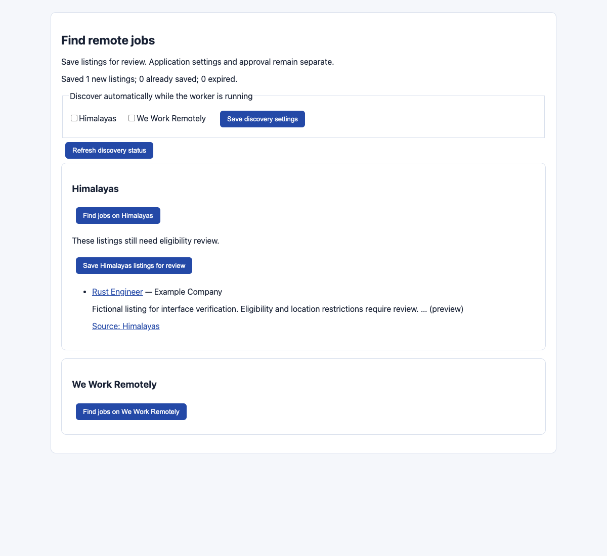

# Scheduled public discovery, owner controls and token compatibility — 2026-11-16

Implementation [21bc50a3f401fb47d9c332d6a18a0522cd6c3cc1](https://github.com/karanagg166/automated-apply/commit/21bc50a3f401fb47d9c332d6a18a0522cd6c3cc1),
branch `feat/rust-agent-runtime`, base `chore/uv-python-tooling`, [PR50](https://github.com/karanagg166/automated-apply/pull/50).
The owner requests continued implementation with no partial completion reports. This
repository checkpoint records evidence; it does not declare the full plan complete.

## Behavior

GET/PUT `/api/v1/rust-agent/discovery/schedule` exposes revisioned owner settings and
last bounded discovery status. Defaults enable no sources. PUT accepts only
`expected_revision` and up to two unique fixed public source IDs. The existing Rust
worker checks enabled sources at30-second boundaries while globally RUNNING, subject
to existing durable per-source cooldowns. It uses its existing connection and fixed
public transport; there is no new scheduler process, pool, inference or application grant.
The selected source cursor advances before dispatch so a failing source cannot starve
another source. Provider failures retain consumed cooldowns and sanitized status.

Cached completed batches can be ingested without another request. STOP/disable after a
fetch preserves cache and defers intake. Scheduled intake independently locks the global
control and schedule rows through its transaction, closing the gap between an authority
read and a later write. Global controls are reread after cancellation. Database failures
use the existing bounded reconnect path. Corrupt cached application links are revalidated
before exposure. Explicit manual ingestion retains its existing owner API behavior.

The workflow dashboard now supports opt-in public discovery settings, explicit listing
search and separate save-for-review actions. It preserves original application links,
source attribution and preview labels. Failed/conflicting settings saves do not retry
or fabricate success. BFF routes remain closed to the two public sources and exact
GET/PUT/POST operations; existing session, CSRF, body and direct-loopback protections
remain. These controls do not start applications or establish eligibility.

`account_tokens` ports the existing key-ID/fingerprint/Fernet envelope and context-bound
purpose semantics. Keys and payloads have no Debug/Serialize representation on the store.
Partial configuration, changed key identity, tampered ciphertext and another account
purpose fail closed with fixed codes. Retained keys decrypt old tokens after rotation.
Actual isolated legacy Python encryption decrypts in Rust and vice versa, without loading
runtime settings or real credentials. This is the token-storage foundation, not a working
OAuth/account/Gmail service or a new live connection.

## Evidence matrix

| Check | Result | Exact evidence / limit |
| --- | --- | --- |
| Full standard Rust at scheduler checkpoint | PASS |159 passed,0 failed;195 PG cases ignored at that compile point |
| Full disposable native PostgreSQL | PASS |196 passed,0 failed,45.98s; fictional isolated database |
| Account-token focused suite | PASS |3 additional standard cases,0.36s; six Python/Rust cross-decryption comparisons inside one case |
| Distinct Rust tests covered | PASS |358 =159 +196 +3, across qualified runs; not a single162-standard run |
| Focused scheduler PostgreSQL | PASS |6 passed,0.41s before final two guard/cache cases; overlaps196 |
| Frontend full unit suite | PASS |309 passed,43 files,14.00s; four added UI/route cases |
| Frontend typecheck/build/format | PASS |Production Next build and final checks passed |
| Clippy / Rust format / diff | PASS |All targets, warnings denied; latest token-inclusive Clippy9.72s |
| Actual Brave component fixture | PASS |Actual TSX component, fictional requests/data, isolated headless Brave; external HTTP blocked |
| Installed dashboard / portal / scheduler cycle | NOT TESTED |No installed API/frontend/worker/browser profile changed |
| Live Google encryption keys/account/Gmail | NOT TESTED |Only fictional token values and fixture keys; no Google account request |
| Provider/network/resource comparison | NOT TESTED |No real provider request or paired whole-system benchmark in this checkpoint |
| Full plan / submission / first strict receipt | NOT TESTED |Remaining account/browser/execution/provider/platform/install/live acceptance remains |

The final two native guard cases verify transaction-level STOP/revision fences and
rejection of a corrupted cached destination before returning links. Other new cases
cover disabled defaults, stopped control, cached replay without network, source fairness
and429 cooldown, stale/suppressed settings, STOP during fetch, authenticated HTTP and
closed input. Existing worker lifecycle, leases, unknown outcomes, queue controls and
actual CLI/MCP fixtures remain in the196-case passing run.

The first screenshot harness failed because its virtual entry contained untransformed
JSX. Its replacement uses a plain-JS virtual entry loading the actual component. The
successful screenshot uses fixture styling and fictional data; it is not the installed
Next.js page or live provider acceptance. No real browser account or production data was
used. The failed harness was closed, not promoted to a successful UI check.



```sh
cargo test --locked --workspace
uv run --no-project --python .venv/bin/python python -m rust.scripts.run_postgres_tests
uv run --no-project --python .venv/bin/python python -m rust.scripts.run_postgres_tests --filter discovery_schedule
cargo test --locked --workspace --test account_tokens
cargo clippy --locked --workspace --all-targets -- -D warnings
cargo fmt --all -- --check
pnpm -C frontend test
pnpm -C frontend typecheck
pnpm -C frontend build
pnpm -C frontend format:check
git diff --check
```

No production installation/DDL, owner browser navigation or activation, provider call,
message, upload, Apply, quota reset, cleanup, hosted Actions or merge occurred. Headless
fixture processes used disposable contexts, not the owner's automation profile. The
existing physical login prerequisite and failed automatic window-creation suspension
remain. Connection ceilings are unchanged by design, not freshly measured on the hosted
pooler. Keep source, fixture, installed and live acceptance separate.

Next continue Gmail/account/Drive transport and service ports, browser/execution/kernel
parity, other provider/CLI/Telegram capabilities and remaining platform adapters. The full
combined runner and STOP-only whole-family cutover/rollback, actual receipts,24-hour
awake/locked observation and resource comparison remain required. Do not send a final
completion report or merge based on these component results.
