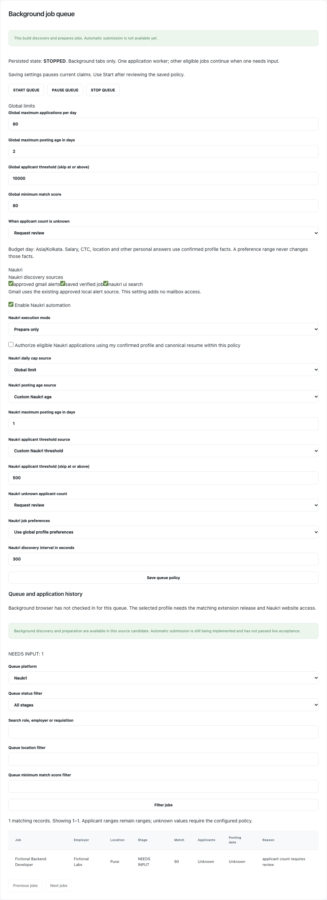

# Naukri dashboard policy and background discovery queue

**Phase OPEN. Automatic application submission is not available in this candidate.**

Implementation branch: `fix/live-prepare-discovery-20261030`, base `main`.
Exact implementation/release candidate:
[`81a678cdce4ac9fd7b1761e0f43d67f7fa6a1cd2`](https://github.com/karanagg166/automated-apply/commit/81a678cdce4ac9fd7b1761e0f43d67f7fa6a1cd2).
[PR #48](https://github.com/karanagg166/automated-apply/pull/48).
[Sanitized metrics and complete changed-file list](naukri-background-queue-metrics-20261031.json).
[Current owner scope](naukri-background-queue-scope-20261031.md).

The owner explicitly removed obtaining platform approval as a prerequisite to
building ordinary recurring browser UI automation and declined provider outreach.
**Naukri permission has not been established.** This report does not make a legal
finding or equate account/Mac permission with provider permission. There is no email
task. CAPTCHA, access restrictions and rate controls remain boundaries. Production
replacement still requires owner review and approval of its exact SHA.

## Behavior delivered in source

The dashboard now stores independent global/custom limits for Naukri: daily cap
80 by default, initially configurable through100; maximum posting age2days by
default; applicant threshold10,000 by default, excluding at or above that number;
and global confirmed-profile versus custom job preferences. Custom filters include
roles, locations, advertised experience/salary ranges and employer exclusions.
Personal CTC/experience/notice answers are not inferred from preference ranges.
Minimum matching score remains80. Unknown applicant counts have a separate
review/skip/allow choice; `10,000+` is a lower bound, not an invented exact count.

The owner can select the approved local Gmail alert source, existing saved Naukri
jobs and ordinary Naukri UI search independently, and use Start/Pause/Stop. Saving
settings pauses old claims. Start requires fresh inspection. Disabling a source,
platform policy, or global execution blocks further affected work. Stop also
fences the legacy Naukri preparation/form channel. No new mailbox, body scope,
deferred adapter or sender is enabled. The local alert producer consumes only
already-approved `local:1` records; it does not read Gmail itself.

Queue/history filters cover platform, stage, role/employer/requisition search,
location, minimum score and pagination. The existing genuine receipt is projected
as historical `SUBMITTED_RECORDED` with zero new attempts and its original mode.
Missing dates/counts stay unknown. The dashboard explicitly says this candidate
discovers/prepares jobs and does not yet submit them.



The queue uses the existing private PostgreSQL `OwnerPreference` JSONB store,
owner row lock, permanent platform/requisition UUID, policy revision, leases,
committed write-admission ledger and transactional event outbox. No migration,
Kafka/Redis daemon, new production pool or connection-role change is required.
The concurrency limit is one, pending capacity defaults to200, and UI search
defaults to a bounded300-second interval. This is polling, not an instantaneous
provider event feed. Daily reservations are conservative and unknown outcomes
are not refunded or automatically replayed.

The shipped extension consumer shares the existing serial heartbeat/native
transport. It creates an owned **inactive** blank tab, binds it to the selected
profile/window/session/lease, then navigates normally. It never adopts an owner
tab or activates/focuses a window. Owner activation is remembered, even after
switching away, so that tab is not automatically closed. Active Naukri use takes
priority. Missing origin permission, navigation, changed bindings, Stop and
restart are fenced. This consumer exposes only search/job observation; it
explicitly refuses Apply/answer/upload operations, regardless of a saved mode.

Normal DOM search yields at most20 exact posting links per cycle. The job observer
requires an actual header, company, role, location, experience band, description,
skills and an identity-consistent structured timestamp. Unknown layouts, date-only
labels or ambiguous identity require input. It neither derives facts from slugs
nor treats a generic success screen as a receipt. These selectors remain
**unaccepted against the installed real Naukri journey**.

Observed facts pass through actual ingestion, current confirmed-profile matching,
age/applicant/negative/experience checks, persisted packet creation and canonical
encrypted-PDF preflight. A fresh-session test exercised that full code path to
`READY_TO_APPLY`, waiting with `submission_executor_pending`. A local PDF is not
proof of Naukri's currently saved CV; the existing write gate requires a fresh
provider-side canonical-resume binding before any eventual Apply admission.

## Files changed

- Backend queue contracts/store/native observation/preparation: new
  `execution/application_queue.py`, `queue_contracts.py`, `naukri_native.py`,
  `queue_preparation.py`; changes to execution router/worker/global Stop/capability
  reporting and local-agent native command validation/dispatch/allowlists.
- Extension: new `naukri-queue.js` and `naukri-observation.js`; serial heartbeat
  hook, background wiring, build inventory and an owner-gesture settings button
  for the already-declared optional `https://www.naukri.com/*` origin. Manifest
  permissions and stable extension ID are unchanged.
- Frontend: new application queue feature, Naukri page integration, three exact
  gateway routes and regenerated API types.
- Targeted queue/native/worker/DOM/tab/dashboard tests, a fresh loopback-only
  PostgreSQL race verifier, current scope document and fictional UI screenshot.
  All35 exact paths are listed in the metrics JSON.

## Validation and limits

| Check | Verdict | Actual evidence |
| --- | --- | --- |
| Backend targeted regressions | PASS fixtures |305 tests,25.41s; actual ORM/services on fictional SQLite |
| Independent candidate Python environment | PASS fixtures |51 overlapping queue/preflight tests,5.55s; pip check passed |
| PostgreSQL concurrency | PASS isolated DB |6 cases,0.190s, PostgreSQL14.24; duplicate publish/claim/control, stale lease, restart, unknown-write no replay |
| Extension suite | PASS fixtures |155 tests,6.959s, including21 new queue/DOM cases |
| Real Chromium inactive-tab behavior | PASS fictional pages |3 cases,5.990s, Chromium156.0.8078.4; search, job facts and Stop; owner tab preserved |
| Dashboard unit tests | PASS fixtures |11 tests across2 files,2.18s |
| Dashboard actual browser journey | PASS fictional API |1 test,7.9s including startup;1.9s journey; save/reload filters and revisioned Start/Pause/Stop |
| Production frontend build / types / formatting | PASS local |Next build, typecheck, repository format check, API regeneration |
| Python Ruff E9/F/I / diff / dependency check | PASS local |Changed Python files; no broken requirements |
| Exact candidate extension | PASS disk |20/20 files identical, zero extras, same ID; no runtime reload claim |
| Actual new eligible discovery | NOT TESTED |0 new eligible opportunities; no approved Gmail cycle run for this milestone |
| Actual installed UI matching/preparation | NOT TESTED |Old runtime retained; current observer/worker not deployed |
| Unattended canonical browser upload | BLOCKED |Runtime upload adapter/provider-saved CV proof pending; native chooser path remains NEEDS_HUMAN |
| Genuine new recurring-worker submissions | BLOCKED |0 attempts,0 recorded; submission/answer/upload/receipt implementation pending |
| Genuine QTrino preserved and not replayed | PASS prior genuine evidence + fixture fence |1 retained receipt;0 replays; source unchanged |
| Actual awake/locked execution | NOT TESTED |No lock/unlock, power change or owner desktop operation performed |
| Extended unattended uptime | NOT TESTED |Short isolated tests do not establish24/7 reliability |
| Exact-SHA installation authorization | BLOCKED |Owner approval of81a678c is not yet recorded |

Counts overlap and must not be added as independent test coverage. No real online
candidate data was put in SQLite or the disposable PostgreSQL fixture. The latter
used a separate local instance with a two-connection test pool, stopped afterward;
the existing online role limit of five and runtime pools were untouched. Peak
RAM/CPU and production throughput were not measured. Avoiding a new broker is an
architecture choice, not a measured Kafka performance comparison.

The final Chromium run routed three page requests to fictional HTML, blocked
provider DNS in that isolated browser, recorded zero unexpected requests and
zero file choosers, and performed no Apply clicks. It does not prove live Naukri
selectors, upload acceptance or locked-screen operation. The test manifest's
fixture origin grant, isolated debug connection and DNS rule are not shipped.
No debugger permission, debug connection or browser startup flag was added to
the owner's Chrome.

Failures encountered before the final checks are preserved here:

- PostgreSQL rejected the initial stage aggregation with code42803 because
  independently constructed JSON expressions produced different bound parameters
  in SELECT and GROUP BY. Reusing the selected stage alias fixed the actual
  PostgreSQL failure; all six cases then passed. SQLite had not caught it.
- The first UI journey matched a hidden PAUSED option as well as the visible
  status. The assertion now targets the state element; the application control
  itself did not fail.
- Initial Chromium harness runs forced focus emulation, causing the real
  visibility guard to return `owner_tab_active`. The harness now uses documented
  [`connectOverCDP` with `noDefaults:true`](https://playwright.dev/docs/api/class-browsertype#browser-type-connect-over-cdp-option-no-defaults),
  preserving actual browser visibility. No DOM visibility value is spoofed.
- One failed fresh-profile browser probe observed a provider challenge before
  routing of the first navigation was assured. Network reachability was not
  completely captured for that failed probe: **a public Naukri read may have
  occurred**. No owner account/credentials, Apply action or submission was used.
  The final harness blocks provider DNS and observes navigation only after binding
  the blank tab, so its zero-provider-request result is separately bounded.

Reproduction commands from the repository root:

```sh
backend/venv/bin/python -m pytest backend/tests/test_application_queue.py backend/tests/test_naukri_background_queue.py backend/tests/test_naukri_upload_preflight.py backend/tests/test_naukri_receipts.py backend/tests/test_naukri_recurring.py backend/tests/test_chrome_profiles.py backend/tests/test_phase1_local_agent.py backend/tests/test_execution_naukri.py backend/tests/test_naukri_ready_workflow.py -q
pnpm -C extension test
node extension/tests/naukri-queue.browser.mjs --report /tmp/naukri-queue-browser-metrics.json
pnpm -C frontend exec vitest run tests/application-queue.test.tsx tests/naukri-automation.test.tsx
PYTHON="$PWD/backend/venv/bin/python" pnpm -C frontend exec playwright test tests/e2e/application-queue.spec.ts
pnpm -C frontend build
pnpm -C frontend typecheck
pnpm -C frontend format:check
```

For PostgreSQL, initialize a **new disposable loopback instance**, create a fresh
database named `candidate_profile_test`, and run
`backend/venv/bin/python backend/scripts/verify_application_queue_postgres.py --url postgresql://postgres@127.0.0.1:PORT/candidate_profile_test`.
The verifier refuses production/default ports, remote targets, password URLs and
an existing `job_agent` schema. Never point it at Supabase or a real account DB.

## Genuine evidence and current release inventory

The original [QTrino genuine report](https://github.com/karanagg166/automated-apply/blob/040c336e9ab5994fa9211a05501c325f36057ea8/docs/acceptance/qtrino-first-genuine-receipt-20261031.md)
remains authoritative: QTrino Labs Limited, Backend Developer, requisition
`261026028027`, one owner-authorized software-operated UI Apply with an
owner-supplied factual answer and foreground native file selection; persistent
Applied / Application Sent. It is **not** an employer acknowledgment, an
owner-manual submission or an installed recurring-worker success. Never reapply.

This milestone has **0 new real application attempts,0 new Naukri-recorded
submissions,0 unknown submission outcomes,0 failed application outcomes and0
Telegram submission notices**. There are no new genuine eligible opportunities.
The previous approved local alert measurement was0messages/0candidates; this work
does not replace that with a simulated discovery count.

Read-only filesystem inventory rechecked all four LaunchAgent references
(API/execution/frontend/Telegram) and the native wrapper: all still point to
`90f2f2ade50a1c31b26ca85cc7fdf5e93bb67c20`. Profile8's saved extension path is still
historical `b06909293b1866e8191277d17fc284c398b4307b`; **12/20** files match the new
candidate (the earlier15/18 comparison was against an earlier inventory).
Disk/path evidence does not prove a runtime reload or explain the old discrepancy.
No production reference, Chrome preference, profile selection or permission was
changed; no production service restarted.

An immutable **non-installed**81a678c source archive is prepared at
`~/Library/Application Support/Automated Apply/release-candidates/81a678cdce4ac9fd7b1761e0f43d67f7fa6a1cd2`.
It has its own Python environment with the tested development dependency versions,
an independent standalone frontend, and20 verified extension files. No mutable
dependency symlink escapes the candidate. The standalone login returned200 in a
temporary isolated process, stopped afterward; no backend/provider action ran.
Environment files and private account data were not copied. Approximate allocated
size at the dated check:415,484KiB, about406MiB; this is not a cleanup estimate or
authority to remove it. All original releases and rollback artifacts remain.

## Exact next boundary and rollback

The immediate live acceptance step is to install/reload **this exact read-only
discovery/preparation candidate**, then measure actual background source delivery,
DOM recognition and packet preparation in Profile8. It will not send applications.
The repository's [AGENTS.md](../../AGENTS.md) requires: “Do not merge changes or
replace an installed production release without owner review and approval of its
exact SHA.” No approval of the moving PR head is assumed.

After approval of81a678c, preserve private hashes/backups of the current four
LaunchAgents/native wrapper, confirm no active action leases, quiesce the affected
services and switch only the reviewed references to the prepared immutable
candidate. Keep private environment/profile/database settings and Gmail scope
unchanged. Queue defaults remain STOPPED/PREPARE_ONLY. No SQL migration is needed.
Before enabling discovery, use the supported
[stable extension cutover](../extension-stable-path.md): owner-operated Profile8
Load unpacked/Reload, same ID, and the one-time Naukri-origin permission button if
needed. Do not manipulate protected preferences, focus the owner's workspace or
silently broaden permissions. Confirm fresh bound heartbeat, matching20-file
inventory and one bounded real read-only cycle before further acceptance.

Rollback: Stop/Pause before switching; preserve unknown actions without replay;
restore the backed-up90 service/native references and the preserved historical
extension distribution using the supported owner-operated reload. Restart only
the affected approved services and check health/history. Retain the new candidate,
all original releases, receipts, private config and audit evidence. No merge,
directory cleanup, force push or hosted Action is part of this plan.

Remaining work after that live read-only observation is precise: verify the saved
provider CV against canonical bytes; implement supported factual-question and
chooser-free upload mutations with current UI evidence; add durable Apply and
persistent Naukri-history reconciliation plus submission notifications; validate
multiple genuinely suitable distinct submissions through the installed worker;
then test awake/locked Stop/recovery and an extended unattended window. None of
those acceptance gates is marked PASS by these fixtures.
