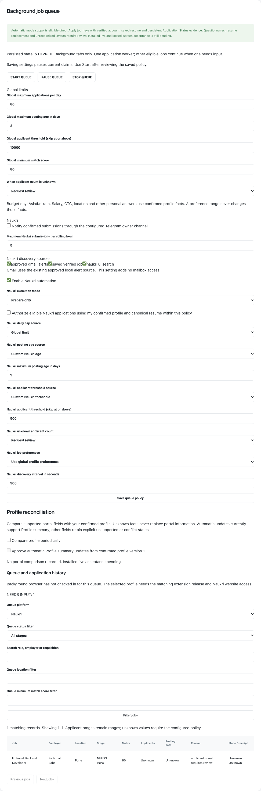

# Naukri direct Apply candidate — milestone OPEN

**This is a tested source/release candidate, not successful installed Naukri acceptance.**
No new real application, provider receipt, profile write, Telegram message, Gmail
operation or Chrome profile operation was performed. Questionnaires and resume
replacement are still unsupported by this recurring consumer. The full requested
milestone remains **OPEN**.

- Implementation branch: `fix/live-prepare-discovery-20261030`; base `main` at
  `f745068cbfac7e6c052429745a613ebd9ad8844e`, re-fetched during this continuation.
- Exact implementation/build SHA:
  [`ee8c591b382626f657f3e99f2e757c303ec217b0`](https://github.com/karanagg166/automated-apply/commit/ee8c591b382626f657f3e99f2e757c303ec217b0).
- [PR #48](https://github.com/karanagg166/automated-apply/pull/48).
- [Stage A source/runtime audit](naukri-master-audit-20261031.md).
- [Exact counts, file list, source digests and sanitized measurements](naukri-direct-apply-candidate-metrics-20261031.json).

## Existing implementation and delivered changes

The previous candidate `81a678c` already had PostgreSQL owner fencing, queue leases,
bounded sources/capacity, saved job matching, local canonical-PDF preflight,
read-only inactive-tab observation, revisioned settings and receipt replay fences.
The existing answer engine, Cohere abstraction, Telegram authenticated replies,
Gmail integrations, launchd services and private account configuration are retained.
It stopped at a prepared packet; its browser consumer refused all writes.

This candidate adds an ordinary-UI **direct Apply** execution path:

1. Prepare against the current confirmed profile and canonical encrypted PDF.
2. In an owned inactive tab, verify one visible account identity and read the PDF
   through a unique explicit same-origin Resume Download link in the normal UI.
   Hash/byte-check against canonical bytes. No guessed endpoint, credential export,
   native chooser, cross-origin download or redirect fallback is used.
3. Inspect the exact requisition, role/company, current listing facts, application
   status and unique supported Apply button. Changing material listing facts
   invalidates the packet; applicant bounds are freshly checked.
4. Commit one write admission and quota reservation before clicking. The canonical
   packet enters `submitting` with an audit event, fencing legacy handoff paths.
   A short document/control-bound permit refuses delayed commands. The isolated
   adapter checks account, visibility, header/listing/control changes and consumes
   its private single-use seal before invoking the ordinary button.
5. Treat the click as an attempt. Navigate separately to Application Status and
   require an exact requisition/title/company row saying **Application Sent** in
   two distinct documents. Only then transactionally persist a new worker receipt,
   packet evidence/status, canonical job status, queue event and configured notice.

An ambiguous/lost write response is `SUBMISSION_UNKNOWN`. It is never replayed.
Only read-only history reconciliation is scheduled, with persistent cooldown and
bounded attempts. Unadmitted Apply work recovering after pause/expiry starts with
fresh profile/resume proof. One blocked/unknown item does not hold an account lease
forever or stop unrelated eligible work. Initial SUPERVISED mode has its own small
submission cap; AUTOMATIC uses the saved standing scope rather than per-job approval.

Daily reservations and the new rolling-hour cap are conservative; unknown attempts
retain reservations. Dashboard quota text explicitly describes queue reservations,
not an invented total of all historical/manual applications.

The extension remains MV3 with the same public key/ID and permission declarations.
It adds a dedicated site adapter, preserves inactive-tab ownership checks, and
checks active Naukri work across windows. The popup exposes authenticated queue
status, Pause, Resume and Stop. Routine polling still uses the existing serial
heartbeat/alarm/native path; opening the popup is unnecessary. A final tab-adoption
check before closing reduces an additional ownership race.

Profile reconciliation is separately enabled and pinned to a confirmed profile
version. It classifies name/contact, summary, skills, experience, education,
projects, location/preferences, notice, confirmed compensation, resume, links,
headline and professional title. Fields the adapter cannot observe are
`UNSUPPORTED`, not fabricated matches. Salary-search preferences are never CTC
facts; target roles are never treated as a confirmed current title/headline.

Only **Profile summary** has a write adapter, requiring explicit approval for that
field/version, a supported editor, exact previous-value reference, retained value
after events and a normal Save control. An independent reload must show the
canonical value before `SYNC_VERIFIED`. Unknown saves are audited before dispatch
and are not automatically retried. Per-account native serialization prevents a
profile save overlapping this consumer's application operations. Audit records
store previous/new references, version, time and outcome rather than raw values.

The dashboard exposes hourly controls, conservative quota, profile comparison and
approval, job/application links, mode and receipt source. Telegram gains
`/naukri add <URL>` and `/naukri queue [start|pause|resume|stop]` through the same
durable store; existing sender authentication and question/reply handling remain.
Confirmed-submission Telegram notices have a separate opt-in and reuse the existing
outbox. No message was actually sent during this work.

`GMAIL_READ_DRAFT_ONLY=true` is now the default product fence. The legacy sending
service refuses preview/send even if its old sending flag is enabled. Historical
send tests explicitly opt out using fictional separately authorized fixtures.
No existing credential, connection, message/draft/history or token scope was changed.

The 38 implementation paths are listed in the metrics. Main changes are execution
queue/contracts/native/preparation, new `naukri_submission.py` and `profile_sync.py`,
new `extension/naukri-execution.js`, queue/background/popup wiring, dashboard/gateway
and regenerated API types, Gmail service/settings, tests and the fictional screenshot.
There is **no migration**, added broker, new production pool, new permission or
new platform executor.



## Acceptance and verification

| Check | Verdict | Exact evidence and limit |
| --- | --- | --- |
| Backend focused regressions | PASS fixtures | **367 passed, 0 failed**, 15 files, 28.69 s; matching, gates, receipts, questions, native auth, queue/recovery, settings, installation and Gmail fences |
| Frontend complete unit suite | PASS fixtures | **292 passed**, 38 files, 14.73 s |
| Extension Node suite | PASS fixtures | **155 passed**, 6.724 s |
| Existing queue Chromium cases | PASS fictional pages | **3 passed**, 4.884 s, actual inactive tabs, DNS blocked |
| New execution/profile Chromium cases | PASS fictional pages | **11 passed**, 8.814 s, Chromium 156.0.8078.4; canonical PDF bytes, wrong PDF/account, expired/changed/single-use control, challenge refusal, independent history, profile Save/reload |
| Dashboard Chromium journey | PASS fictional API | **1 passed**, 5.8 s total / 1.9 s journey; saved settings, filters and controls; fictional screenshot inspected |
| PostgreSQL queue races/recovery | PASS disposable PG | **6 passed**, PostgreSQL 14.24, 0.213 s; simultaneous publish/claim/control, stale lease, restart and no replay |
| PostgreSQL committed submission journey | PASS disposable PG | **2 passed**, 0.805 s; full real dispatcher/preparation/admission/evidence code and separate committed-session reads; profile reference record survives another connection |
| Independent exact candidate Python environment | PASS fixtures | **40 overlapping tests passed**, 4.80 s; not added to the 367 count; pip check passes |
| Candidate builds / types / formatting / Ruff / diff | PASS local | Independent frontend build; exact extension 21/21 source files; original checkout build, generated API types, TypeScript, format check and Ruff E9/F/I |
| Candidate frontend startup | PASS isolated Mac process | Exact candidate `/login` HTTP 200; fictional configuration, backend target disabled; process stopped |
| Actual installed runtime inventory | PASS inventory / FAIL version consistency | Four services/native still `90f2f2a…`; selected extension still `b069092…` |
| Genuine QTrino receipt | PASS prior evidence, not reverified live | [Original persistent receipt](qtrino-first-genuine-receipt-20261031.md) retained; 0 replays; no original receipt rewritten |
| Genuine new installed queue-to-submit | NOT TESTED / OPEN | **0 real attempts, 0 new real receipts**; new code not installed |
| Actual provider account/download/Apply/history selectors | NOT TESTED | Only fictional DOM acceptance; actual layout can legitimately produce a specific blocked reason |
| Recurring questionnaires, factual questions, AI narrative, multi-step, uploads | BLOCKED implementation | Consumer supports direct Apply only; existing answer/question engines are not yet connected to this recurring form flow |
| Full profile field synchronization | BLOCKED implementation | Only supported Profile summary editing implemented; other observed/unobserved fields remain conflict/unsupported and are not overwritten |
| Installed service-worker/native/Chrome restart matrix | NOT TESTED | Existing regression coverage is retained; no installed restart or cutover performed |
| Actual awake-and-locked Mac | NOT TESTED | No lock/unlock, power or permission change; isolated headless tabs do not establish locked-Mac behavior |
| Repeated real cycles / extended uptime | NOT TESTED | No live multi-cycle or 24/7 acceptance claim |
| Exact-SHA production installation | BLOCKED owner approval | Reviewed source/build and private installation/rollback plans prepared; no installed reference changed |

Browser runs made **zero live Naukri requests**, zero unexpected requests and zero
chooser events. Provider DNS was blocked and every navigated provider URL was
intercepted by fictional routes. The new browser tests invoke the shipped adapter;
they do not establish that these selectors match Naukri's present authenticated UI.
The PostgreSQL cluster was fresh, loopback-only, synthetic, two-pool-limited and
stopped after verification. No online database was used by the tests.

Initial failures were retained as sanitized classifications in the metrics:
an old preparation-only expectation; test SecretStr/confirmed-summary fixture setup;
a duplicate browser-harness declaration; first-navigation interception timing;
reading a fictional main-world click counter from the isolated world; and a
PostgreSQL harness missing the synthetic password required by the global factory.
The latter was corrected and rerun in a **new** disposable database. No production
database validation was relaxed. Long profile-record keys were also caught during
review and shortened before PostgreSQL verification. Final listed suites have no
remaining failures; this does not change the live BLOCKED/NOT TESTED rows.

### Timing, resources and safety boundaries

The previous report covered 305 backend tests in 25.41 s; this one covers 367 in
28.69 s. The sets differ, so this is expanded verification, not a throughput
benchmark. The extension suite remains 155 tests. No new production daemon,
broker, database role, connection budget or pool configuration was introduced.
Actual production RAM/latency and extended reliability were **not benchmarked**.

The independent candidate measures approximately **886,324 KiB** with `du -sk`:
venv 180,996 KiB, frontend dependencies 578,224 KiB, frontend build 106,944 KiB.
Immutable pnpm-cache/APFS sharing can overlap these counts; they are not unique
reclaimable sizes or cleanup approval. The candidate has independent mutable
environments; no dependency/build directory is symlinked to an installed release.

Stop invalidates database admissions and leases immediately. A previously admitted
action already in transit has a short permit and conservative unknown outcome;
instantaneous cancellation inside a provider handler is not claimed. Source tests
exercise Stop before admission, not a new real installed Stop/submit race.
Native-active/owner-adopted tabs yield to owner work. Actual all-window preservation,
native restart and locked-screen acceptance remain outstanding.

## Exact version and installation / rollback

The inactive, independently built snapshot is at:

```text
$SUPPORT/release-candidates/ee8c591b382626f657f3e99f2e757c303ec217b0
$SUPPORT/installation-plans/master-ee8c591b382626f657f3e99f2e757c303ec217b0
```

`SUPPORT` means `~/Library/Application Support/Automated Apply`. The plan contains
15 prepared/rollback artifacts plus its private hash inventory: four launchd plans,
the frontend launcher, native wrapper/manifest and preserved previous definitions
and private env. Nothing from that private directory is published. The snapshot's
absolute path must remain stable; **do not relocate its built venv**. It can become
an immutable installed snapshot only after exact-SHA approval. The registry records
it separately from active development, and no worktree is released for cleanup.

The final read-only installed API probes returned `/health` HTTP 200 and `/ready` HTTP 200 (two requests). These probe the old installed runtime, not the candidate. All **8/8** compared installed definitions/private-env files still match the preserved plan baseline.

Current references verified during this continuation:

- API/frontend/execution/Telegram and native host:
  `90f2f2ade50a1c31b26ca85cc7fdf5e93bb67c20`.
- Profile 8 extension path:
  `b06909293b1866e8191277d17fc284c398b4307b/extension/dist`, same ID
  `gdjbmkffcpicbpiikcohlmokkmcpipgp`.
- Candidate extension **1.3.3**, 21/21 exact files, unchanged permission sets.
  The old extension overlaps 9/21 candidate files; that is a version comparison,
  not evidence that its installed files were changed by this work.

After explicit owner review/approval of **ee8c591b382626f657f3e99f2e757c303ec217b0**:

1. Revalidate the current definitions against `plan.private.json`, private env,
   exact Git/build inventory, selected profile and every in-flight/unknown task.
   Preserve any newer owner changes and regenerate/review the plan if necessary.
   Keep queues stopped/preparation-only for initial installed observation.
2. Use the preserved private env `phase54.private.env`, encryption keys, account
   selection and stable native origin. Do not enable legacy submission/mail-send
   flags or provider budgets. No DDL/migration is needed. Run the candidate's
   `local_service.py preflight` only as a bounded readiness check; keep output private.
3. Gracefully `launchctl bootout gui/$(id -u)/com.automated-apply.<service>` for
   **telegram, execution, frontend, api**. Verify their PIDs exit; do not run duplicate
   pollers. Atomically replace only the four corresponding LaunchAgent files with
   the reviewed `*.new.plist`, `start-frontend.py` with `frontend-launcher.new.py`,
   and `native-host` with `native-host.new`. Preserve modes 0600 / wrapper 0700 and
   the existing single-origin native manifest. Do not delete occupied installation
   files to bypass the old installer's protections.
4. Bootstrap **api, frontend, execution, telegram** using their existing per-user
   plist paths. Check `/health`, `/ready`, authenticated dashboard/profile/native
   status and worker heartbeats using the original deadlines and connection budget.
5. In the existing selected Profile 8, use supported Chrome controls once to load
   the approved snapshot's `extension/dist`; verify unchanged ID, actual version
   1.3.3, existing permissions and authenticated native health. A file inventory is
   not proof that Chrome loaded the new service worker. Do not manipulate unrelated
   windows/tabs or use a file chooser without the owner's setup involvement.
6. Perform installed read/preparation acceptance first. Then use a deliberately
   small configured supervised scope for a new eligible supported job, never
   QTrino. Reconcile genuine history before claiming success. Locked-Mac and repeated
   cycles remain separate observed acceptance steps.

Rollback: stop only these new services; restore the exact `*.previous.plist`,
`frontend-launcher.previous.py` and `native-host.previous` from the private plan;
retain/restore the original single-origin native manifest. Bootstrap the original
four services in dependency order and use supported Chrome controls to restore the
recorded `b069092…` extension path in the same selected profile. Do not reset the DB,
remove receipts/unknown outcomes, replay submissions or restore an old policy over
new owner changes. Preserve every release, key, profile, application record and
private acceptance log. No cleanup/removal is authorized by this procedure.

### Dashboard activation guide, after installation and observation

Open **Naukri → Background job queue**. Confirm the canonical profile/PDF and
selected Chrome profile. Enable Naukri; choose sources and filters, 5–10 minute
discovery interval and suitable daily/hourly caps. Initially use **Supervised
validation** with the cap of one. For a supported accepted journey, select
**Automatic**, check the explicit standing application authorization, save the
policy and **START QUEUE**. Saving settings pauses old claims; Start obtains fresh
inspection. Pause/Resume/Stop also appear in the extension and Telegram queue commands.
Unknown submission outcomes require reconciliation, never a second Apply.

Profile synchronization is separate: enable periodic comparison, then explicitly
approve Profile summary for the displayed confirmed version if desired. Changing
the canonical version invalidates that write scope. Other fields are not silently
updated. Telegram receipt notifications require their own dashboard opt-in.

### Reproduction and next actions

The metrics enumerate all 15 backend test paths. The full 367-test command and core reproduction commands are:

```sh
.venv/bin/python -m pytest \
  backend/tests/test_application_queue.py backend/tests/test_naukri_background_queue.py \
  backend/tests/test_naukri_upload_preflight.py backend/tests/test_naukri_receipts.py \
  backend/tests/test_naukri_recurring.py backend/tests/test_chrome_profiles.py \
  backend/tests/test_phase1_local_agent.py backend/tests/test_execution_naukri.py \
  backend/tests/test_naukri_ready_workflow.py backend/tests/test_naukri_submission.py \
  backend/tests/test_naukri_profile_sync.py backend/tests/test_packet_telegram_questions.py \
  backend/tests/test_outreach_send_limits.py backend/tests/test_gmail_send_client.py \
  backend/tests/test_phase1_installation.py -q
pnpm -C extension test
node extension/tests/naukri-execution.browser.mjs
node extension/tests/naukri-queue.browser.mjs
pnpm -C frontend test
PYTHON="$PWD/.venv/bin/python" pnpm -C frontend exec playwright test tests/e2e/application-queue.spec.ts
pnpm -C frontend build
pnpm -C frontend typecheck
pnpm -C frontend format:check
```

For PG, create fresh disposable loopback databases on a non-default port, then run
`verify_application_queue_postgres.py --url postgresql://postgres@127.0.0.1:PORT/candidate_profile_test`
and `verify_naukri_submission_postgres.py --url postgresql://postgres@127.0.0.1:PORT/candidate_profile_test_submission`.
Both refuse remote/default/previously initialized targets. Never use Supabase or a
real-data database. Preserve failures; do not reset an application to manufacture
a passing receipt counter.

Next required work is owner-approved installed observation, adapting the actual
supported account/download/questionnaire/resume controls, connecting recurring
questions/grounded answers and safe resumption, broader verified profile updates,
then genuine no-focus locked/restart/multi-cycle acceptance. No provider outreach
is needed or requested. CAPTCHA/access/rate controls are not bypassed. Other
platforms remain deferred. Hosted Actions stayed manual-only and were not dispatched;
there was no merge, production installation or cleanup.
