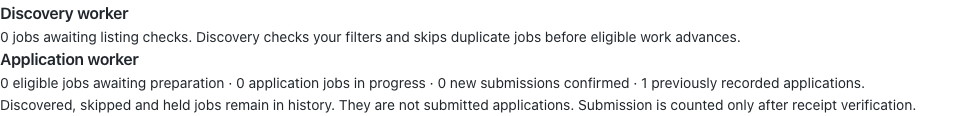

# Discovery filtering, application handoff and profile polling — 2026-11-01

**OPEN: no new independently verified application.** Existing branch
`fix/live-prepare-discovery-20261030`, [PR #48](https://github.com/karanagg166/automated-apply/pull/48),
base `main`. Exact implementation and installed API/execution/frontend:
[`653202800885f9abea0ee65f357d1e628127a2c6`](https://github.com/karanagg166/automated-apply/commit/653202800885f9abea0ee65f357d1e628127a2c6).
All times below are UTC. See the
[execution plan](../plans/2026-11-01-real-automation-execution.md) for the complete
owner-requested scope, including later per-platform and contact/draft acceptance.

## Behavior changes

Previously, a detailed job observation that passed age/applicant checks entered
MATCHED / preparation before experience, full preferences, required skills and
minimum score were checked. Discovery now runs the same complete eligibility
function before handing **ELIGIBLE / prepare** work to the independent application
worker. A failed check stays in durable discovery history as SKIPPED or NEEDS_INPUT,
with its actual reason and no application packet/action. Preparation and every
write still recheck current profile, policy, listing, identity and history.
There is no weakening of unknown-applicant, required-skill or experience checks.

The existing PostgreSQL deterministic platform/requisition identity, owner fence,
leases, replay/history protection and outbox are reused. No new database, broker,
connection limit or concurrent browser action was introduced. Discovery/browser
work is scheduled through the extension/native lane; API execution preparation
runs in its existing independent service. The browser lane remains exclusive.

Profile comparison defaults to **1,800 seconds** and exposes its interval in the
frontend. Read-only polling follows a newly confirmed profile version; automatic
summary writes remain pinned to the exact approved version. Missing supported
facts and conflicts create reference-based, deduplicated in-app notifications
linked to `/profile`, with a delivery record. Unsupported extraction is not
reported as a missing fact; the verified login/contact distinction does not
produce an email mismatch notice. Repeated identical polls do not repeat notices.

The frontend separately displays discovered jobs, eligible preparation, work in
progress, newly receipt-confirmed submissions and historical recorded applications.
Skipped/held discoveries are explicitly not submitted applications.



## Checks and exact candidate

| Check | Result | Evidence scope |
| --- | --- | --- |
| Queue, profile comparison, submission and questionnaire regressions | **119 PASS, 20.32 s** | Local fictional fixtures; includes discovery exclusion and notification/version cases |
| Final event addition: native ingestion, calendar precision and pre-preparation filters | **4 PASS, 43 deselected, 0.86 s** | Overlapping targeted fixtures |
| Exact candidate's own Python runtime, background queue/profile suite | **67 PASS, 9.75 s** | Overlapping fixtures; no real application |
| Frontend queue/profile preferences | **10 PASS, 2.28 s** | Fictional unit tests; includes 30-minute save and honest progress counts |
| Exact frontend candidate | **10 PASS, 1.79 s** | Same overlapping cases |
| Ruff E9/F/I, frontend typecheck, full frontend format check, diff | **PASS** | Changed source and contracts |
| OpenAPI export and generated frontend types | **PASS** | Default interval changed 3,600→1,800 seconds |
| Exact independent backend/frontend builds and pip check | **PASS** | Own runtime, dependencies and production Next build; no mutable runtime symlinks |

The first edited test run stopped on a test-only unmatched bracket; it was fixed.
A subsequent 66-pass/one-failure run found a UUID passed by the new direct-call
fixture into JSON binding data; the fixture was corrected to use the production
string representation. Neither failing test revision was installed. Final results
above passed. No hosted Actions were dispatched. No schema migration was needed.

## Actual Mac replacement and read-only provider acceptance

Queue STOPPED **50** with **491 records**. The observed **14.400 s** interval covers
the Stop request **and its subsequent queue readback**, not an isolated Stop HTTP
latency. Exact previous API/execution **1b23163** and frontend **c94f1fb** plists,
wrapper and immutable runtimes were retained in a three-service rollback inventory.
Rollback unloads replacements under a stopped queue, restores those exact plists,
verifies readiness/data/account/policy and never restores a database snapshot.

At **16:00:54**, installation passed: backend readiness **200**, frontend login
**200**, worker online, all three new PIDs present, same **491 records**, profile
**v5 / 75 skills**, approved Profile 8 account binding **1**, identical stopped
policy, credentials and protected files. Telegram **a093eab**, native **f13c956**
and same-ID extension **0cef522 / 1.3.16** were unchanged. All historical releases
and rollback files remain. This replacement required no owner Chrome operation.

At **16:01:30**, profile polling policy **20** was independently read back enabled,
**1,800 seconds**, automatic writes **false**, no approved write fields, actual
saved-PDF verification required. Queue resumed **RUNNING 51 at 16:01:50**, preserving
age **14**, applicant threshold **1,000**, score **50**, unknown applicants review,
all-company scope and SUPERVISED allowance/hourly cap **one**. Other platforms
remain disabled; Gmail sending remains disabled.

An authenticated **isolated headless browser** rendered the actual installed
frontend at **16:01:53**: correct 30-minute enabled/read-only controls, 14/1,000/50,
**zero new confirmed submissions / one previously recorded application**. Controls
and cropped progress screenshot were verified. Elapsed **23.342 s**, external
requests **zero**, writes **zero**. Authentication used the existing local signed
owner-session mechanism; a password-login journey is not claimed. No personal
Chrome tab/window, keyboard or clipboard was used.

The actual approved Naukri browser connection completed its new profile comparison
at **16:02:25**: **COMPARED**, summary **MATCHED**, saved resume **MATCHED_PDF_BYTES**,
actual Download **100,198 bytes**, canonical checksum match, no provider error.
No Save or upload was performed. Other profile fields returned **UNSUPPORTED** in
this comparison adapter. Consequently no genuine missing-field notification is
claimed from that observation; notification delivery has fixture coverage only.
The next work is actual field extraction, rather than declaring unsupported
fields absent or inventing owner facts.

At **16:02:45**, independent durable read: **491 records**, 367 SKIPPED,
123 NEEDS_INPUT, one historical recorded application, **zero new admitted Apply
actions and zero new receipts**. The Mac was UNLOCKED. Source error `global_stop`
is the retained installation fence awaiting its next cycle, not a claim of a
fresh provider failure. Current jobs still require valid facts under policy.

## Acceptance and remaining work

| Requirement | Result | Remaining proof |
| --- | --- | --- |
| Filter discovery before application preparation | **IMPLEMENTED / FIXTURE PASS** | New installed real detailed-job handoff or rejection |
| Preserve deterministic deduplication / uncertain-history fences | **PASS, existing behavior preserved** | Repeated real submissions still unaccepted |
| Configurable 30-minute bound profile inspection | **PASS, first actual sample** | Repeated scheduled sample; broader field extraction |
| Actual provider-saved resume byte verification | **PASS, actual Download** | Fresh proof again before an application |
| Deduplicated missing-fact notifications | **FIXTURE PASS / LIVE NOT TESTED** | Actual supported missing fact, owner answer, persistence |
| Honest worker/application frontend progress | **PASS, actual installed render** | Full browser/application journeys remain outstanding |
| First new application / independent receipt | **BLOCKED** | No currently admitted eligible application; pending unknown-applicant decision retained |
| Recurring AUTOMATIC / locked forms / submission restart | **NOT TESTED / NOT ACCEPTED** | First new receipt and specific real-operation evidence |
| Additional platform applications | **NOT IMPLEMENTED / NOT ACCEPTED** | Individually delivered real adapters and account acceptance |
| Apollo / SignalHire and actual Gmail drafts | **BLOCKED: API ACCESS** | Neither current runtime API key is present; no paid entitlement assumed |

The requested “Get Shit Done” plugin was searched through plugin discovery and
local skill paths; no matching installed integration was found. The repository
execution plan was created and concrete implementation/deployment performed.
Apollo/SignalHire code already exists; it is not a verified live connection.
Current official API references: [Apollo API search](https://docs.apollo.io/reference/people-api-search)
and [enrichment](https://docs.apollo.io/reference/people-enrichment). Search alone
is not evidence of a fetched email. No provider lookup or credit consumption was
performed in this milestone. Existing draft-only mail protections remain.

Reproduce local checks from the implementation SHA:

```sh
.venv/bin/python -m pytest backend/tests/test_naukri_background_queue.py backend/tests/test_naukri_profile_sync.py backend/tests/test_application_queue.py backend/tests/test_naukri_submission.py backend/tests/test_naukri_questionnaires.py -q
pnpm -C frontend test tests/application-queue.test.tsx tests/profile-company-preferences.test.tsx
pnpm -C frontend typecheck
pnpm -C frontend format:check
.venv/bin/python backend/scripts/export_openapi.py
pnpm -C frontend api:types
pnpm -C frontend build
```

Continue the real application objective, preserve unanswered decisions rather than
silently relaxing them, and expand supported profile observations. Full automation
is not complete. No merge, hosted CI, cleanup/deletion, other-platform activation,
Gmail send, historical/uncertain application replay or invented receipt occurred.
