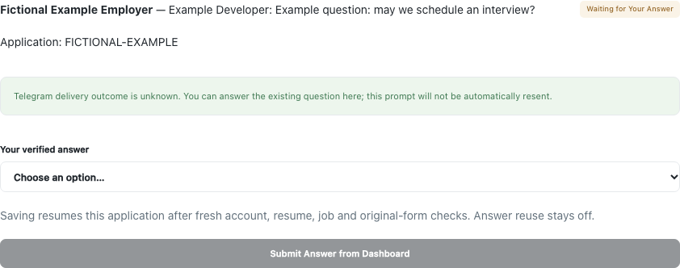

# Lost-form protection, genuine history parsing and installed acceptance

> Superseded by [approved third attempt and actual1.3.40 runtime](naukri-current-search-and-runtime-20261105.md). The owner approved lifetime3; API/execution1f14f1c and extension968cdae/1.3.40 are installed. Earlier pending-quota and source-only reuse statements below are historical. Full maintenance focus still fails.

[PR #48](https://github.com/karanagg166/automated-apply/pull/48), branch
`fix/live-prepare-discovery-20261030`. **OPEN: zero new verified worker receipts;
two authorized Apply admissions consumed.** This November5 UTC snapshot supersedes
the pending interview question and mixed-runtime state in the
[earlier report](naukri-retained-radio-and-discovery-20261105.md).

## Actual results and failures

At12:40–12:41UTC, the second original application tab was absent from every Chrome
window. It was not found in another window. Its cause of closure is unknown; the
bound profile window remained connected. The first original application tab was
already lost. Neither may receive another Apply. The new loss handler quarantined
the second attempt, preserving its original one admission, zero answers, submitting
packet revision2 and both exhausted three-attempt reconciliation counters. Both
unanswered prompts are now `closed_form_unavailable`; the interview question no
longer needs an answer. No screening answer or questionnaire Save was sent.

The real application-history page shows **one total application**, the historical
QTrino requisition261026028027, with an explicit Application sent status and
31October date. It contains no exact row for either current attempt. History has
no ordinary listing anchors: its current cards expose the requisition through
two same-origin interview helper links. Read-only evaluation of the exact
candidate parser recognizes the historical card and finds neither current job,
using their actual durable titles/employers. No helper link was clicked, no
receipt was inserted and no Apply admission was refunded. This layout observation
is distinct from an authenticated worker's independently persisted receipt.

The final14:47UTC audit recorded2,451 durable requisitions, **zero duplicates
across all2,451 keys**, two Apply admissions and zero worker receipt records.
Both uncertain attempts remain `SUBMISSION_UNKNOWN`, with zero answers and their
reconciliation counters unchanged. Each has one uncertainty notice in Telegram
state `sent`; these notices are not successful-application notifications.
The audit initially inspected the wrong requisition property and counted zero
keys; it was corrected to require complete key coverage before claiming deduplication.

Real discovery remains RUNNING revision152, every300seconds, independently of an
open dashboard. The14:44:01–14:44:18UTC cycle added seven identities with no source
error. Processing continues to inspect/filter jobs, but its lifetime allowance
is consumed. Effective filters remain any verified listed skill, score50,
age14days, applicant threshold1000 and unknown-count review. Other platform
adapters are OFF. Global limits are inherited; unused per-platform defaults do
not override these effective values.

## Installed components and changes

| Component | Exact installed implementation |
| --- | --- |
| API |[010f6799329e5fe458662c3c249fe9e6e7a62ab9](https://github.com/karanagg166/automated-apply/commit/010f6799329e5fe458662c3c249fe9e6e7a62ab9) |
| Frontend |[7efdb64fb7b8100f9268ac1d17761ea8c188cbfd](https://github.com/karanagg166/automated-apply/commit/7efdb64fb7b8100f9268ac1d17761ea8c188cbfd) |
| Extension disk and fully reloaded runtime |[b7c0e0203ba60807e48f7325b50645f98529e98d](https://github.com/karanagg166/automated-apply/commit/b7c0e0203ba60807e48f7325b50645f98529e98d),1.3.39,25 files |
| Execution worker, unchanged |0c875625aef0f720feb42f9f96507658589858ef |
| Telegram/native host, unchanged |b6b069051cdddc26683e67ef64646a90a2a7f753 |

The stable extension ID is `gdjbmkffcpicbpiikcohlmokkmcpipgp`. There is no longer a
cached1.3.31/mixed-settings runtime. Manifest permissions and key are unchanged.
The frontend now displays an answer form for `delivery_unknown` questions without
resending an uncertain Telegram prompt or selecting a default answer. Worker
answers resume only after current account, PDF, job and original-form checks.

[3e6f535](https://github.com/karanagg166/automated-apply/commit/3e6f5353fda5e1841c4ed0b48c7ef44c9ab0361f)
prevents generic tab cleanup from closing any parked form until that same work
has a confirmed submission. A removed original tab is reported through the
authenticated native channel and quarantined. API010f679 also fences replaced
browser sessions/windows. No loss handler grants provider access, resets a quota,
replays an action or changes the submitted packet.
[dc27159](https://github.com/karanagg166/automated-apply/commit/dc27159b08589f9d71ad31618ce7b56deaa49178)
lets a guarded retained-form controller yield to an existing read and restore its
heartbeat alarm. These controllers are available for a future intact form; they
cannot recover the two lost originals.

The1.3.39 history parser reads actual `.jdTupleContainer` cards, title/company and
explicit sent status. It requires agreement between the same-origin mock-interview
`flowType=JD&flowId=` and question-bank `jobId=` links. Conflicting/duplicate IDs,
foreign links, ambiguous queries and unsent statuses refuse a receipt. Account
binding, expected requisition/title/employer, two independent documents and the
original admitted action remain required in the native receipt path.

## Installation, readiness, focus and rollback

STOP147 preceded the API/frontend/1.3.38 replacement at13:30–13:31UTC. Readiness,
native reconnect,2,386 records, profile5, account binding1, policy and protected
file hashes passed. Its Chrome window/selected-tab snapshots were equal. The
later extension-only1.3.39 replacement used STOP151 at14:20UTC and preserved2,428
records, credentials, all four service definitions, native host, profile5 and
binding1. Actual frontend Start resumed RUN152. No rollback was executed.

**Focus acceptance FAILED on the last extension-only update.** Chrome's front-window
ordering changed to the automation window; selected tabs stayed unchanged. These
snapshots did not capture the OS foreground app and cannot establish the cause.
This failure is not hidden by successful readiness. Unattended Chrome WebUI
navigation/reload maintenance is suspended until independently validated. No
window is activated to restore an old snapshot. Ordinary inactive-tab processing
remains installed; a focus-safe authenticated updater still needs acceptance.

At14:47UTC the queue GET took1.455s, API readiness returned200 in2.143s and the
frontend returned200 in0.048s. All four LaunchAgents had PIDs; the native host was
CONNECTED with commands enabled and a recent heartbeat. PIDs are not application
or Telegram delivery evidence. The approved account binding remains revision1,
candidate profile5. A genuine native saved-resume Download at13:41:50.523380UTC
returned `SYNC_VERIFIED` / `MATCHED_PDF_BYTES`,100198bytes. No replacement was needed.

One role snapshot counted four sessions, including the temporary audit, with one
lock waiter; the next counted four with zero waiters. These are bounded samples,
not a contention benchmark. Pool1 per process, role limit5, schema003 and recovery
guarantees are unchanged. STOP147 took8.881s; comparison with the previous26s
observation is uncontrolled and is not claimed as a performance improvement.
No timeout or connection-limit increase was made.

At14:55–14:56UTC a later audit counted2,454 requisitions with complete key coverage,
zero duplicates, the same two admissions and zero new receipts. The14:54 cycle
added three identities in19.442s with no source error. Queue GET took9.403s,
readiness200 took2.389s and frontend200 took0.218s. Thus slow queue responses
remain an unresolved performance issue despite readiness; the faster earlier
sample does not establish a fix. The four-session snapshot then had zero lock
waiters. Policy remained RUN152/lifetime2/hour1 with both notices sent.

Private rollback inventories are retained under Application Support:
`installation-plans/form-context-010f6799329e5fe458662c3c249fe9e6e7a62ab9` and
`installation-plans/history-cards-b7c0e0203ba60807e48f7325b50645f98529e98d`.
They contain exact prior plists/wrappers, extension files and protected-file
hashes. The immediate extension rollback is full1.3.38/3e6f535; service rollback is
API0c87562/frontendae66975. The older mixed-runtime disk/runtime inventories are
also preserved separately. Keep STOPPED during rollback, verify readiness and
unchanged data/account/policy, and never restore the DB, refund admissions or
delete releases. The documented Chrome WebUI reload step now requires a proven
focus-safe mechanism or unavoidable owner action; do not reuse it unattended.

## Targeted validation, distinct from live acceptance

| Check | Actual result |
| --- | --- |
| Exact installed API candidate |115 backend tests PASS,22.62s pytest /28.719s process; own venv/pip check PASS |
| Final source form-loss/window subset |27 PASS,6.95s; overlaps the115 |
| Frontend affected files |30 tests in2 files PASS; exact candidate overlaps; build/typecheck PASS |
| Form-loss/retained/queue Node cases |111 PASS (58+40+13); exact candidate repeats overlap |
| Modern-history Node cases |20 PASS,1.180s exact candidate; source repeat overlaps |
| Retained alarm/cleanup isolated Chrome |1 journey,5 checks PASS,2.510s |
| Modern-history isolated Chrome |5 cases PASS,3.569s exact candidate; zero provider clicks/new windows |
| Existing execution isolated Chrome |44 cases PASS,110.196s against the changed execution source |
| Fixture request boundaries |Zero live Naukri/unexpected requests and file chooser events |
| Source checks |Targeted Ruff/Prettier, build, immutable file audit and diff checks PASS |

Counts above are not added across overlapping source/candidate runs. Initial
failures included an authenticated-fixture setup mismatch, Chrome component
worker selection, about:blank pending navigation and test-only module/URL-loader
resolution. Those harness issues were corrected and relevant exact candidates
passed; they are not represented as passing first runs or production acceptance.
Raw private journals retain failed and successful results.



This screenshot uses the installed frontend in a separate headless browser and
an intercepted fictional question. It crops only that fictional article. The
answer is blank, Submit disabled, with zero saves, mutations or external requests.
The actual old frontend reproduced the hidden `delivery_unknown` answer form;
after installation the real lost prompt correctly shows closed with no form.
A genuine successful answer/save is **NOT TESTED** by this screenshot.

Reproduce only the affected fixture checks with existing development dependencies:

```sh
.venv/bin/python -m pytest backend/tests/test_naukri_form_loss.py backend/tests/test_naukri_questionnaires.py backend/tests/test_chrome_profiles.py backend/tests/test_naukri_background_queue.py -q
pnpm -C frontend exec vitest run tests/naukri.test.tsx tests/applications.test.tsx
node --test extension/tests/naukri-queue.test.mjs extension/tests/naukri-retained.test.mjs extension/tests/naukri-retained-auto.test.mjs extension/tests/naukri-history-cards.test.mjs
node extension/tests/naukri-retained-auto.browser.mjs
node extension/tests/naukri-history-cards.browser.mjs
pnpm -C extension build
git diff --check
```

Private installed audits use the existing authenticated local API and a single
NullPool read-only PostgreSQL connection, then close it. No raw account, resume,
email, token, browser log or real candidate screenshot is published.

## Acceptance and next actions

| Requirement | Status | Evidence / remaining work |
| --- | --- | --- |
| Approved identity and actual saved PDF | PASS | Binding1/profile5; genuine PDF bytes match |
| Real recurring discovery and deduplication | PASS | Five-minute cycle;2,451 keys/zero duplicates at audit |
| Lost forms cannot replay and prompts close | PASS | Both unknown; admissions/counters intact; notices sent |
| Genuine current history layout | PASS | Read-only historical card recognized; current target rows absent |
| Installed services and full extension runtime | PASS | Exact SHAs above; ready200/native connected |
| Maintenance focus preservation | FAIL | Chrome front-window ordering changed; unsafe updater suspended |
| First new worker submission/strict receipt | BLOCKED | Zero receipts; lifetime2 consumed; no third admission authorized |
| Genuine questionnaire answer and final submit | NOT TESTED | Both originals lost; no answer or Save dispatched |
| Recurring AUTOMATIC | BLOCKED | First strict worker receipt still required |
| Full restart and continuous locked/overnight operation | NOT TESTED | Earlier locked browser work does not prove this; Mac slept overnight |
| Additional platform adapters/contact drafts | NOT TESTED | Disabled/unaccepted; no paid entitlement assumed |
| Project complete/reviewed/merge | BLOCKED | Requirements above remain open; no merge |

A concrete, validated but **unapplied** proposal changes only Naukri's supervised
lifetime allowance2→3. Hourly1, current filters, both quarantines and the first-
receipt AUTO gate remain unchanged. Owner authorization is required by the
existing-limit rule in AGENTS.md before a different eligible attempt. No quota
has been changed by this report. Then prioritize a genuine fresh supported form,
verified factual answers, final submission, two independent receipt observations
and accurate notification. Only after that receipt and critical checks enable
bounded AUTO and test repeated processing/restart/locked behavior.

### Subsequent source repair: approved-answer reuse, not installed

[55c7b4b8119fb121d7219d2918bd5094a256fdf9](https://github.com/karanagg166/automated-apply/commit/55c7b4b8119fb121d7219d2918bd5094a256fdf9)
fixes the oversized approved-answer bank key. The old prefix plus64hex characters
exceeded the existing50-character preference field. URL-safe base64 now preserves
the full256-bit scope digest in exactly50characters, including its prefix. Saved
question JSON containing the older key converts only when reuse is explicitly
approved. Profile/job/question/options scope, expiry and revocation remain intact;
application-only answers do not become reusable automatically.

The affected questionnaire file passes **16 tests in7.35s**, including new/legacy
key paths through explicit approval, scoped lookup and revocation. A collection
failure from a parametrized test's default argument was corrected before this
successful run. Ruff E9/F/I and diff checks pass. A fresh loopback-only PostgreSQL
17.11 instance passed **3 groups in0.078s**: actual old-key SQLSTATE22001 rejection,
new-key commit under the unchanged VARCHAR(50), and retrieval after a new session
with profile-scope isolation. It used fictional data, zero owner DB/provider
access, pool1 and a fresh schema. Its local server was stopped and data retained.
The real owner database, runtime components and policy were untouched.

Reproduce with an already-created fresh disposable local database only:

```sh
.venv/bin/python -m pytest backend/tests/test_naukri_questionnaires.py -q
.venv/bin/python -m backend.scripts.verify_naukri_answer_reuse_postgres --database-url postgresql://postgres@127.0.0.1:55485/candidate_profile_test_answer_reuse_fresh
```

This repair is **source-only**. API and execution worker both compute reuse keys
and must receive compatible code together under STOP before live answer reuse
can be accepted. The installed SHAs in the component table remain unchanged.
The additional-attempt quota proposal remains unapplied and owner approval is
pending. Focus-safe maintenance, overnight availability and additional platforms
remain unfinished. Gmail sending is disabled; no hosted Actions, provider bypass,
cleanup, release deletion or merge occurred.
