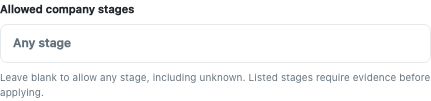

# Owner scope correction, project skill review and live dashboard — 2026-11-01

**OPEN: no new independently verified application receipt.** This work supersedes
the early-stage restriction recorded in the
[previous report](naukri-profile-matching-20261101.md), which was a saved setting,
not an explicit owner instruction. Existing branch
`fix/live-prepare-discovery-20261030`, [PR #48](https://github.com/karanagg166/automated-apply/pull/48)
remains open against `main`. Times below are UTC.

Implementation:

- [`02d8a52f9de4b73af0c87adbdefc88c8476402a4`](https://github.com/karanagg166/automated-apply/commit/02d8a52f9de4b73af0c87adbdefc88c8476402a4): active profile company-stage/startup controls, reviewed version-bound save and owner authorization record.
- [`c94f1fbc70e1c5f280e3105cc96230a72f421903`](https://github.com/karanagg166/automated-apply/commit/c94f1fbc70e1c5f280e3105cc96230a72f421903): bounded saved-job review reads and independently rendered queue controls.

## Actual saved policy and profile

The owner explicitly corrected the scope: any company stage, posting age **14
days**, applicant threshold **1,000**, minimum score **50**, evidence-backed skills
from their portfolio/GitHub. The applicant threshold skips known counts at or above
1,000, as labeled by the existing dashboard. A label such as `100+` still has no
upper bound. The owner was asked once whether those lower-bound-only counts may
proceed; no answer or permission is inferred. The existing unknown-count review
rule remains in force.

Queue STOPPED **41** before profile/configuration work; policy saved and independently
read back as STOPPED **42** at **12:39:57**. Profile company stages changed from
`[early]` to `[]`, and startup prioritization from true to false. The separate
saved-discovery preferences were also corrected for those two fields and 14-day
recency, preserving other preferences. Submission allowance **one**, hourly cap
**one**, approved Profile 8 account binding **revision 1**, score **50**, other
platforms disabled and existing experience/salary/required-skill/history checks
were preserved. No applicant number or posting timestamp was invented.

Read-only GitHub inspection covered **26 non-fork repositories**, excluding **16
forks** from skill attribution. Repository manifests, documentation and trees were
pinned to exact commit SHAs; **24 selected implementation/documentation files**
were subsequently read in detail. Generated/vendor code and mere dependency
declarations were distinguished from original project implementations. Raw source
snapshots, pinned URLs, content digests and per-skill provenance remain private and
are recorded with the profile audit; candidate-specific URLs and personal facts
are not published here.

**33 skills were added; 42 existing skills were preserved, total 75.** Examples
include SQLAlchemy, Qdrant, RabbitMQ/Dramatiq, Django, Flutter/Dart, Firebase,
GraphQL, PHP/Magento, Redux, Pytest, Playwright and Vitest. MySQL was explicitly
listed in the owner's pinned GitHub profile; it was not inferred from PostgreSQL.
Electron/Vue were explicit owner portfolio technology claims. Compound HTML/CSS
and SQL/MySQL labels required both component facts. Testing skills describe
reviewed project tests; no certification, professional tenure or production test
success was inferred. A forked React Native repository was not attributed as an
original implementation or used to add that skill.

The owner-authorized additive update and confirmation committed atomically at
**12:44:34**, profile **v4→v5**, using the existing owner lock and version comparison.
The audit identifies exact source evidence and authorization. Contacts, login
binding, verified four-month experience, employment dates/roles, education, summary,
canonical PDF and historical applications were unchanged. Conflicting portfolio
career dates were not substituted for confirmed resume facts. These additions are
verified in the local profile; a bulk Naukri skill save is not claimed.

## Frontend and real performance repair

The existing discovery preference editor saves a different record from the profile
used for applications. Consequently, changing its company-stage input did not
remove the application's saved stage restriction. The profile's **Search
preferences** step now exposes **Allowed company stages** and **Startup preference**
and includes both in reviewed, version-bound profile saves. Blank stages means any,
including unknown. Discovery-editor text identifies which screen controls which
policy. Age, applicants and score remain editable on **Naukri → Background job
queue**. No API contract or migration changed.




The global daily cap shown above remains 80, but the first-application allowance
and hourly cap remain **one**. This screenshot does not mean 80 submissions were
authorized before the first independently verified receipt.

Genuine installed-page checks exposed another delay: the saved-job review performs
company/packet/receipt/history queries for each job, occupying the small database
pool while the page waits. Retained request timings before the fix show **279 SQL
reads**, **51.559–58.853 s connection occupancy**, **15.030–20.214 s pool wait** and
**72.307–74.385 s HTTP duration** in two samples.

The review now loads companies, terminal/uncertain packets and receipt keys in
bounded set-based reads. Packet lifecycle and same-requisition/different-slug
history remain replay barriers. Even damaged receipt existence is preserved as a
barrier. Browser write admission still performs its independent canonical checks
under the owner fence. The queue panel renders independently of the legacy status
panel. No connection limit, business timeout or queue integrity protection changed.

After installation, **56 saved jobs** returned in **3.248 s client time**; request
instrumentation recorded **6 SQL reads**, **2.784 s connection occupancy**, **0.139 s
pool wait**, **3.406 s HTTP duration**, HTTP 200. These are actual endpoint samples,
not a universal latency guarantee or a fixture benchmark. The focused regression
uses 32 fictional listings and asserts five fixed internal reads, plus the route's
job-list query makes six in production.

## Exact installation, rollback and rendered acceptance

Frontend-only `02d8a52` installed at **12:48:46** with STOPPED 42, **437 records**,
profile v5/binding 1, ready 200/login 200, exact unchanged extension **23 files** and
protected services/native/configuration. The first installed rendering attempts
failed their short assertion waits and then the queue's 30-second observation wait;
they were not reported as UI success. No production timeout was increased.

The first `c94f1fb` API installation attempt failed its readiness acceptance and
**restored the previous f13c956 API**, preserving database outcomes. Its exact plan
and failure remain private. A second attempt with the same probe count/deadlines
recorded connection refusals during startup, then actual ready 200 and all
preservation checks passed at **13:00:05**. Cause of the first readiness miss is not
claimed conclusively established. No database snapshot was restored.

Frontend `c94f1fb` installed and verified at **13:00:44**. Current components:

| Component | Exact source / result |
| --- | --- |
| API and frontend | `c94f1fbc70e1c5f280e3105cc96230a72f421903` |
| Execution worker and native host | `f13c956c3a00f8434a4152f7c8ff451cb5eaca14`, unchanged |
| Telegram | `a093eabc1ca1f0989b4ff7e3f7be187f442ddb2a`, unchanged |
| Extension | `08aab53f3ae0eeb018dedcbdeed30544bae4504f`, **1.3.15**, same stable ID, exact **23/23 files**, unchanged |
| Queue/profile/account | STOPPED 42 during replacement; profile v5, binding revision 1, 437 records preserved |
| Rollback | Exact previous API/frontend plists and wrapper inventories; retained previous runtimes, extension/native/config digests and all historical releases |

The candidates have independent build/runtime directories; pnpm reused its cache
without mutable dependency symlinks. The frontend wrapper's retained interpreter
reference is inventoried. Current API, worker, Telegram, frontend and native
components must not be described as all running one SHA.

At **13:01:25**, isolated **headless Chromium against the actual installed frontend
and production local API** read back blank company stages, startup priority false,
age 14, applicants 1,000 and score 50. Queue controls became visible in **14.600 s**
with the rest of the page's parallel reads. A later screenshot capture repeated the
read at **13:03:39**, **18.213 s**. These are observation times, not per-query costs.
No external request, provider action or save was made by this check. It used a
short-lived session signed with the existing local application's owner secret;
password login is not claimed tested by this check. Screenshots contain only the
actual settings controls and were visually inspected before publication. No owner
Chrome window, selected tab, keyboard or clipboard was used for these checks.

At **13:01:55**, queue resumed **RUNNING revision 43** under the corrected policy.
The first real discovery cycle **13:02:07→13:02:30** admitted **four new unique
jobs**, **437→441**, with no source error. At **13:04:00**, the worker and Telegram
were polling; 321 SKIPPED, 115 NEEDS_INPUT, three DISCOVERED, one MATCHED and the
historical receipt remained. MATCHED is not submission eligibility or a receipt.
**New Apply admissions 0; new receipts 0.**

Six promising, previously policy-held unsubmitted jobs were explicitly queued for
fresh ordinary UI inspection at **13:04:26**. The operator journal records preimages
and version changes, excludes packets/admitted actions/forms, and checks retained
receipts and packet/requisition history. It does not reuse old listing facts as a
write grant. The first attempt hit the existing owner-lock timeout and rolled back;
the second used the unchanged timeout and succeeded after contention cleared.
An actual connection/lock sample showed four role connections, no blocking PIDs
and short transactions; no connection cap or lock timeout was raised. This is a
point-in-time sample, not proof of universal contention resolution.

## Acceptance matrix and remaining work

| Requirement | Result | Evidence |
| --- | --- | --- |
| Remove early-stage/startup-only restriction | **PASS** | Actual profile v5 and independently rendered installed frontend |
| Save age 14 / applicants 1,000 / score 50 | **PASS** | Versioned live API write/read and installed rendered controls |
| Owner can change active company preferences from frontend | **PASS** | Installed controls; reviewed-save tests preserve version and unrelated facts |
| Project/portfolio skill review and additive save | **PASS** | 26 non-fork repositories, 24 detailed files, 33 sourced additions, atomic v5 confirmation |
| Focused frontend regressions | **9 PASS, 1.91 s** | Fictional unit fixtures; includes two new profile-save cases |
| Exact c94f1fb frontend candidate regressions | **9 PASS, 2.04 s** | Same cases, overlapping; own immutable build |
| Backend batch/review regressions | **22 PASS, 3.08 s** | Fictional fixtures; one new replay/query-count case |
| Additional prior review/currentness checks | **3 PASS, 0.31 s; 79 deselected** | Targeted existing cases |
| Exact c94f1fb own Python candidate | **22 PASS, 2.53 s** | Overlapping backend cases; pip check passed |
| Typecheck, selected formatting, Ruff E9/F/I, build, diff check | **PASS** | Exact changed source/candidates; first test-only type/format mistakes corrected |
| Real recurring discovery after corrected policy | **PASS, bounded sample** | Four new jobs, no source error; dashboard closed during worker processing |
| First new supported application and independent receipt | **NOT YET VERIFIED** | Zero new Apply admissions/receipts |
| Lower-bound-only applicant counts | **AWAITING OWNER DECISION** | `100+` remains unknown above; explicit question asked once |
| Recurring AUTOMATIC / real upload/questionnaire/locked submission | **NOT ACCEPTED** | First new receipt and critical live checks still required |

No new locked-screen or restart acceptance is claimed. Previously unanswered
project client/start/status facts remain unmodified. No QTrino or uncertain replay,
merge, hosted Actions, Gmail send, other-platform activation, cleanup or deletion
occurred. No financial/provider budget changed.

Reproduce targeted code checks:

```sh
.venv/bin/python -m pytest backend/tests/test_naukri_review_batch.py backend/tests/test_naukri_reviewed_facts.py -q
.venv/bin/python -m pytest backend/tests/test_execution_naukri.py -q -k 'review_explains_unknown_experience or owner_applied_and_closed or currentness_expires'
.venv/bin/ruff check --isolated --select E9,F,I backend/app/execution/naukri_review.py backend/tests/test_naukri_review_batch.py
pnpm -C frontend test tests/profile-company-preferences.test.tsx tests/application-queue.test.tsx
pnpm -C frontend typecheck
pnpm -C frontend build
```

Continue fresh genuine matching under the corrected scope, honor the exact answer
on unknown applicant counts if one arrives, and complete one supported eligible
application with independently persistent provider receipt before bounded recurring
AUTOMATIC. Actual recurring real applications remain the completion criterion.

## Live continuation: owner-activity race and read-only resumption

At **13:09:43**, five of the six reconsidered jobs remained queued for inspection.
The sixth had a genuine extension result **`owner_platform_active`**, observed at
**13:08:51**: Naukri became active between polling and observation, and the consumer
yielded. No keyboard, clipboard, tab selection or focus action was attempted, and
this job had zero admitted actions. The server previously left that read waiting
for owner input indefinitely. This was a real autonomous-resumption defect, not
missing candidate information.

Implementation
[`e5d0eb6fc875e9526d34ea2abb386729eb1c9b1f`](https://github.com/karanagg166/automated-apply/commit/e5d0eb6fc875e9526d34ea2abb386729eb1c9b1f)
defers **only `inspect_job` / `owner_platform_active`**, with no packet, form or
admitted action, as durable queued `FAILED_RETRYABLE` work available **60 seconds**
later. The extension's existing owner-activity gate still applies. A later attempt
creates a fresh owned inactive inspection tab; it does not act on the adopted tab.
CAPTCHA, other unsupported observations, packet/form work and any admitted action
continue to wait/reconcile through their existing paths. No Apply or questionnaire
retry was added.

**Seven targeted backend cases passed in 1.03 s** (38 deselected), including five
new cases: safe read resumption after a fresh database session, packet refusal,
form refusal, admitted-action refusal and CAPTCHA refusal. The complete relevant
background queue file passed **45 cases in 5.55 s**. The immutable candidate's own
Python environment passed the same seven focused cases in **1.14 s**, overlapping
the preceding results; pip check, Ruff E9/F/I and diff check passed. No unrelated
frontend or extension suite was repeated.

The actual Stop took **7.938 s**, queue STOPPED **44**. API-only replacement passed
at **13:13:42**, ready **200**, **442 records**, profile **v5**, binding **1**, with
all protected frontend/worker/Telegram/native/extension/configuration files
unchanged. Startup connection refusals were observed before ready 200 within the
existing acceptance probe budget; no timeout or connection limit was increased.
Saved review returned **57 jobs in 3.440 s**. Exact previous c94 API plist/runtime
and every historical release remain retained in the new rollback inventory.

**Current API is e5d0eb6**; frontend remains c94f1fb, worker/native f13c956, Telegram
a093eab and extension 1.3.15/08aab53, same stable ID. Queue resumed **RUNNING 45** at
**13:14:13**, preserving the entire corrected policy and first-application allowance.
At **13:14:45**, a journaled one-time upgrade recovery placed the existing held
read-only job into delayed inspection after checking packet, form, receipt and
admitted-action exclusions. This is not a second Apply and not a claimed new
provider observation. The new race-handling branch is **fixture-verified and
installed; a repeated live occurrence followed by successful resumption is NOT YET
VERIFIED**. First new submission/receipt, recurring AUTOMATIC and locked submission
acceptance remain OPEN. The unknown applicant-count decision is still pending.
