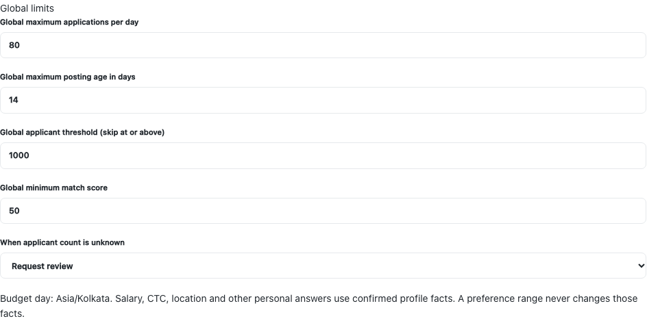

# Owner scope correction, project skill review and live dashboard — 2026-11-01

**OPEN: no new independently verified application receipt.** This work supersedes
the early-stage restriction recorded in the
[previous report](naukri-profile-matching-20261101.md), which was a saved setting,
not an explicit owner instruction. Existing branch
`fix/live-prepare-discovery-20261030`, [PR #48](https://github.com/karanagg166/automated-apply/pull/48)
remains open against `main`. Times below are UTC.

Implementation:

- [`02d8a52f9de4b73af0c87adbdefc88c8476402a4`](https://github.com/karanagg166/automated-apply/commit/02d8a52f9de4b73af0c87adbdefc88c8476402a4): active profile company-stage/startup controls, reviewed version-bound save and owner authorization record.
- [`c94f1fbc70e1c5f280e3105cc96230a72f421903`](https://github.com/karanagg166/automated-apply/commit/c94f1fbc70e1c5f280e3105cc96230a72f421903): bounded saved-job review reads and independently rendered queue controls.

## Actual saved policy and profile

The owner explicitly corrected the scope: any company stage, posting age **14
days**, applicant threshold **1,000**, minimum score **50**, evidence-backed skills
from their portfolio/GitHub. The applicant threshold skips known counts at or above
1,000, as labeled by the existing dashboard. A label such as `100+` still has no
upper bound. The owner was asked once whether those lower-bound-only counts may
proceed; no answer or permission is inferred. The existing unknown-count review
rule remains in force.

Queue STOPPED **41** before profile/configuration work; policy saved and independently
read back as STOPPED **42** at **12:39:57**. Profile company stages changed from
`[early]` to `[]`, and startup prioritization from true to false. The separate
saved-discovery preferences were also corrected for those two fields and 14-day
recency, preserving other preferences. Submission allowance **one**, hourly cap
**one**, approved Profile 8 account binding **revision 1**, score **50**, other
platforms disabled and existing experience/salary/required-skill/history checks
were preserved. No applicant number or posting timestamp was invented.

Read-only GitHub inspection covered **26 non-fork repositories**, excluding **16
forks** from skill attribution. Repository manifests, documentation and trees were
pinned to exact commit SHAs; **24 selected implementation/documentation files**
were subsequently read in detail. Generated/vendor code and mere dependency
declarations were distinguished from original project implementations. Raw source
snapshots, pinned URLs, content digests and per-skill provenance remain private and
are recorded with the profile audit; candidate-specific URLs and personal facts
are not published here.

**33 skills were added; 42 existing skills were preserved, total 75.** Examples
include SQLAlchemy, Qdrant, RabbitMQ/Dramatiq, Django, Flutter/Dart, Firebase,
GraphQL, PHP/Magento, Redux, Pytest, Playwright and Vitest. MySQL was explicitly
listed in the owner's pinned GitHub profile; it was not inferred from PostgreSQL.
Electron/Vue were explicit owner portfolio technology claims. Compound HTML/CSS
and SQL/MySQL labels required both component facts. Testing skills describe
reviewed project tests; no certification, professional tenure or production test
success was inferred. A forked React Native repository was not attributed as an
original implementation or used to add that skill.

The owner-authorized additive update and confirmation committed atomically at
**12:44:34**, profile **v4→v5**, using the existing owner lock and version comparison.
The audit identifies exact source evidence and authorization. Contacts, login
binding, verified four-month experience, employment dates/roles, education, summary,
canonical PDF and historical applications were unchanged. Conflicting portfolio
career dates were not substituted for confirmed resume facts. These additions are
verified in the local profile; a bulk Naukri skill save is not claimed.

## Frontend and real performance repair

The existing discovery preference editor saves a different record from the profile
used for applications. Consequently, changing its company-stage input did not
remove the application's saved stage restriction. The profile's **Search
preferences** step now exposes **Allowed company stages** and **Startup preference**
and includes both in reviewed, version-bound profile saves. Blank stages means any,
including unknown. Discovery-editor text identifies which screen controls which
policy. Age, applicants and score remain editable on **Naukri → Background job
queue**. No API contract or migration changed.




The global daily cap shown above remains 80, but the first-application allowance
and hourly cap remain **one**. This screenshot does not mean 80 submissions were
authorized before the first independently verified receipt.

Genuine installed-page checks exposed another delay: the saved-job review performs
company/packet/receipt/history queries for each job, occupying the small database
pool while the page waits. Retained request timings before the fix show **279 SQL
reads**, **51.559–58.853 s connection occupancy**, **15.030–20.214 s pool wait** and
**72.307–74.385 s HTTP duration** in two samples.

The review now loads companies, terminal/uncertain packets and receipt keys in
bounded set-based reads. Packet lifecycle and same-requisition/different-slug
history remain replay barriers. Even damaged receipt existence is preserved as a
barrier. Browser write admission still performs its independent canonical checks
under the owner fence. The queue panel renders independently of the legacy status
panel. No connection limit, business timeout or queue integrity protection changed.

After installation, **56 saved jobs** returned in **3.248 s client time**; request
instrumentation recorded **6 SQL reads**, **2.784 s connection occupancy**, **0.139 s
pool wait**, **3.406 s HTTP duration**, HTTP 200. These are actual endpoint samples,
not a universal latency guarantee or a fixture benchmark. The focused regression
uses 32 fictional listings and asserts five fixed internal reads, plus the route's
job-list query makes six in production.

## Exact installation, rollback and rendered acceptance

Frontend-only `02d8a52` installed at **12:48:46** with STOPPED 42, **437 records**,
profile v5/binding 1, ready 200/login 200, exact unchanged extension **23 files** and
protected services/native/configuration. The first installed rendering attempts
failed their short assertion waits and then the queue's 30-second observation wait;
they were not reported as UI success. No production timeout was increased.

The first `c94f1fb` API installation attempt failed its readiness acceptance and
**restored the previous f13c956 API**, preserving database outcomes. Its exact plan
and failure remain private. A second attempt with the same probe count/deadlines
recorded connection refusals during startup, then actual ready 200 and all
preservation checks passed at **13:00:05**. Cause of the first readiness miss is not
claimed conclusively established. No database snapshot was restored.

Frontend `c94f1fb` installed and verified at **13:00:44**. Current components:

| Component | Exact source / result |
| --- | --- |
| API and frontend | `c94f1fbc70e1c5f280e3105cc96230a72f421903` |
| Execution worker and native host | `f13c956c3a00f8434a4152f7c8ff451cb5eaca14`, unchanged |
| Telegram | `a093eabc1ca1f0989b4ff7e3f7be187f442ddb2a`, unchanged |
| Extension | `08aab53f3ae0eeb018dedcbdeed30544bae4504f`, **1.3.15**, same stable ID, exact **23/23 files**, unchanged |
| Queue/profile/account | STOPPED 42 during replacement; profile v5, binding revision 1, 437 records preserved |
| Rollback | Exact previous API/frontend plists and wrapper inventories; retained previous runtimes, extension/native/config digests and all historical releases |

The candidates have independent build/runtime directories; pnpm reused its cache
without mutable dependency symlinks. The frontend wrapper's retained interpreter
reference is inventoried. Current API, worker, Telegram, frontend and native
components must not be described as all running one SHA.

At **13:01:25**, isolated **headless Chromium against the actual installed frontend
and production local API** read back blank company stages, startup priority false,
age 14, applicants 1,000 and score 50. Queue controls became visible in **14.600 s**
with the rest of the page's parallel reads. A later screenshot capture repeated the
read at **13:03:39**, **18.213 s**. These are observation times, not per-query costs.
No external request, provider action or save was made by this check. It used a
short-lived session signed with the existing local application's owner secret;
password login is not claimed tested by this check. Screenshots contain only the
actual settings controls and were visually inspected before publication. No owner
Chrome window, selected tab, keyboard or clipboard was used for these checks.

At **13:01:55**, queue resumed **RUNNING revision 43** under the corrected policy.
The first real discovery cycle **13:02:07→13:02:30** admitted **four new unique
jobs**, **437→441**, with no source error. At **13:04:00**, the worker and Telegram
were polling; 321 SKIPPED, 115 NEEDS_INPUT, three DISCOVERED, one MATCHED and the
historical receipt remained. MATCHED is not submission eligibility or a receipt.
**New Apply admissions 0; new receipts 0.**

Six promising, previously policy-held unsubmitted jobs were explicitly queued for
fresh ordinary UI inspection at **13:04:26**. The operator journal records preimages
and version changes, excludes packets/admitted actions/forms, and checks retained
receipts and packet/requisition history. It does not reuse old listing facts as a
write grant. The first attempt hit the existing owner-lock timeout and rolled back;
the second used the unchanged timeout and succeeded after contention cleared.
An actual connection/lock sample showed four role connections, no blocking PIDs
and short transactions; no connection cap or lock timeout was raised. This is a
point-in-time sample, not proof of universal contention resolution.

## Acceptance matrix and remaining work

| Requirement | Result | Evidence |
| --- | --- | --- |
| Remove early-stage/startup-only restriction | **PASS** | Actual profile v5 and independently rendered installed frontend |
| Save age 14 / applicants 1,000 / score 50 | **PASS** | Versioned live API write/read and installed rendered controls |
| Owner can change active company preferences from frontend | **PASS** | Installed controls; reviewed-save tests preserve version and unrelated facts |
| Project/portfolio skill review and additive save | **PASS** | 26 non-fork repositories, 24 detailed files, 33 sourced additions, atomic v5 confirmation |
| Focused frontend regressions | **9 PASS, 1.91 s** | Fictional unit fixtures; includes two new profile-save cases |
| Exact c94f1fb frontend candidate regressions | **9 PASS, 2.04 s** | Same cases, overlapping; own immutable build |
| Backend batch/review regressions | **22 PASS, 3.08 s** | Fictional fixtures; one new replay/query-count case |
| Additional prior review/currentness checks | **3 PASS, 0.31 s; 79 deselected** | Targeted existing cases |
| Exact c94f1fb own Python candidate | **22 PASS, 2.53 s** | Overlapping backend cases; pip check passed |
| Typecheck, selected formatting, Ruff E9/F/I, build, diff check | **PASS** | Exact changed source/candidates; first test-only type/format mistakes corrected |
| Real recurring discovery after corrected policy | **PASS, bounded sample** | Four new jobs, no source error; dashboard closed during worker processing |
| First new supported application and independent receipt | **NOT YET VERIFIED** | Zero new Apply admissions/receipts |
| Lower-bound-only applicant counts | **AWAITING OWNER DECISION** | `100+` remains unknown above; explicit question asked once |
| Recurring AUTOMATIC / real upload/questionnaire/locked submission | **NOT ACCEPTED** | First new receipt and critical live checks still required |

No new locked-screen or restart acceptance is claimed. Previously unanswered
project client/start/status facts remain unmodified. No QTrino or uncertain replay,
merge, hosted Actions, Gmail send, other-platform activation, cleanup or deletion
occurred. No financial/provider budget changed.

Reproduce targeted code checks:

```sh
.venv/bin/python -m pytest backend/tests/test_naukri_review_batch.py backend/tests/test_naukri_reviewed_facts.py -q
.venv/bin/python -m pytest backend/tests/test_execution_naukri.py -q -k 'review_explains_unknown_experience or owner_applied_and_closed or currentness_expires'
.venv/bin/ruff check --isolated --select E9,F,I backend/app/execution/naukri_review.py backend/tests/test_naukri_review_batch.py
pnpm -C frontend test tests/profile-company-preferences.test.tsx tests/application-queue.test.tsx
pnpm -C frontend typecheck
pnpm -C frontend build
```

Continue fresh genuine matching under the corrected scope, honor the exact answer
on unknown applicant counts if one arrives, and complete one supported eligible
application with independently persistent provider receipt before bounded recurring
AUTOMATIC. Actual recurring real applications remain the completion criterion.

## Live continuation: owner-activity race and read-only resumption

At **13:09:43**, five of the six reconsidered jobs remained queued for inspection.
The sixth had a genuine extension result **`owner_platform_active`**, observed at
**13:08:51**: Naukri became active between polling and observation, and the consumer
yielded. No keyboard, clipboard, tab selection or focus action was attempted, and
this job had zero admitted actions. The server previously left that read waiting
for owner input indefinitely. This was a real autonomous-resumption defect, not
missing candidate information.

Implementation
[`e5d0eb6fc875e9526d34ea2abb386729eb1c9b1f`](https://github.com/karanagg166/automated-apply/commit/e5d0eb6fc875e9526d34ea2abb386729eb1c9b1f)
defers **only `inspect_job` / `owner_platform_active`**, with no packet, form or
admitted action, as durable queued `FAILED_RETRYABLE` work available **60 seconds**
later. The extension's existing owner-activity gate still applies. A later attempt
creates a fresh owned inactive inspection tab; it does not act on the adopted tab.
CAPTCHA, other unsupported observations, packet/form work and any admitted action
continue to wait/reconcile through their existing paths. No Apply or questionnaire
retry was added.

**Seven targeted backend cases passed in 1.03 s** (38 deselected), including five
new cases: safe read resumption after a fresh database session, packet refusal,
form refusal, admitted-action refusal and CAPTCHA refusal. The complete relevant
background queue file passed **45 cases in 5.55 s**. The immutable candidate's own
Python environment passed the same seven focused cases in **1.14 s**, overlapping
the preceding results; pip check, Ruff E9/F/I and diff check passed. No unrelated
frontend or extension suite was repeated.

The actual Stop took **7.938 s**, queue STOPPED **44**. API-only replacement passed
at **13:13:42**, ready **200**, **442 records**, profile **v5**, binding **1**, with
all protected frontend/worker/Telegram/native/extension/configuration files
unchanged. Startup connection refusals were observed before ready 200 within the
existing acceptance probe budget; no timeout or connection limit was increased.
Saved review returned **57 jobs in 3.440 s**. Exact previous c94 API plist/runtime
and every historical release remain retained in the new rollback inventory.

**Current API is e5d0eb6**; frontend remains c94f1fb, worker/native f13c956, Telegram
a093eab and extension 1.3.15/08aab53, same stable ID. Queue resumed **RUNNING 45** at
**13:14:13**, preserving the entire corrected policy and first-application allowance.
At **13:14:45**, a journaled one-time upgrade recovery placed the existing held
read-only job into delayed inspection after checking packet, form, receipt and
admitted-action exclusions. This is not a second Apply and not a claimed new
provider observation. The new race-handling branch is **fixture-verified and
installed; a repeated live occurrence followed by successful resumption is NOT YET
VERIFIED**. First new submission/receipt, recurring AUTOMATIC and locked submission
acceptance remain OPEN. The unknown applicant-count decision is still pending.

At **13:18:11**, an independent authenticated queue read verified that the
recovered job had completed fresh native inspection at **13:16:23** and reached
**NEEDS_INPUT / `applicant_count_requires_review`**, with no remaining lease. Thus
the journaled delayed read actually resumed and reached the current listing filter;
it was not left stuck on owner activity. Naukri's lower-bound-only applicant count
still does not prove compliance with 1,000. This is **PASS for this recovered
read's resumption**, not a new Apply, receipt, repeated occurrence of the newly
fixed race, or full unattended-application acceptance. Queue remained **RUNNING
45**. The pending applicant-count question was not repeated or answered by timeout.

## Live continuation: bound sorting outside inactive-page timers

The actual paged source `sde-jobs-2`, identity
`940a98b9-ea72-5ab0-abcc-7b7fda9c4068`, began **13:20:02** and was still recorded as
executing at **13:22:16**, with its lease ending **13:23:02**. An independent
connection sample showed four role connections, no blocking PIDs, and short/idle
transactions. This did **not** establish successful completion or prove a unique
cause. Source inspection found a relevant defect: sorting/pagination chained
200-ms timers **inside the inactive provider page**, including five settling waits.
Chrome can throttle those waits, so a loop count was not a reliable time bound.
The timer diagnosis is an inference from code and the observed wait, not a captured
browser scheduling trace. The task was not restarted merely because observation
timed out; its identity/lease were inspected and Stop subsequently fenced it.

Implementation
[`0cef5222a8be5c51a8f24b8a4303640648f20c38`](https://github.com/karanagg166/automated-apply/commit/0cef5222a8be5c51a8f24b8a4303640648f20c38),
extension **1.3.16**, makes each injected sorting operation one synchronous DOM
step. The extension worker schedules subsequent steps, retains the exact document
and permitted same-role path state, rechecks ownership before/after each injection,
and bounds progress to **40 steps / 10-second worker budget**. A pending renderer
call is raced against that same worker budget. Date selection and actual Next
controls retain their existing validation; no provider query/filter parameter was
guessed, no active tab was used and no application path changed. Document changes,
CAPTCHA, owner adoption and unconfirmed sorting still refuse candidate admission.
No database/native timeout, connection cap or discovery interval increased.

**24 focused Node cases passed in 0.150 s**, including three new cases for state
continuity, a forty-step nonsettling result and a stalled renderer bounded by the
worker clock. The immutable candidate passed the same **24 overlapping cases in
0.153 s**. **12 isolated actual Chromium cases passed in 23.694 s**, including a new
page-two case with isolated provider-page timers explicitly disabled. It verified
ordinary Date/Next navigation and owner-tab preservation without those timers.
Live provider / unexpected / chooser requests were **0 / 0 / 0**. The preceding
12-case run before the final renderer-budget addition passed in 23.851 s; counts
overlap and are not summed. Build, selected formatting and diff checks passed.

Actual Stop took **7.724 s**, queue STOPPED **46**. At **13:34:03**, exact extension
**1.3.16 / 23 files** installed with the same stable ID and unchanged manifest
permissions/key. Native messaging reconnected with a fresh heartbeat; ready **200
in 2.309 s**. Profile **v5**, account binding **1**, **442 records**, all service and
native references/configurations were preserved. Before/after front-window and all
selected-tab ID snapshots matched. The exact **23-file 1.3.15** backup and previous
releases remain inventoried; rollback restores those files under a STOPPED queue
and never restores a database snapshot.

Queue resumed **RUNNING 47** at **13:34:53**, same 14-day/1,000/score-50 policy and
SUPERVISED one/hour-one allowance. The first genuine new-extension source read
completed **13:35:00→13:35:16**, **15.293 s**, zero newly admitted jobs after
deduplication, no source error. It was page one, so it is **not** represented as a
same-page performance comparison against the earlier page-two wait. A private
read-only observer was attached to the actual next scheduled source to verify
page-two completion separately; a running observer or heartbeat is not that proof.

Current components: API **e5d0eb6**, frontend **c94f1fb**, execution/native
**f13c956**, Telegram **a093eab**, extension **0cef522 / 1.3.16**. No new Apply,
submission receipt, questionnaire/upload acceptance or locked-Mac submission is
claimed. Unknown applicant-count policy remains awaiting the once-asked decision.

**Genuine page-two acceptance subsequently PASS:** the read-only observer followed
the same durable source identity into its next scheduled lease at **13:40:26**,
actual URL `https://www.naukri.com/swe-jobs-2`. It independently observed completion
at **13:40:45**, **18.976 s**, source idle, lease cleared, **19 new unique jobs** and
no source error. The Mac was **UNLOCKED** during these samples. This proves actual
paged discovery with the installed 1.3.16 scheduler; it is not a fabricated fixture
receipt, locked-screen acceptance, or a claim that these 19 jobs are eligible.
The observer then exited normally. The selected Profile 8 connection was separately
CONNECTED, commands enabled, fresh heartbeat at **13:41:17**, no reported error.
New listings proceed to the unchanged individual inspection/matching gates.

## Nineteen-job inspection outcome and equivalent role spelling

An observer followed the **exact 19 new page-two records**, rather than the older
historical fixture/acceptance cohort. At **13:53:50**, all 19 had completed their
initial inspection: **17 SKIPPED / posting outside the 14-day limit**, **two
NEEDS_INPUT / posting-age precision review**, zero outstanding initial inspections,
**zero admitted actions and zero new receipts**. The observer exited normally. A
new search-card appearance was not substituted for the detailed posting's date.
These 19 genuine discoveries were not eligible applications.

Another retained genuine listing exposed a false title mismatch: **Fullstack
Developer Trainee** did not match the saved **Full Stack Developer** target solely
because of spacing. Implementation
[`1b2316300bb2f9f55ae77ee7b0859442dfab4c95`](https://github.com/karanagg166/automated-apply/commit/1b2316300bb2f9f55ae77ee7b0859442dfab4c95)
normalizes spacing/hyphen variants of **full stack**, **frontend** and **backend**
for title comparison. It does not equate developer/engineer/designer/sales roles,
alter saved titles or target preferences, or infer new career skills. Required
skills and verified experience checks remain unchanged.

**45 targeted matching/discovery cases passed in 2.89 s**, including eight new
positive/negative role cases that retain a missing Rust requirement. The exact
candidate's own Python environment passed **20 overlapping focused matching cases
in 1.09 s**, five deselected. Ruff E9/F/I, diff and pip check passed. No frontend,
extension or unrelated large suite was rerun for this backend-only change.

The retained real browser facts were read from the durable queue into a private
snapshot with source evidence and the unchanged confirmed **profile v5**. The
exact previous and candidate runtimes independently rescored the same input hash:
**80→95**, false title-negative removed, missing-skill results unchanged. This is
**a re-score of retained genuine facts, not a fresh provider observation, new
canonical-job import, eligibility grant or submission**. The earlier applicant
guard had prevented that listing's canonical ingestion; no synthetic job was
inserted to manufacture an API acceptance result.

Actual Stop took **6.889 s**, queue STOPPED **48**. API and execution worker exact
**1b2316300bb2f9f55ae77ee7b0859442dfab4c95** installed at **14:07:14**, ready **200**,
worker heartbeat online, **464 records**, approved binding **1**, profile **v5 / 75
skills**, exact queue policy unchanged. Previous API **e5d0eb6** and worker
**f13c956** plists/runtimes are preserved in an exact two-service rollback plan.
Native host **f13c956**, frontend **c94f1fb**, Telegram **a093eab**, extension
**0cef522 / 1.3.16**, credentials and protected files remained unchanged.

Queue resumed **RUNNING 49** at **14:08:55**, preserving 14 days, threshold 1,000,
score 50, all-company scope and SUPERVISED one/hour-one. This is component restart
and data-preservation evidence; it is not a locked-Mac or in-flight application
restart acceptance claim. The applicant upper-bound decision remains unanswered;
no unknown count was converted into a verified number. First new application,
independent receipt and recurring AUTOMATIC remain unaccepted.

## Final eligibility audit and naturally locked discovery

At **14:28:17**, the live API independently returned RUNNING **49**, age **14**,
applicant threshold **1,000**, minimum score **50**, unknown applicants
`needs_review`, SUPERVISED allowance/hourly cap **one**, profile **v5 / 75 skills**,
empty company-stage restrictions and startup preference false. API, execution and
Telegram services were loaded. No other platform was enabled.

At **14:36:48**, a diagnostic against **445 retained genuine listing observations**
and **471 durable queue records** found **zero eligible by the available facts**.
This applies current matching rules to saved observations; it does not represent
445 fresh provider visits. Four retained matches score **95**, with no missing
required skills or negative matching factors, but show applicant lower bound
**100** and no upper bound. Their applicant review holds remain; other current
facts still require fresh validation before any application. The once-asked
unknown-count decision remains unanswered. No company-stage restriction remains
and no verified experience, count or skill fact was invented to admit a job.

The Mac naturally entered a locked state. Samples at **14:34:27**, **14:35:12**,
**14:35:38**, **14:35:58** and **14:36:19** returned **LOCKED**. Authenticated
readiness returned **HTTP 200 in 2.453 s at 14:35:15**. A new actual source cycle
started **14:35:26.416** and finished **14:35:44.833**, **18.417 s**, no source
error. Its source was observed executing in the intermediate locked sample and
idle in the later locked samples. It added **one new durable job**, created
**14:35:44.069**. That job acquired real listing facts and reached MATCHED / queued
for preparation at **14:36:12**; the later diagnostic found that its required
experience/skills or preferences and score prevent eligibility. MATCHED alone is
not admission to submit. No owner lock, unlock, focus, keyboard or clipboard action
was performed for this observation.

| Final live check | Result | Scope |
| --- | --- | --- |
| Corrected policy and project skills persisted | **PASS** | Live API read, profile v5 and installed frontend evidence above |
| Readiness during a naturally locked sample | **PASS, one sample** | HTTP 200; does not establish browser operation by itself |
| Genuine discovery between locked samples | **PASS, bounded sample** | Executing source observed, actual completion and one durable job |
| First new eligible submission and independent receipt | **BLOCKED** | Zero new Apply admissions/receipts; no currently eligible saved facts |
| Recurring AUTOMATIC and locked form/upload/submission | **NOT TESTED / NOT ACCEPTED** | First receipt and the respective real operation evidence still required |

The same eligibility/evidence impasse was revalidated over three consecutive goal
turns after the owner's resume. Independently demonstrated repairs are installed;
the remaining decision cannot be inferred from a higher numeric applicant limit.
The engineering goal is blocked pending that answer or new qualifying provider
evidence. **Discovery remains RUNNING every five minutes**; this status does not
stop the software, authorize unknown counts, or enable recurring AUTOMATIC.
There were **zero additional fixture tests or installations in this final audit**.
The exact component SHAs and rollback inventory above remain unchanged. PR #48
remains open, and no new receipt, QTrino replay or completed Naukri milestone is
claimed.
