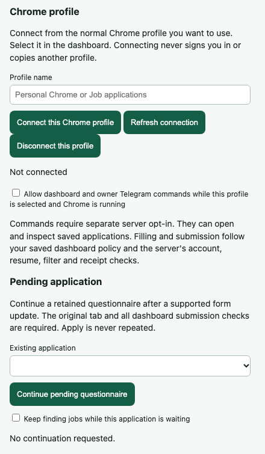

# Genuine retained radio form and discovery recovery

[PR #48](https://github.com/karanagg166/automated-apply/pull/48), branch
`fix/live-prepare-discovery-20261030`. **Naukri remains OPEN: two consumed Apply
admissions, zero new verified worker submissions.** Times use UTC explicitly;
November4 late UTC is November5 IST. The later morning snapshot is November5 UTC.
This report supersedes the earlier extension/runtime and pending-form details in
[the second genuine attempt report](naukri-web-role-live-20261105.md).

## Actual defect and resulting behavior

The second authorized application reached a genuine single-select radio question.
The cached extension recognized text/chips but not the provider's current radio
structure. Its original inactive tab and first unanswered question survived. The
new adapter reads the actual `.singleselect-radiobutton`, `.ssrc__radio`, associated
labels and current questionnaire Save control. The job-header Save button is
outside its scope. Preselected/ambiguous/changed controls, owner adoption and
expired permits refuse a write; selection is consumed before dispatch, and a slow
handler cannot cause a later Save after its permit expires.

A trusted read independently established the same original Apply document,
account/window/session, unchanged first question, two bot messages, zero user
messages and two unselected radio choices. Under STOP, a narrow audited recovery
restored inspection of that untouched first step. It did not reset the submitting
packet, refund an admission, click Apply, select an answer or repeat a save. Lost
Java and later/answered/changed forms cannot use this recovery path.

The next real profile refresh exposed a separate readiness defect: the account
field was absent through2.522seconds although readyState was already complete.
The approved account field appeared at3.233seconds. This was hydration, not evidence
of a different account. The fixed read-only path waits at most40 reads /10seconds
only when account evidence is entirely absent. A wrong or ambiguous identity,
challenge, context change or active owner tab still refuses immediately. No write,
Download admission, timeout setting or connection limit is repeated/increased by
this wait. Genuine account, actual saved PDF100198 bytes, listing and first radio
question checks subsequently passed at23:30:36UTC November4.

The real application is now NEEDS_INPUT for the interview preference already asked
once. No owner answer exists and no radio or questionnaire Save has been sent.
The dashboard question persisted at packet revision2. Its Telegram state is
`delivery_unknown`, with zero message IDs: successful delivery is **not** claimed
and the uncertain send is not repeated. The earlier lost application's separate
uncertainty notification remains genuinely delivered once.

Continuation now reuses one queue and its adoption listeners. With the existing
settings control enabled, it permits only leased `inspect_job` / `search_jobs`
reads alongside the retained application. Foreign Apply, questionnaire answers,
profile writes and execution-shaped reads remain blocked before browser action.
The ordinary native/server queue and all current filters/admissions still apply.

## Exact source and installation

| Component | Exact implementation / actual runtime |
| --- | --- |
| Radio DOM and guarded first-step recovery |[b38fc0af1806b2f0e28e08c4844a8d3569f1e2a6](https://github.com/karanagg166/automated-apply/commit/b38fc0af1806b2f0e28e08c4844a8d3569f1e2a6) |
| Permit checked again before Save |[2c9362e9ccbfd5eb416a68e543aa06fb6407800a](https://github.com/karanagg166/automated-apply/commit/2c9362e9ccbfd5eb416a68e543aa06fb6407800a) |
| Trusted connection refresh and cached-worker alarm hold/restore |[edb96c375d42f3f20f21dd020f8e9add80d265d3](https://github.com/karanagg166/automated-apply/commit/edb96c375d42f3f20f21dd020f8e9add80d265d3) |
| Read-only genuine profile hydration |[60a93c1591ccc2bb666415d37fbb9ee3a0ac3d10](https://github.com/karanagg166/automated-apply/commit/60a93c1591ccc2bb666415d37fbb9ee3a0ac3d10) |
| Current extension disk / trusted settings modules |[cdd231b025e4669dbfc55f9be711dc1f29c392cc](https://github.com/karanagg166/automated-apply/commit/cdd231b025e4669dbfc55f9be711dc1f29c392cc),1.3.36,25 exact files |
| Cached global service worker |b8b380c6443bd2a2c293c376d9c5129ced10385b,1.3.31; intentionally not reloaded |
| Installed API / execution worker |0c875625aef0f720feb42f9f96507658589858ef |
| Telegram / native host |b6b069051cdddc26683e67ef64646a90a2a7f753 |
| Frontend |ae66975691a75cb0a3a43010dcfdba26a5100128 |

The staged radio/profile updates stopped the queue before replacement. The last
cutover used STOP145; source/profile/account/policy and original one-Apply/zero-
answer checks passed. Exact previous1.3.35 files and hashes, protected-file hashes,
credentials, LaunchAgents, native-host inventory, historical releases and rollback
instructions are retained privately. Only the known owned inactive settings page
reloaded; no whole-extension reload, service restart or original provider reload.
Readiness returned200, binding1/profile5 and protected files were unchanged, and
front-window/selected-tab snapshots were equal. The stable extension ID remains
`gdjbmkffcpicbpiikcohlmokkmcpipgp`; permissions and manifest key are unchanged.

Actual installed frontend Start returned RUN146 with zero unexpected requests.
Policy is unchanged: SUPERVISED lifetime2/hour1, any verified skill, score50,
age14days, applicant threshold1000, unknown-count review, other platforms OFF.
STOP145 took9.065seconds in this observation; that is not a controlled improvement
over earlier26second observations. No database pool/limit increase was made.

Rollback keeps STOPPED and restores exact previous disk files while preserving
the original provider document and admissions. It must not reload the extension,
replay Apply, restore the database or delete a release. A complete worker reload
remains deferred until this active application is safely resolved. Disk version
and trusted settings execution must not be represented as a complete worker reload.

## Targeted checks, fixtures clearly separated

| Check | Result |
| --- | --- |
| Recovery and questionnaire backend regressions |52 PASS,17.83s; earlier34 are overlapping |
| Integrated radio/profile/queue/retained Node run |103 PASS,1.064s before the final queue/continuation additions |
| Final guarded queue file |46 PASS,0.160s; overlaps the integrated run |
| Current retained/discovery file |40 PASS,0.755s; overlaps earlier retained cases |
| Exact independent cdd231b candidate |Build/25-file identity audit PASS; same40 tests PASS,0.767s, not40 additional cases |
| Isolated Chromium radio cases |8 PASS,14.741s; selection/Save once, immediate advance/removal, preselected/duplicate, missing Save, slow expired permit and active-tab refusal |
| Isolated Chromium profile readiness |6 PASS,18.796s; delayed field, wrong/ambiguous/absent identity, challenge and owner adoption; zero Save clicks |
| Browser fixture external requests / chooser events |0 live Naukri,0 unexpected,0 chooser in both focused browser runs |
| Source checks |Ruff E9/F/I, targeted Prettier and diff checks PASS |

The fresh independent candidate initially lacked its test-only jsdom dependency;
the test runner failed before collecting tests. Its successful rerun used an
explicit test-only loader resolving that one dependency to the existing immutable
pnpm package. Candidate source/build bytes were unchanged; no mutable dependency
symlink, new runtime dependency or production installation was introduced.
An earlier development test run also caught a misplaced optional argument; the
committed signature and exact-candidate rerun above pass. Neither failed setup is
represented as production failure or successful verification.

Reproduce focused source checks with existing development dependencies:

```sh
.venv/bin/python -m pytest backend/tests/test_naukri_unanswered_recovery.py backend/tests/test_naukri_questionnaires.py -q
node --test extension/tests/naukri-chatbot.test.mjs extension/tests/naukri-queue.test.mjs extension/tests/naukri-retained.test.mjs
node extension/tests/naukri-radio.browser.mjs
node extension/tests/naukri-profile-readiness.browser.mjs
pnpm -C extension build
pnpm -C frontend exec prettier --check ../extension/naukri-retained.js ../extension/settings.js ../extension/settings.html ../extension/tests/naukri-retained.test.mjs
git diff --check
```

These are fixture/source reproduction commands, not instructions to repeat Apply
or recover another application. No broad previously passed suite was rerun.



Screenshot: static shipped HTML in a separate headless testing browser, JavaScript
disabled, zero external requests, no account data. It illustrates controls, not a
live connected account or successful application. One older discovery-help sentence
still describes a read-only release; current policy checks and acceptance limits
above are authoritative. That copy correction remains for the next maintenance.

## Actual discovery, sleep and morning recovery

At23:46:51UTC November4, OS lock telemetry was LOCKED and an independent read of
the genuine inactive search document observed21 listing links with the explicit
Fresher filter. The native cycle completed23:46:59, no source error, zero new
identities; known/fenced observations were deduplicated. It did not alter
the waiting form or increase the two Apply admissions.

The overnight observation is **not** continuous-uptime acceptance. macOS power
logs show repeated Deep Idle / Sleep Service intervals before a full wake around
09:19UTC November5. The private observer eventually failed with
`connection was closed in the middle of operation`; its sparse samples cannot
prove uninterrupted five-minute work. The system cannot run browser applications
while this Mac is asleep. No power setting, screen lock, keyboard or owner focus
was changed to manufacture a result.

After the actual wake, the existing running system completed a real discovery
cycle at09:20:25 with7 new identities and no source error. At the09:22 audit:
**2141 durable identities,0 duplicate requisitions,2 Apply admissions,0 new worker
receipts.** Current readiness, queue and question requests returned200 in
2.829/2.264/2.515seconds respectively. The next discovery due time remained about
five minutes after the cycle start; that configured interval is not proof of
uninterrupted overnight operation.

A further real cycle completed09:25:29UTC with20 new identities, no source error
and the same two Apply admissions. This confirms two actual awake cycles about
five minutes apart; it does not erase the overnight sleep gap.

An independent09:22 inactive-tab read verified the same genuine interview
question, two bot messages, zero user messages, two radios and zero selections.
The work remains NEEDS_INPUT/waiting, original single Apply intact. The old Java
application remains SUBMISSION_UNKNOWN and is never retried. No sleep/recovery
observation justifies a new submission or admission refund.

| Acceptance | Status | Remaining action |
| --- | --- | --- |
| Actual approved account/PDF/listing refresh and untouched first-radio inspection |PASS, bounded genuine evidence |Preserve original document and fresh checks at next authorized answer |
| Recognize actual radio structure and guard selection/Save |PASS for real read + fixtures |Actual answer/write still NOT TESTED without owner fact |
| Discovery while the current form waits |PASS, bounded real cycle |Continue repeated awake cycles and durable dedup |
| Post-sleep discovery recovery and no duplicate requisitions |PASS, bounded real audit |Extended outage/restart acceptance remains open |
| Overnight uninterrupted / asleep browser automation |FAIL / unsupported while asleep |Do not claim24/7 from heartbeat, sparse snapshots or wake recovery |
| Interview answer and first strict worker receipt |BLOCKED on already-requested personal fact |Continue this original form only after truthful owner answer |
| Telegram delivery of current missing-fact question |UNKNOWN |No duplicate uncertain send; chat/dashboard question remains available |
| Recurring AUTOMATIC / final locked submission / full project |NOT TESTED / OPEN |First strict receipt, critical checks and repeated actual applications first |

No Gmail send, paid purchase, other-platform activation, CAPTCHA/rate bypass,
third Apply attempt, hosted workflow dispatch, merge, cleanup or release deletion.
