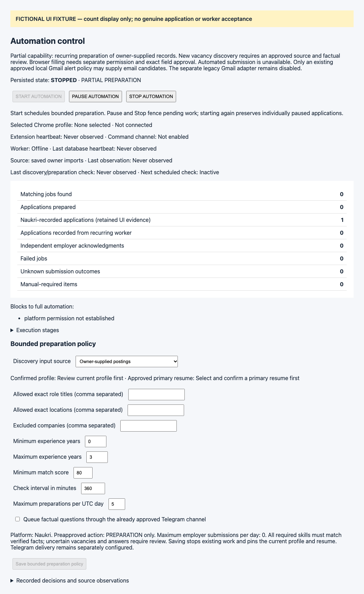

# Naukri worker milestone: truthful receipts and bounded source diagnosis

**Implementation PASS locally; Naukri unattended phase OPEN / BLOCKED.**
The genuine QTrino receipt is preserved. No new application, upload, browser
submission, installation, merge, hosted Action or cleanup occurred.

Repository `karanagg166/automated-apply`; branch
`fix/live-prepare-discovery-20261030`; base `main`;
[PR #48](https://github.com/karanagg166/automated-apply/pull/48).
Implementation: [`a3472fcebe389ab4ec03739095cc4a841185a6c9`](https://github.com/karanagg166/automated-apply/commit/a3472fcebe389ab4ec03739095cc4a841185a6c9),
including initial change
[`927aea8a6dac0fa5807405d063ffe6c0cd2d91da`](https://github.com/karanagg166/automated-apply/commit/927aea8a6dac0fa5807405d063ffe6c0cd2d91da).
The report commit is documentation only; it does not authorize installing either
the implementation or the moving PR head.
[Sanitized machine-readable evidence](naukri-worker-receipts-discovery-metrics-20261031.json).

## What changed

- `backend/app/execution/naukri_receipts.py` reads existing
  `naukri_receipt:<requisition>` records without rewriting their contents,
  importing a human report or promoting a packet. Exact persistent Application
  Sent observations count separately from installed recurring-worker submissions
  and independent employer acknowledgments. Validation checks exact identity,
  source/mode, reload persistence, observation time and a private-evidence digest.
  This is a read model of retained operator observations, not a new live provider
  verifier. Aggregate API output contains no candidate facts or private references.
- `execution/recurring.py` includes those observations instead of hardcoding the
  real-platform count to zero. `submitted_confirmed` remains a compatibility alias
  for `naukri_recorded`; use the separate worker/employer counters and provenance
  when evaluating acceptance. The new counters do not count mock-employer receipts.
- `execution/store.py` fences exact requisitions with retained receipt records
  even after a changed URL slug or lost local job status. Damaged/incomplete
  observations do not count as sent but still prevent replay pending reconciliation.
  Original receipt and packet lifecycles remain unchanged.
- `integrations/gmail/job_alerts.py` persists listed/previously processed message
  counts, rejected topics, authenticated messages without direct links and whether
  more pages remain. It also retains a fixed failure code and stage after recovery;
  arbitrary exception text is never saved. Success clears current error but keeps
  last failure. A superseded lease cannot write diagnostics into a successor policy.
  Sender/body selection, maximum five selected messages, page/date cursors,
  authentication checks and Stop/account/policy fences remain in force.
- `execution/naukri.py` explicitly reports recurring submission as
  `BLOCKED_PLATFORM` and the native chooser path as `NEEDS_HUMAN`. Initialization
  is required; file selection can itself submit. It claims neither a verified
  unattended upload nor locked-screen capability.
- `execution/contracts.py`, `frontend/src/features/naukri-automation.tsx` and
  regenerated `frontend/src/types/api.d.ts` default new preparation policies to 80.
  The dashboard distinguishes platform/worker/employer counts and the approved
  local Gmail source from the disabled legacy adapter. No cosmetic redesign.
- Regression files: `backend/tests/test_naukri_receipts.py`,
  `test_local_gmail_discovery.py`, `test_execution_naukri.py`, and
  `frontend/tests/naukri-automation.test.tsx`.
- [Scope, smallest next implementation plan, pending executor contract, upload
  investigation and ready-to-send permission request](naukri-unattended-plan-and-permission-20261031.md).



The screenshot renders the actual React component using fictional props, simple
fixture styling and isolated headless Chromium with network requests blocked.
It contains no applicant screenshot, real profile, employer session or resume.

## Actual Mac and online evidence

The required seven QTrino, installation and recurring reports were read before
implementation. The checkout started clean at
`040c336e9ab5994fa9211a05501c325f36057ea8`, matching PR #48. The current owned
checkout was reused and its shared registry updated. No other active worktree,
archived checkout, installed source or private configuration was edited.

**Receipt:** a read-only transaction on the existing approved online PostgreSQL
target read the preserved exact-QTrino record. The new read model returned:
**1 Naukri-recorded / owner-authorized software-operated UI application,
0 installed recurring-worker submissions, 0 employer acknowledgments,
0 malformed records.** It did not revisit Naukri, click Apply, upload or modify
any evidence. The [historical provider observation](qtrino-first-genuine-receipt-20261031.md)
remains the source; this read is not a fresh provider confirmation. The old
installed API still displays zero because the correction has not been installed.

**Source, bounded observations:** the existing approved local account's policy
was enabled at version 1, polling every 900 seconds. An actual metadata-only Gmail
list used exactly its saved Inbox/exact-sender/time query, with limit five. It
returned **0 listed messages, 0 already processed, no next page** for
`2026-10-29T19:49:20Z` through `2026-10-30T20:04:28Z`; no message body or linked
page was read, cursor advanced or policy broadened by this diagnostic. That
selected zero is explained by no matching messages in that exact query, not a
parser rejection or dedupe-only cycle. It does not establish coverage of other
senders, archived mail or dates outside the approved query.

Later live status showed `gmail_alert_cycle_failed` at
`2026-10-30T20:19:51.496754Z`. The installed release retains only a generic code;
**its cause is unproven**. It occurred around the policy change below, but timing
does not prove policy fencing caused it. One bounded normal sync through the
installed approved local-source endpoint returned **HTTP 200 / observed,
0 messages, 0 authenticated, 0 links, 0 candidates, submitted=false,
links_opened=false**. This is a real allowed source cycle, not a fixture or a new
mailbox grant. The failure is preserved here instead of erased by the successful
check. The new stage/fixed-code diagnostics are for future cycles after installation.
No new genuine opportunity was available for matching or preparation acceptance.

**Requested policy correction:** live preparation policy was 90, contrary to the
requested minimum 80. Preflight read all persisted browser command/task records
and found **0 active browser operations**. Through the existing installed API,
only `minimum_match_score` changed to 80; policy save and Start each returned
200, advancing automation revision **22 → 24**, ending RUNNING. All other policy
fields were verified unchanged. A later status GET independently showed 80,
worker online and **max_applications_per_day=0 / submission_permission=false**.
Existing individually paused browser tasks were not resumed. No release changed.

**Installation inventory:** all four API/frontend/execution/Telegram LaunchAgent
program references still identify
`90f2f2ade50a1c31b26ca85cc7fdf5e93bb67c20`; all retain their existing
restart-on-failure configuration and 30-second throttle. The Chrome native-host
definition/wrapper also references 90. Profile 8's persisted extension path still
identifies historical `b06909293b1866e8191277d17fc284c398b4307b`. Against the current
extension source, **15/18** files match; `background.js` and `task-coordinator.js`
differ and `tab-audit.js` is missing. Runtime reload was not verified. No extension
file, protected Chrome preference, profile binding, permission or native-host file
was changed. History correction `98965f7` and newer preparation notices remain
uninstalled, alongside this milestone.

**Resource/lock scope:** one bounded PostgreSQL sample showed role limit **5**
and **5 sessions including the operator audit**. Each operator engine used
NullPool, a single connection at a time, and closed on completion; no runtime
pool or role limit changed. This snapshot is not an extended connection-leak
acceptance run. Available Mac telemetry reported **UNLOCKED**. No lock/unlock,
Chrome interruption, production service restart or power-setting change occurred.

## Local test counts and failures retained

Final backend run: **178 passed, 0 failed, 0 skipped in 16.41 s**,
across the eight files in the reproduction command below. New coverage in this
milestone is **20 backend cases** (16 retained-receipt cases and four source
diagnostic cases); other cases are existing regression coverage. Fresh worker
sessions commit and reclaim actual persisted fictional records: confirmed and
incomplete receipt evidence both fence a replay while another job remains
claimable. No isolated SQLite fixture contains real candidate data.

Frontend: an initial `pnpm ... test -- ...` invocation ran the full suite:
**285 passed across 37 files in 21.58s**. After the final Gmail copy correction,
the focused command correctly selected **6 passed across 1 file in 1.16s**.
These overlap; do not add them together. One frontend case is new. Typecheck,
Ruff E9/F/I, changed-file Prettier and `git diff --check` passed. API schema/type
regeneration changed only the score default. No new dependencies or migration.

Preserved diagnostic failures, resolved or bounded:

- One initial ORM audit imported model metadata before configuring the selected
  schema, causing `UndefinedTableError` / SQLSTATE `42P01`. Correct configuration
  before model import fixed the operator probe. No table was created or changed.
- One status probe used `/api/v1/gmail/accounts` and returned 404; it was an
  incorrect diagnostic path. The bounded sync used the real existing route below.
- Initial changed-file Prettier check failed; formatting was corrected.
- The additional failure-history test initially expected an old lease to write
  diagnostics after policy replacement: **177 passed / 1 failed, 15.87s**. The
  assertion was corrected to require no write to the successor policy. The
  implementation's stronger ownership fence was preserved; final results above
  include the regression.
- The live generic Gmail-cycle failure described above recovered for the one
  bounded normal sync; its original cause remains unknown. Do not call it a
  proven software fix or sustained source-health acceptance.

No production performance optimization or comparative workload was performed.
The initial live workflow GET returned 200 in 4.985s under the existing 12-second
deadline; the erroneous route returned 404 in 0.021s. Local test wall times and
one role-session snapshot are not before/after runtime benchmarks. Timing/resource
comparisons and extended uptime are **NOT TESTED**.

## Reproduction

```sh
backend/venv/bin/python -m pytest \
  backend/tests/test_naukri_receipts.py \
  backend/tests/test_local_gmail_discovery.py \
  backend/tests/test_naukri_recurring.py \
  backend/tests/test_execution_naukri.py \
  backend/tests/test_naukri_ready_workflow.py \
  backend/tests/test_naukri_reviewed_facts.py \
  backend/tests/test_application_handoff.py \
  backend/tests/test_application_packet_review.py -q

backend/venv/bin/python -m ruff check --isolated --select E9,F,I \
  backend/app/execution/naukri.py backend/app/execution/naukri_receipts.py \
  backend/app/execution/contracts.py backend/app/execution/recurring.py \
  backend/app/execution/store.py backend/app/integrations/gmail/job_alerts.py \
  backend/tests/test_naukri_receipts.py backend/tests/test_local_gmail_discovery.py \
  backend/tests/test_execution_naukri.py
pnpm -C frontend exec vitest run tests/naukri-automation.test.tsx
pnpm -C frontend typecheck
pnpm -C frontend exec prettier --check \
  src/features/naukri-automation.tsx tests/naukri-automation.test.tsx
backend/venv/bin/python backend/scripts/export_openapi.py
pnpm -C frontend api:types
git diff --check
```

Live inspection is read-only except the explicitly requested threshold setting
and the already-approved source's normal cursor/token maintenance. Use the
authenticated owner API `GET /api/v1/execution/naukri` and
`GET /api/v1/browser/chrome-profiles`. The existing bounded source-sync endpoint
is `POST /api/v1/integrations/gmail/local/accounts/1/job-alerts/sync`; use only the
already approved slot/policy, without broadening sender/body/folder/date scope.
Do not put authentication headers, configuration values or raw responses into
public commands or logs. For preserved receipt reproduction, read exact existing
evidence; **never click Apply or re-upload to QTrino**.

## Acceptance matrix and exact next actions

| Requirement | Verdict | Evidence / missing work |
| --- | --- | --- |
| Preserve genuine QTrino software-operated UI receipt | PASS live retained evidence | One exact persisted record; no mutation or replay |
| Truthful platform/worker/employer counts | PASS fixtures + read-only online projection | 1 / 0 / 0; installed API correction awaits deployment |
| Receipt replay fence through worker restart | PASS fixtures | Fresh sessions, persisted lease/receipt, other job still claimable |
| Real Chrome crash/restart recovery | NOT TESTED | No Chrome restart; existing binding/fencing code unchanged |
| Approved real alert query | PASS bounded empty observation | Metadata list zero; later real normal sync zero |
| Continuous discovery source health | NOT ACCEPTED | One generic failure then one healthy bounded sync; no sustained window |
| New genuine candidate → match → prepare | NOT TESTED | Zero new real candidates; fixture workflow regression passes |
| Minimum score 80 | PASS installed configuration | API save/Start and later status; submission cap still zero |
| Applicable Naukri recurring submission permission (A) | BLOCKED | [Precise provider request prepared](naukri-unattended-plan-and-permission-20261031.md#one-precise-owner-action-send-this-request-to-naukri); not sent or granted |
| Installed unattended discover/prepare/submit executor (B) | BLOCKED / NOT IMPLEMENTED | This code fixes evidence/source diagnosis; full worker stages and standing submission policy remain pending |
| Unattended resume/questions while locked (C) | BLOCKED / NOT TESTED | Native chooser is NEEDS_HUMAN; browser-only candidate unverified; no new genuine UI flow |
| Multiple distinct worker-recorded applications (D) | NOT MET | Lifetime 1 supervised QTrino application, 0 recurring-worker submissions |
| Stop/Pause, answer provenance and notification outbox (E) | PASS relevant fixtures; live incomplete | Existing targeted regressions pass; no new genuine Telegram receipt or locked Stop test |
| Connection limit | PASS one live snapshot only | Five including operator; no pool increase or sustained-window claim |
| Extended awake/locked unattended run (F) | NOT TESTED | Screen observed unlocked; no duration/24-7 claim |
| Installed compatible extension | FAIL persisted-path/content check | Historical path, 15/18 files; owner standard cutover and runtime evidence required |
| Full consolidated release build/install acceptance | NOT TESTED / NOT INSTALLED | Source candidate only; review/build/exact-SHA approval required |
| Hosted CI, merge, production release, cleanup | NOT PERFORMED | All three workflows remain manual-only; no dispatch |

The next owner/provider action is the single prepared permission request. In
parallel, the next permitted code increment is the Naukri-specific stage and
upload admission implementation described in the plan, with real submissions
disabled. No other platform or migration phase was started.

## Rollback / preservation

There is no new installed release to roll back. Keep approved90, all historical
releases, native-host files, LaunchAgents, private state and rollback backups.
The development changes can be reverted through a reviewed ordinary Git revert;
do not reset a dirty checkout or delete worktrees. Reverting code must not remove
the genuine QTrino receipt or its existing applied status. The score-80 preference
is the owner's requested configuration, not an accidental release side effect;
retain it unless the owner changes it.

For a later authorized deployment, preserve installation references and build an
immutable exact-SHA candidate before changing them. Follow the existing
[installation/rollback review](history989-installation-approval-20261030.md) and
[stable extension procedure](../extension-stable-path.md), using the newly
reviewed consolidated SHA rather than assuming the older 989 approval packet or
this PR head grants installation authority. Production replacement and cleanup
remain separate owner boundaries.
