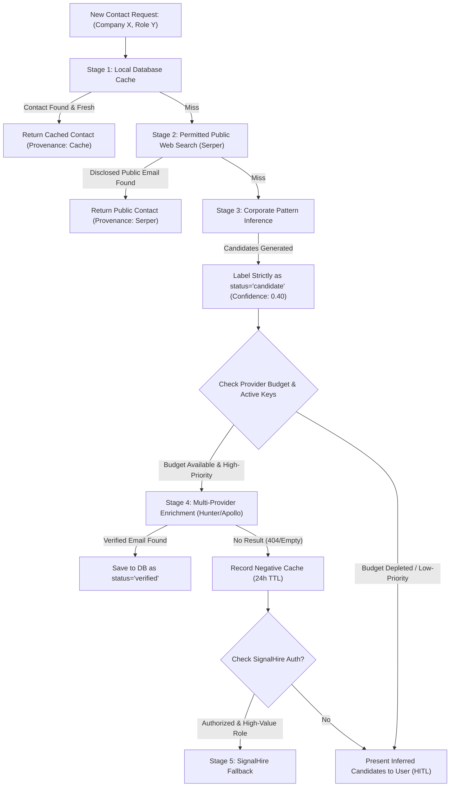

# System Architecture — Job Pulse Agent

Phase 10 adds an explicitly launched discovery worker sharing PostgreSQL with the existing
API. A singleton schedule lock bounds global admission; source executions use durable
leases/fences, existing adapters/pacing/ingestion and approved-profile matching. The
existing Next.js Discover page manages it. No API-startup recurring task or message broker
is introduced. See [Phase 10](phase10-automation.md) for the current execution diagram,
failure semantics, new tables and separately reviewed security overlay. Live activation
remains disabled and unauthorized.

> The diagrams include future components. See the implementation status below and the roadmap for what exists today.

## 1. Executive Summary

`job-pulse-agent` is an intelligent, privacy-first job discovery and recruiter outreach platform. It bridges multi-source job aggregation, deterministic & LLM-assisted matching, a 5-stage contact enrichment waterfall, and human-supervised cold outreach through official Gmail APIs.

---

## 2. Component Architecture

```text
                                  ┌───────────────────────────────┐
                                  │      User / Developer         │
                                  └───────────────┬───────────────┘
                                                  │
                                                  ▼
                                  ┌───────────────────────────────┐
                                  │    Next.js Frontend (Ph 4)    │
                                  │   Dashboard + AI Chat Studio  │
                                  └───────────────┬───────────────┘
                                                  │ HTTP / SSE / REST
                                                  ▼
                                  ┌───────────────────────────────┐
                                  │       FastAPI Backend         │
                                  │   Routing, Health, Auth, CORS │
                                  └───────┬───────────────┬───────┘
                                          │               │
                        ┌─────────────────┴─┐           ┌─┴─────────────────┐
                        ▼                   │           │                   ▼
         ┌──────────────────────────────┐   │           │   ┌──────────────────────────────┐
         │     FastMCP Tool Server      │   │           │   │    Task Scheduler / Queue    │
         │ AI Tools with HITL Guardrails│   │           │   │ Periodic Discovery / Alerts  │
         └──────────────┬───────────────┘   │           │   └───────────────┬──────────────┘
                        │                   │           │                   │
                        ▼                   ▼           ▼                   ▼
    ┌───────────────────────────────────────────────────────────────────────────────────┐
    │                                  Service Layer                                    │
    │  ┌───────────────────────┐  ┌───────────────────────┐  ┌───────────────────────┐  │
    │  │ Job Matching Engine   │  │ Enrichment Waterfall  │  │ Credit Budget Manager │  │
    │  └───────────────────────┘  └───────────────────────┘  └───────────────────────┘  │
    └─────────────────────────────────────────┬─────────────────────────────────────────┘
                                              │
                                              ▼
    ┌───────────────────────────────────────────────────────────────────────────────────┐
    │                                Repository Layer                                   │
    │      CompanyRepository │ JobRepository │ ContactRepository │ CreditRepository     │
    └─────────────────────────────────────────┬─────────────────────────────────────────┘
                                              │
                                              ▼ Direct asyncpg Connection (Port 5432)
    ┌───────────────────────────────────────────────────────────────────────────────────┐
    │                               Supabase PostgreSQL                                 │
    │   ┌───────────────────────────────────────────────────────────────────────────┐   │
    │   │                        SCHEMA: job_agent (Isolated)                       │   │
    │   │   companies │ jobs │ contacts │ api_keys_pool │ provider_usage_logs       │   │
    │   │   outreach_logs                                                           │   │
    │   └───────────────────────────────────────────────────────────────────────────┘   │
    │                                                                                   │
    │   ┌───────────────────────────────────────────────────────────────────────────┐   │
    │   │                        SCHEMA: public (Untouched)                         │   │
    │   │   Existing production applications / tables completely untouched          │   │
    │   └───────────────────────────────────────────────────────────────────────────┘   │
    └───────────────────────────────────────────────────────────────────────────────────┘
```

---

## 3. Data Flow & Subsystems

### 3.1 Subsystem Boundaries

| Subsystem | Responsibility | Protocol / Interface |
| :--- | :--- | :--- |
| **Frontend** | Dashboard metrics, manual job triage, outreach approval UI, AI chat. | Next.js 14, React, Tailwind, Vercel AI SDK |
| **FastAPI Core** | REST API endpoints, health & readiness probes, middleware, authentication. | HTTP REST, OpenAPI, JSON |
| **FastMCP Layer** | Model Context Protocol tools for AI agent orchestration. | FastMCP 4.1.0 authenticated, opt-in Streamable HTTP ASGI mount |
| **Domain Services** | Matching calculations, email candidate generation, credit quota tracking. | Pure Python, Async, Pydantic v2 |
| **Database** | ACID transactional persistence, schema-isolated PostgreSQL tables. | SQLAlchemy 2.0 (asyncio), asyncpg |

### 3.2 5-Stage Contact Enrichment Waterfall



---

## 4. Security & Privacy Architecture

1. **Zero Raw Secrets in Source Code or Logs:**
   All sensitive credentials (API keys, tokens) are either loaded via `env:VAR_NAME` or encrypted at rest using AES-128-CBC via Python `cryptography.fernet`.
2. **Schema Isolation:**
   All tables live strictly within `job_agent`. The default `public` schema used by existing applications is never modified or dropped.
3. **Strict Human-in-the-Loop (HITL) Outreach:**
   Generating an email draft **never** authorizes sending. The database state machine requires an explicit transition to `approved` before any outbound SMTP/Gmail request can be dispatched.
4. **Idempotent Background Jobs:**
   Deduplication is enforced by unique constraints on canonical job URLs (`job_agent.jobs.job_url`) and `(company_id, email)` tuples.


## Candidate profile foundation (implemented)

`GET/PUT/PATCH /api/v1/profile` and `POST /api/v1/jobs/{job_id}/match` use an isolated bearer
authentication dependency. `JOB_AGENT_API_TOKEN` comes from server configuration, is held as
SecretStr, compared in constant time, and is never included in responses. Missing configuration
fails closed with 503. Authentication runs before payload parsing; requests are bounded to 64 KiB.
Profile responses use `Cache-Control: no-store`. At the Phase 1 milestone MCP tools required explicit inputs and
cannot retrieve persisted candidate data through their unauthenticated mount.

The route calls `CandidateProfileService`, then `CandidateProfileRepository` with an injected
AsyncSession. The existing session dependency owns commit/rollback. There are no repository commits.
The `job_agent.candidate_profiles` table holds one unique `primary` record, UUID, timestamps, version,
identity columns and bounded JSONB career collections/preferences (JSON in SQLite). Production DDL
is migration 002; it creates only `job_agent` objects and enables RLS without client policies.
The PostgreSQL job skills mapping uses the TEXT[] already declared by migration 001.

Updates perform an atomic `UPDATE ... WHERE version = expected_version`. A conflicting update
returns 409; changed PUT/PATCH requires a quoted numeric If-Match ETag. The database trigger also
advances versions for direct SQL updates. No-op requests preserve versions and timestamps.
PUT has complete replacement semantics. PATCH merges only present fields and nested preference
properties, with explicit null permitted only for truly nullable fields. Lists replace as a whole.

Career facts are user-asserted as verified, not independently verified by the system. Preferences
are separate from those facts. Missing values stay null or empty lists; an empty list means no
recorded facts, not evidence of absence. No AI recommendations are stored or generated in this phase.
A profile needs a name and valid email; missing optional career information does not prevent matching.
Unknown experience receives no seniority points and is explained as unknown. Draft generation omits
unknown answers and uses only supplied facts, without assuming authorization, notice period or skills.

The Phase 1 profile adapter preserves the legacy scorer. Phase 2B adds explicit remote policy and a
separate discovery preference overlay for salary, exclusions, employment types and observed stage.
Industry matching awaits reliable company evidence. The jobs list now requires authentication;
discovery runs retain profile-versioned rankings without overwriting human notes or decisions.

## Future account boundaries

LinkedIn discovery must use authorized or otherwise permitted access. Connection requests, messages
and applications remain manual; no authenticated scraping or automated account actions are introduced.
Gmail outreach needs review and explicit sending approval. Naukri, Instahyre, Wellfound, YC Work at a
Startup and Internshala integrations and eligible submission automation are later work. Apollo and
SignalHire use this profile foundation through the modular backend. Tokens,
passwords, provider keys, browser credentials and session cookies do not belong in profile records.

## Phase 2A answer engine (implemented)

The existing FastAPI application includes authenticated candidate-resource, evidence and answer
routes, using the same `ProtectedProfileRoute` and bearer boundary as Phase 1. Existing MCP tools
are unchanged and cannot access the new private storage through the public MCP mount.

`ApplicationAnswerService` routes through the deterministic question classifier and link resolver
before considering a provider. Exact facts require no AI credentials. Relevant confirmed facts
are ranked deterministically; project narratives require purpose and actual contribution, plus
challenge/solution when requested. Job descriptions are untrusted opportunity context, never
candidate evidence. Missing facts return `needs_input` without a paid call.

`ApplicationLLMProvider` isolates SDK details. `GeminiProvider` uses the supported google-genai async
structured-output API with a configured model, separate system instructions and no tools or URL
fetches. Length, evidence reference/quote, name, number and conservative claim checks run on the
server. Schema validity does not establish factual correctness; every narrative requires review.

Migration 003 adds candidate_resources, candidate_evidence, application_answer_drafts and
llm_monthly_usage to `job_agent`. Standard GitHub/LinkedIn/portfolio columns remain authoritative;
the resource table excludes duplicate standard storage. One primary per profile/type and URL
deduplication are database-enforced. New tables have RLS and no Supabase client access policies.

Request/draft transactions remain caller-owned. The deliberate exception is `LLMUsageManager`,
which atomically reserves each provider attempt and records reported token usage in independent
transactions. This makes the UTC monthly cap durable across failures and shared across workers.
Durable provider cooldowns honor Retry-After across workers and month boundaries.
The overall timeout includes queuing and retries; concurrency is bounded per worker. Drafts are
saved only on explicit request, and profile-version staleness never rewrites reviewed content.

See [the detailed API, validation and operational guide](ai-application-answer-engine.md).
No browser filling, deployment, production DDL, OAuth, downloads, outreach or submissions are added.

## Phase 2B discovery architecture

Protected REST requests enter `JobDiscoveryService`: saved-profile query defaults → typed source
registry → bounded adapter → per-record normalization → identity resolution → savepoint ingestion
→ deterministic preference ranking. Run claims commit independently before provider access; jobs,
observations and successful final audit state commit together. Paid reservations commit independently
and survive failed/cancelled requests. See [pipeline details](job-discovery-pipeline.md).

`job_agent.jobs` retains legacy columns and adds v2 metadata. Separate observation rows retain every
source link; known ATS URLs and exact company/role/location/content evidence merge conservatively.
Possible duplicates remain separate. PostgreSQL advisory transaction locking plus unique indexes
protect concurrent ingestion. Human application status, shortlist decisions and notes remain intact.

`discovery_runs` records bounded explicit operations. `discovery_monthly_budgets` and
`discovery_budget_reservations` account for Apify dollar caps and Serper query credits atomically.
`discovered_company_people` stores public profile evidence independently of enriched contacts. No
new queue, scheduler, outbound messaging or privileged MCP discovery tool is introduced. The legacy
jobs list now requires bearer authentication to protect candidate-specific fields. Source fetch,
ingestion and connectivity functions are no longer registered on the unauthenticated MCP transport.

Public people discovery calls only a configured search API; user/company/LinkedIn URLs are validated
and stored but never fetched. Manual action URLs and ambiguous evidence require human review.
Existing `ApplicationAssistant` and Gemini answer-generation contracts remain separate from discovery.

## Phase 3 contact enrichment foundation

The protected contact router uses `contact_enrichment.service` to bridge existing contacts and `DiscoveredPerson` observations. The local-first waterfall chooses explicit providers through a capability factory. Apollo matching is synchronous with reveal/waterfall disabled; SignalHire uses synchronous `withoutWaterfall`. No enrichment or cached-contact tool is exposed by MCP.

`contact_enrichment_runs` records idempotency and outcomes; `contact_evidence` preserves observations and verification claims; `contact_identities` holds company-scoped provider/profile mappings. Company-row locks and unique mappings guard reconciliation. `contact_provider_lookups` commits before HTTP to prevent repeated billable work after restart. Shared `DiscoveryBudget` reservations and existing `CreditManager` usage audit commit independently of contact ingestion. Unknown actual billing stays distinct from estimates. No synthetic ApiKeyPool balance is seeded.

Suppression and human corrections live on the existing contacts table. Ranking reports evidence-derived categories and contextual role relevance; guessed addresses stay separate. See [contact enrichment](contact-enrichment.md) for the provider matrix, retention maintenance and API contract. Migration 005 has no production execution hook.


## Phase 4A implementation status (supersedes earlier MCP/outreach descriptions)

One FastMCP 4.1.0 instance exposes stateless Streamable HTTP at `/mcp/`, disabled by default.
A full-path ASGI boundary plus native token/authorization middleware protects initialization,
listing and calls; read/draft wrappers additionally authorize independently. Ordinary REST
bearer credentials are not accepted by MCP. Legacy mutation/provider tools are unregistered.

REST and MCP call shared saved-data, profile, contact read/ranking and outreach services.
REST Gemini composition uses the Phase 2A provider/budget infrastructure; MCP drafts use exact
saved contributions without paid calls. Contact suppression, evidence expiry, employer checks
and speculative-email guards apply inside the service, not just in HTTP dependencies.

The integrations API owns a single secondary Gmail connection. Durable hashed OAuth state,
an encrypted PKCE verifier, browser-binding cookie and connection-generation locks protect the
callback independently of bearer headers. Google UserInfo and Gmail profile verify identity.
A separate versioned Fernet keyring encrypts refresh and access tokens; API/MCP views never
serialize credential models. Scope is metadata plus OpenID/email, with no mailbox body/write API.

Additive migration 006 creates `connected_accounts`/`oauth_states` and extends `outreach_logs`
with snapshots, revisions, idempotency and approval hashes. RLS denies client roles. PostgreSQL
triggers preserve legacy history, invalidate approvals on direct material edits and reject
fake delivery fields/sent transitions. Approvals record review only; future sending must recheck.

See [MCP security](mcp-security-and-tools.md), [Gmail OAuth](gmail-oauth-connection.md), and
[outreach drafting](outreach-drafting.md) for current contracts and operational limits.
No production migration/deployment or real account/provider verification is implied.

## Phase 4B approved sending

The owner-only REST send preview uses the existing drafting eligibility/evidence service and
Gmail connection. It persists a hashed five-minute consent binding the exact revision, message,
evidence, recipient, sender authorization and owner. A separate authenticated send request
consumes consent atomically with a permanent unique attempt. PostgreSQL advisory/row locks
serialize claims, account changes, eligibility updates and rolling sending caps across workers.
Prepared and attempting states commit before Gmail; no worker resumes them after a crash.

The narrow Gmail adapter emits plain-text RFC MIME and invokes users.messages.send once.
Ambiguous transport/server/response/persistence outcomes require manual reconciliation; there
is no retry, bulk send, follow-up, mailbox search or delivery/read tracking. Accepted responses
update the immutable attempt and mirror provider IDs/acceptance time to OutreachLog without
changing its reviewed revision. Historical messages survive suppression and disconnect.
Migration 007 adds confirmations/attempts and controlled OAuth upgrades, superseding the 006
draft guard in place. No public-schema writes or deployment/migration hooks are introduced.
See [approved Gmail sending](gmail-approved-sending.md) for protocol, limits and operations.

## Phase 5A standalone application preparation

Automated Apply is a modular monolith with FastAPI as its primary service, PostgreSQL as the system
of record, the existing FastMCP instance as an authorized read interface, and Gemini as the configured
AI provider. The `apply-extension` repository is not a dependency or part of the approved scope.
There is no browser worker, broker, extension bridge, extra server or portal login client.

`services/applications` assembles a saved-data preview and persists a separate packet domain through
`ApplicationPacketRepository`. The platform registry supplies a Naukri capability adapter; field
mapping, review, readiness and tracking stay platform-independent. Saved observation links can
establish Naukri provenance even when the canonical job uses an employer ATS URL. Source-label/host
conflicts stay visible. URLs are locally validated, retained exactly in the snapshot, and never fetched.

`AnswerBuilder` delegates classification, saved facts, retrieval, Gemini budgets/validation and
optional `ApplicationAnswerDraft` storage to the existing engine. Narrative generation is an explicit
REST action. The packet snapshot stores typed candidate facts, resume ID/version digest, match
results, destination and a digest of material candidate/job/company/resource/evidence dependencies.
Readiness, approval and handoff recheck those dependencies; updates never silently rewrite approvals.

Migration 008 creates `application_packets`, `application_packet_fields`, `application_events` and
`application_submission_evidence` in `job_agent`, with RLS and no client policies. Database uniqueness
deduplicates candidate/job packets and durable request keys; row locks plus revision CAS serialize
edits and reports. Parent/field triggers invalidate direct edits, enforce approval prerequisites and
reject false provider confirmations. Events and self-reported evidence are append-only. Restrictive
foreign keys preserve jobs, profiles and selected resume resources used in audit history.

REST transactions own all packet mutations; failures roll back packet, field and event together.
Existing independent Gemini quota reservations intentionally survive a failed request. Read-only
MCP tools use `read_applications`, confer no approval/submission/Gmail authority, and work through
the same service. REST remains available with remote MCP disabled. A handoff GET is read-only;
only an explicit owner report creates self-reported submission evidence. `Job.status` is unchanged.
See [the detailed contract](application-preparation.md) for lifecycle, examples and verification.

## Phase 6A implementation: startup intelligence

`StartupDiscoveryService` composes existing `JobDiscoveryService`, `JobIngestionService`,
`JobDiscoveryMatcher`, `CandidateProfileService`, company repositories and cached contact reads.
Its company-first path accepts typed, permission-confirmed observations directly into canonical
companies; it creates no fake job. Unsupported directory access is explicit. Job-led runs retain a
child job-discovery run so source failures, reservations and provider IDs remain auditable even if
subsequent company ranking fails. Company snapshots and parent final state commit together;
child job runs commit independently and remain inspectable after parent failure.

The protected startup router and five read-only FastMCP tools share these services. Existing people
research and contact routes remain the execution boundaries for optional founder research/enrichment.
`PublicSearchAdapter` is the sole Serper HTTP client. Official-domain research and separately
permission-gated profile research feed the existing contact identity/evidence pipeline; suppression,
human corrections, uncertain employer association, freshness and mailbox distinctions are preserved.

Migration 009 adds company snapshots, reviewed shortlist entries, connector diagnostics and atomic
provider pacing in `job_agent`; existing discovery runs, companies/jobs and contact tables are reused.
No production migration, crawler/browser service, broker, second database, extension, auto-apply or
outbound-message automation is introduced. The temporary SQLite demo is test isolation, not a new
production datastore. See [startup documentation](live-startup-discovery.md) for exact current scope,
including source permissions and evidence from bounded actual public checks.

## Phase 6B operational boundary

`operations/` composes existing services for configuration/catalog inspection, onboarding,
provider diagnostics and bounded pilots. It does not add another discovery/LLM subsystem or
migration history table. Pydantic reports separate configured and live evidence; operator
commands reject production database connections and require a pinned staging identity.
Catalog inspection is READ ONLY; migration application remains a separately reviewed owner action.

The single container runs FastAPI behind trusted HTTPS ingress with PostgreSQL. Remote MCP is
optional/off, Gmail sending defaults off, paid requests require existing per-call gates, and all
applications end at human-reviewed manual handoff. The packet registry adds narrow public-feed
local preparation while retaining Naukri support; explicit safe source-backed application URLs
are necessary. No company domain/headcount/application destination is inferred to fill a gap.
See [operational runbook](phase6b-operations.md) and [deployment security limits](security-deployment-review.md).


## Phase 7 owner workspace

The Next.js App Router application is in the same repository and delegates backend workflows to FastAPI. Browser → same-origin authenticated BFF → existing private owner REST services → PostgreSQL. Backend bearer and provider credentials remain server-side. Signed HttpOnly sessions, exact Host/Origin checks and session-bound CSRF protect the single-owner access boundary.

Startup search extends the existing evidence service with exact numeric headcount and submission-aware filters. Application lifecycle/review and Gmail challenge protocols remain unchanged. Existing candidate resources support encrypted private-resume download references separately from public profile URLs. Migration 010 adds owner-only encrypted imports, notifications and preferences with RLS/client-grant denial. No new backend or extension integration exists.

[Frontend](phase7-frontend.md) · [Security](phase7-security.md) · [Deployment](phase7-deployment.md)
