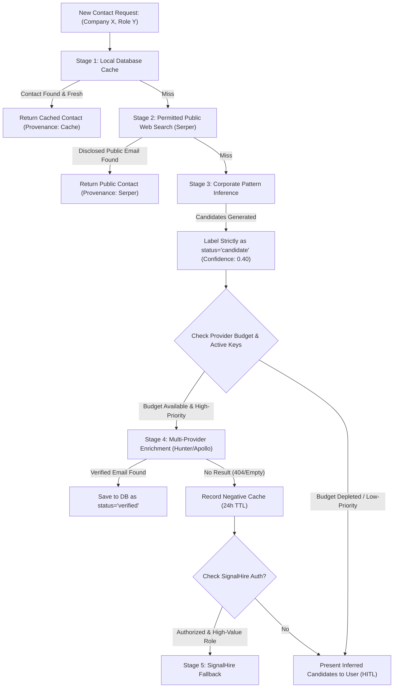

# System Architecture — Job Pulse Agent

## 1. Executive Summary

`job-pulse-agent` is an intelligent, privacy-first job discovery and recruiter outreach platform. It bridges multi-source job aggregation, deterministic & LLM-assisted matching, a 5-stage contact enrichment waterfall, and human-supervised cold outreach through official Gmail APIs.

---

## 2. Component Architecture

```text
                                  ┌───────────────────────────────┐
                                  │      User / Developer         │
                                  └───────────────┬───────────────┘
                                                  │
                                                  ▼
                                  ┌───────────────────────────────┐
                                  │    Next.js Frontend (Ph 4)    │
                                  │   Dashboard + AI Chat Studio  │
                                  └───────────────┬───────────────┘
                                                  │ HTTP / SSE / REST
                                                  ▼
                                  ┌───────────────────────────────┐
                                  │       FastAPI Backend         │
                                  │   Routing, Health, Auth, CORS │
                                  └───────┬───────────────┬───────┘
                                          │               │
                        ┌─────────────────┴─┐           ┌─┴─────────────────┐
                        ▼                   │           │                   ▼
         ┌──────────────────────────────┐   │           │   ┌──────────────────────────────┐
         │     FastMCP Tool Server      │   │           │   │    Task Scheduler / Queue    │
         │ AI Tools with HITL Guardrails│   │           │   │ Periodic Discovery / Alerts  │
         └──────────────┬───────────────┘   │           │   └───────────────┬──────────────┘
                        │                   │           │                   │
                        ▼                   ▼           ▼                   ▼
    ┌───────────────────────────────────────────────────────────────────────────────────┐
    │                                  Service Layer                                    │
    │  ┌───────────────────────┐  ┌───────────────────────┐  ┌───────────────────────┐  │
    │  │ Job Matching Engine   │  │ Enrichment Waterfall  │  │ Credit Budget Manager │  │
    │  └───────────────────────┘  └───────────────────────┘  └───────────────────────┘  │
    └─────────────────────────────────────────┬─────────────────────────────────────────┘
                                              │
                                              ▼
    ┌───────────────────────────────────────────────────────────────────────────────────┐
    │                                Repository Layer                                   │
    │      CompanyRepository │ JobRepository │ ContactRepository │ CreditRepository     │
    └─────────────────────────────────────────┬─────────────────────────────────────────┘
                                              │
                                              ▼ Direct asyncpg Connection (Port 5432)
    ┌───────────────────────────────────────────────────────────────────────────────────┐
    │                               Supabase PostgreSQL                                 │
    │   ┌───────────────────────────────────────────────────────────────────────────┐   │
    │   │                        SCHEMA: job_agent (Isolated)                       │   │
    │   │   companies │ jobs │ contacts │ api_keys_pool │ provider_usage_logs       │   │
    │   │   outreach_logs                                                           │   │
    │   └───────────────────────────────────────────────────────────────────────────┘   │
    │                                                                                   │
    │   ┌───────────────────────────────────────────────────────────────────────────┐   │
    │   │                        SCHEMA: public (Untouched)                         │   │
    │   │   Existing production applications / tables completely untouched          │   │
    │   └───────────────────────────────────────────────────────────────────────────┘   │
    └───────────────────────────────────────────────────────────────────────────────────┘
```

---

## 3. Data Flow & Subsystems

### 3.1 Subsystem Boundaries

| Subsystem | Responsibility | Protocol / Interface |
| :--- | :--- | :--- |
| **Frontend** | Dashboard metrics, manual job triage, outreach approval UI, AI chat. | Next.js 14, React, Tailwind, Vercel AI SDK |
| **FastAPI Core** | REST API endpoints, health & readiness probes, middleware, authentication. | HTTP REST, OpenAPI, JSON |
| **FastMCP Layer** | Model Context Protocol tools for AI agent orchestration. | FastMCP 4.x ASGI mount over SSE |
| **Domain Services** | Matching calculations, email candidate generation, credit quota tracking. | Pure Python, Async, Pydantic v2 |
| **Database** | ACID transactional persistence, schema-isolated PostgreSQL tables. | SQLAlchemy 2.0 (asyncio), asyncpg |

### 3.2 5-Stage Contact Enrichment Waterfall



---

## 4. Security & Privacy Architecture

1. **Zero Raw Secrets in Source Code or Logs:**
   All sensitive credentials (API keys, tokens) are either loaded via `env:VAR_NAME` or encrypted at rest using AES-128-CBC via Python `cryptography.fernet`.
2. **Schema Isolation:**
   All tables live strictly within `job_agent`. The default `public` schema used by existing applications is never modified or dropped.
3. **Strict Human-in-the-Loop (HITL) Outreach:**
   Generating an email draft **never** authorizes sending. The database state machine requires an explicit transition to `approved` before any outbound SMTP/Gmail request can be dispatched.
4. **Idempotent Background Jobs:**
   Deduplication is enforced by unique constraints on canonical job URLs (`job_agent.jobs.job_url`) and `(company_id, email)` tuples.
