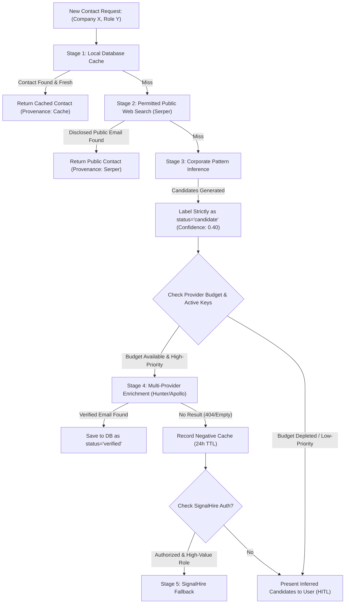

# System Architecture — Job Pulse Agent

> The diagrams include future components. See the implementation status below and the roadmap for what exists today.

## 1. Executive Summary

`job-pulse-agent` is an intelligent, privacy-first job discovery and recruiter outreach platform. It bridges multi-source job aggregation, deterministic & LLM-assisted matching, a 5-stage contact enrichment waterfall, and human-supervised cold outreach through official Gmail APIs.

---

## 2. Component Architecture

```text
                                  ┌───────────────────────────────┐
                                  │      User / Developer         │
                                  └───────────────┬───────────────┘
                                                  │
                                                  ▼
                                  ┌───────────────────────────────┐
                                  │    Next.js Frontend (Ph 4)    │
                                  │   Dashboard + AI Chat Studio  │
                                  └───────────────┬───────────────┘
                                                  │ HTTP / SSE / REST
                                                  ▼
                                  ┌───────────────────────────────┐
                                  │       FastAPI Backend         │
                                  │   Routing, Health, Auth, CORS │
                                  └───────┬───────────────┬───────┘
                                          │               │
                        ┌─────────────────┴─┐           ┌─┴─────────────────┐
                        ▼                   │           │                   ▼
         ┌──────────────────────────────┐   │           │   ┌──────────────────────────────┐
         │     FastMCP Tool Server      │   │           │   │    Task Scheduler / Queue    │
         │ AI Tools with HITL Guardrails│   │           │   │ Periodic Discovery / Alerts  │
         └──────────────┬───────────────┘   │           │   └───────────────┬──────────────┘
                        │                   │           │                   │
                        ▼                   ▼           ▼                   ▼
    ┌───────────────────────────────────────────────────────────────────────────────────┐
    │                                  Service Layer                                    │
    │  ┌───────────────────────┐  ┌───────────────────────┐  ┌───────────────────────┐  │
    │  │ Job Matching Engine   │  │ Enrichment Waterfall  │  │ Credit Budget Manager │  │
    │  └───────────────────────┘  └───────────────────────┘  └───────────────────────┘  │
    └─────────────────────────────────────────┬─────────────────────────────────────────┘
                                              │
                                              ▼
    ┌───────────────────────────────────────────────────────────────────────────────────┐
    │                                Repository Layer                                   │
    │      CompanyRepository │ JobRepository │ ContactRepository │ CreditRepository     │
    └─────────────────────────────────────────┬─────────────────────────────────────────┘
                                              │
                                              ▼ Direct asyncpg Connection (Port 5432)
    ┌───────────────────────────────────────────────────────────────────────────────────┐
    │                               Supabase PostgreSQL                                 │
    │   ┌───────────────────────────────────────────────────────────────────────────┐   │
    │   │                        SCHEMA: job_agent (Isolated)                       │   │
    │   │   companies │ jobs │ contacts │ api_keys_pool │ provider_usage_logs       │   │
    │   │   outreach_logs                                                           │   │
    │   └───────────────────────────────────────────────────────────────────────────┘   │
    │                                                                                   │
    │   ┌───────────────────────────────────────────────────────────────────────────┐   │
    │   │                        SCHEMA: public (Untouched)                         │   │
    │   │   Existing production applications / tables completely untouched          │   │
    │   └───────────────────────────────────────────────────────────────────────────┘   │
    └───────────────────────────────────────────────────────────────────────────────────┘
```

---

## 3. Data Flow & Subsystems

### 3.1 Subsystem Boundaries

| Subsystem | Responsibility | Protocol / Interface |
| :--- | :--- | :--- |
| **Frontend** | Dashboard metrics, manual job triage, outreach approval UI, AI chat. | Next.js 14, React, Tailwind, Vercel AI SDK |
| **FastAPI Core** | REST API endpoints, health & readiness probes, middleware, authentication. | HTTP REST, OpenAPI, JSON |
| **FastMCP Layer** | Model Context Protocol tools for AI agent orchestration. | FastMCP 4.x ASGI mount over SSE |
| **Domain Services** | Matching calculations, email candidate generation, credit quota tracking. | Pure Python, Async, Pydantic v2 |
| **Database** | ACID transactional persistence, schema-isolated PostgreSQL tables. | SQLAlchemy 2.0 (asyncio), asyncpg |

### 3.2 5-Stage Contact Enrichment Waterfall



---

## 4. Security & Privacy Architecture

1. **Zero Raw Secrets in Source Code or Logs:**
   All sensitive credentials (API keys, tokens) are either loaded via `env:VAR_NAME` or encrypted at rest using AES-128-CBC via Python `cryptography.fernet`.
2. **Schema Isolation:**
   All tables live strictly within `job_agent`. The default `public` schema used by existing applications is never modified or dropped.
3. **Strict Human-in-the-Loop (HITL) Outreach:**
   Generating an email draft **never** authorizes sending. The database state machine requires an explicit transition to `approved` before any outbound SMTP/Gmail request can be dispatched.
4. **Idempotent Background Jobs:**
   Deduplication is enforced by unique constraints on canonical job URLs (`job_agent.jobs.job_url`) and `(company_id, email)` tuples.


## Candidate profile foundation (implemented)

`GET/PUT/PATCH /api/v1/profile` and `POST /api/v1/jobs/{job_id}/match` use an isolated bearer
authentication dependency. `JOB_AGENT_API_TOKEN` comes from server configuration, is held as
SecretStr, compared in constant time, and is never included in responses. Missing configuration
fails closed with 503. Authentication runs before payload parsing; requests are bounded to 64 KiB.
Profile responses use `Cache-Control: no-store`. Existing MCP tools require explicit inputs and
cannot retrieve persisted candidate data through their unauthenticated mount.

The route calls `CandidateProfileService`, then `CandidateProfileRepository` with an injected
AsyncSession. The existing session dependency owns commit/rollback. There are no repository commits.
The `job_agent.candidate_profiles` table holds one unique `primary` record, UUID, timestamps, version,
identity columns and bounded JSONB career collections/preferences (JSON in SQLite). Production DDL
is migration 002; it creates only `job_agent` objects and enables RLS without client policies.
The PostgreSQL job skills mapping uses the TEXT[] already declared by migration 001.

Updates perform an atomic `UPDATE ... WHERE version = expected_version`. A conflicting update
returns 409; changed PUT/PATCH requires a quoted numeric If-Match ETag. The database trigger also
advances versions for direct SQL updates. No-op requests preserve versions and timestamps.
PUT has complete replacement semantics. PATCH merges only present fields and nested preference
properties, with explicit null permitted only for truly nullable fields. Lists replace as a whole.

Career facts are user-asserted as verified, not independently verified by the system. Preferences
are separate from those facts. Missing values stay null or empty lists; an empty list means no
recorded facts, not evidence of absence. No AI recommendations are stored or generated in this phase.
A profile needs a name and valid email; missing optional career information does not prevent matching.
Unknown experience receives no seniority points and is explained as unknown. Draft generation omits
unknown answers and uses only supplied facts, without assuming authorization, notice period or skills.

The adapter feeds the existing scorer, preserving scoring weights. Onsite is supported conservatively
using the existing remote flag and location. The job model cannot distinguish hybrid from onsite,
and salary, exclusions, employment types, industries and company stage do not yet affect scoring.
Matching results remain transient to prevent candidate-specific information from appearing through
the unauthenticated jobs listing. Future service/tool access must preserve an authenticated boundary.

## Future account boundaries

LinkedIn discovery must use authorized or otherwise permitted access. Connection requests, messages
and applications remain manual; no authenticated scraping or automated account actions are introduced.
Gmail outreach needs review and explicit sending approval. Naukri, Instahyre, Wellfound, YC Work at a
Startup and Internshala integrations and eligible submission automation are later work. Apollo,
SignalHire and the apply-extension may consume this profile foundation in later phases. Tokens,
passwords, provider keys, browser credentials and session cookies do not belong in profile records.
