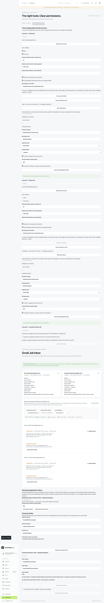

# Three-account Gmail workspace

Implemented for owner review; **not activated**. Do not start real OAuth, scan a mailbox or create a Gmail draft until the corresponding owner authorization. Sending remains disabled.

| Account | Independent grant | Application capability |
| --- | --- | --- |
| Account 1 | Gmail metadata, OpenID and verified email | Read-only application evidence from selected Inbox/Sent pages |
| Account 2 | Its own metadata grant and verified identity | Independent read-only evidence, shared reviewed application history |
| Account 3 | Fresh Gmail compose grant, OpenID and verified email | Explicitly reviewed draft creation only; no send operation |

The dashboard Connections → **Connected Gmail accounts** page manages these roles. No email address is required before OAuth. The Google account chooser determines identity, then the callback verifies it. Read-account uniqueness and the shared account lock prevent connecting one Google identity as both a read mailbox and outreach account. The legacy compose account and its tokens are not reused.

All account connection actions require an explicit account-consent checkbox. OAuth uses browser-bound HttpOnly state, PKCE, one-use durable intent, exact scope validation and connection generations. Optional body access requires a separate account action, the operator body-review flag and the exact read-only grant. It is not part of initial metadata consent. Refresh scope/identity changes fail closed.

## Controlled historical scans

The two read-account cards independently configure Inbox, Sent Mail, optional custom-label IDs, optional sender allowlists and a historical window of 1–24 calendar months. The initial selection is metadata-only and raw metadata retention is 14 days. Custom labels and senders are optional when Inbox/Sent selection is explicit.

Each explicit scan action lists one page of at most **25 message IDs** and processes those IDs within the existing 90-second operation limit. Inbox and Sent are separate streams: label filters are AND, so they must not be combined into one `INBOX,SENT` list request. Durable folder/page cursors, versioned settings, per-account token generations and leases support recovery and invalidate stale selections. There is no automatic historical scan loop.

Gmail metadata scope [does not support the `q` search parameter](https://developers.google.com/workspace/gmail/api/reference/rest/v1/users.messages/list). Metadata scanning therefore checks dates locally while paging the selected folders. It may inspect dates/headers outside the window to locate in-window evidence; only selected, in-window job-related metadata is retained. A small page or a header-only scan cannot establish that all historical applications were found. Archived messages outside Inbox/Sent are not covered by this selection. Bodies require separate consent and purpose; they are not retained.

Possible confirmations, recruiter replies, interview invitations, rejections and updates are visibly **uncertain evidence**, never automatic proof of application or employer status. The owner reviews company, role, date, status and evidence before saving a structured history record.

## Retention and duplicate recommendations

Selected subject/from/to/folder/date metadata is encrypted in the existing protected owner store with a message-specific context. The local retention worker scrubs expired metadata and OAuth intents every minute; API reads also enforce expiration. `GMAIL_RETENTION_ENABLED=true` is required before a scan that retains raw metadata. The worker makes no Google requests.

Reviewed structured history has a separate owner-selected retention period (14–7,300 days), editable in the dashboard, and an explicit Forget action. The editor initially offers 365 days, which is saved only through owner review. Expiring raw metadata does not erase reviewed company/role/date/status or evidence references. Adding uncertain evidence does not erase an already confirmed application. Forget removes its recommendation effect and scrubs the structured record.

History merges across both accounts using canonical job identity where supplied, otherwise exact normalized company/role. Canonicalization preserves requisition query parameters and removes tracking only. Different known job URLs remain distinct. Company/role fallback is less specific and should be reviewed carefully when an employer reuses titles. Only confirmed, unexpired history suppresses a recommendation; uncertain messages do not. The matcher loads the history once per search/run, not once per listing. Existing human application state and source deduplication are preserved.

## Outreach drafts

The outreach card authorizes a third account independently. Google's [compose scope includes sending permission](https://developers.google.com/workspace/gmail/api/auth/scopes), so scope alone is insufficient: this workflow exposes no send operation and never supplies its token to the legacy send service or either read mailbox.

The dashboard prepares personalized **local** drafts from the current owner-approved profile and owner-entered company/role/context, without a paid model call. Recipient, subject and message can be edited locally. Saving in Gmail is a separate explicit action requiring the reviewed content hash, current revision, current profile and outreach-account generation. Edits or account changes invalidate review.

`GMAIL_DRAFTS_ENABLED` defaults to false. With separately authorized activation, the only mailbox write is the documented [`users.drafts.create`](https://developers.google.com/workspace/gmail/api/reference/rest/v1/users.drafts/create) endpoint. A durable dispatch fence precedes the request. Ambiguous timeout, crash or upstream acceptance is never retried automatically; the owner must inspect Gmail before reconciliation. A confirmed replay returns the recorded draft ID without another write. Saved Gmail drafts can be reviewed/edited manually in Gmail. Nothing is sent by the application.

## Migration and activation

The forward SQL remains `backend/scripts/migrations/phase3_gmail_readonly.review.sql`, rendered explicitly for `public` by the existing renderer. It still creates only `gmail_read_accounts` and `gmail_read_oauth_states`, with the existing forced-RLS manifest, private ownership and restricted runtime grants. The forward checksum is unchanged. No live DDL has been applied.

Draft credentials, local drafts, scan settings and reviewed history use separate encrypted/protected namespaces in the existing owner-preference store. No new schema or broader grant is needed for those records. The empty-install rollback additionally refuses to remove the read schema when any workspace account, outreach credential/intent/draft or application history exists. Once populated, use a reviewed repair or verified backup recovery, never DELETE/CASCADE to force rollback.

All flags below default to false:

```dotenv
GMAIL_READ_SYNC_ENABLED=false
GMAIL_READ_BODY_REVIEWED=false
GMAIL_DRAFTS_ENABLED=false
GMAIL_RETENTION_ENABLED=false
GMAIL_SENDING_ENABLED=false
```

Activation order is: exact target/migration approval with verified backup and writer coordination; separately approved installation; independent account consent through Google for each role; reviewed per-account selections; explicit scan or individual draft authorization. Applicable Google app verification or testing/internal-app eligibility must be satisfied for the requested [restricted scopes](https://developers.google.com/workspace/gmail/api/auth/scopes). No email addresses are requested in advance by this application.

The existing [migration operator procedure](phase3/phase35-gmail-operator.md) still governs the DDL transaction, pre/post catalog checks and backup/recovery. Use the updated rollback together with the current code. Private live catalog/clone receipts and exact approval SQL stay outside Git.

## Verification

Tests use fictional accounts and MockTransport. Regression coverage exercises anonymous account selection, browser-state isolation/replay, duplicate identities, independent grants, 24-month folders/page bounds, encrypted metadata, separate expiration, cross-account history merge, conservative job identity, one history read per recommendation run, exact draft approval, disabled writes, idempotent draft receipt and ambiguous-dispatch no-retry behavior.

The real FastAPI + disposable PostgreSQL + production dashboard journey persists history from two fictional accounts, edits a local draft, changes scan policy and verifies that Gmail draft creation remains disabled. The existing job-alert lead review/import UI is retained. No genuine OAuth, Gmail read/write or outreach draft is represented by those fixtures.

Final affected verification: **216 backend tests, 203 frontend tests and 29 combined PostgreSQL Chromium journeys passed**, plus production build, typecheck, formatting, generated API types, Ruff and full-app Bandit. The current-schema clone/rollback and restricted-runtime fictional outreach OAuth checks passed. The original full backend/extension/native receipts remain attached to their original frozen source, not claimed as a full rerun of this expansion.


