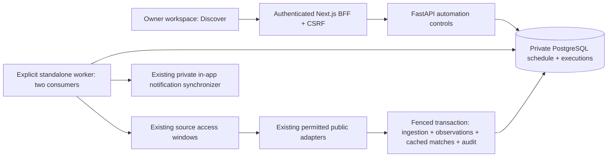

# Phase 10 discovery automation

This is local implementation, with fictional fixtures and mocked HTTP. Live automation
has not been activated. Phase 9 remains incomplete: R1 execution still needs private
credentials and recovery configuration; R2 remains unauthorized. Neither this document
nor the feature flag authorizes production access, migration, onboarding or provider calls.

## Scope and assumptions

Phase 10 was absent from the committed roadmap. This implementation assumes one trusted
owner and the existing FastAPI/Next.js BFF deployment, private `job_agent` PostgreSQL
schema, conservative connection pools, and bounded public discovery batches. It extends
the existing architecture. No Redis, broker, new provider registry, billing ledger, job
identity algorithm, application sender or email notification channel is introduced.

Reused components: `JobSourceFactory`/source registry, direct adapters and their URL,
normalization and attribution checks, `ProviderAccessWindow` and atomic pacing claims,
`JobIngestionService`/deduplication/observations, `CandidateProfileService`,
`JobDiscoveryMatcher`, startup evidence intelligence, Phase 7 preferences, notifications
and delivery records, owner API authentication, BFF allowlist and CSRF checks.

## Execution architecture



The worker uses the existing application image and database. A separate **process** is
needed so API restarts, request disconnects and horizontal API scaling do not own
recurring provider work. Nothing starts it on import, FastAPI startup or migration.
Two consumers admit at most two active source executions across all processes by
locking the singleton schedule row. Each task claim also uses `FOR UPDATE SKIP LOCKED`.
Only short transactions hold locks; no connection or row lock is held during HTTP.
Dispatch commits the existing source quota reservation and running marker together,
using one connection, before provider work starts.

Migration 012 adds only `automation_schedule`, `automation_executions`, and
`automation_matches`. Unique request/source and active-source indexes enforce durable
idempotency and coalescing. Historical migrations 001–011 and their checksums remain
unchanged. The catalog manifest is regenerated on disposable PostgreSQL 17. Restricted
runtime grants/RLS for the new objects are a **separate unapproved**
[Phase 10 addendum](sql/phase10-runtime-addendum.sql). The pinned Phase 9 SQL is unchanged.
Apply-order planning is 001–011, the reviewed Phase 9 overlay, then 012 and its separately
reviewed addendum; the disposable compatibility verifier also checks the equivalent
fresh-database ordering. No remote SQL is part of this phase.

## Owner controls and truthful results

`/discover` contains schedule configuration, profile-version approval, source selection,
enable/disable, zero-call preview, idempotent Run Now, next/last admission times, heartbeat,
history and failure/blocked filters, opportunities and approved matches. `/settings`
retains notification preferences, thresholds, quiet hours, timezone and global pause.
Job review, shortlist and packet preparation continue on the existing job/application pages.

Private API prefix: `/api/v1/dashboard/automation`. GET/PUT controls configuration;
POST `/preview` plans without provider calls; POST `/run` queues with a caller idempotency
key and expected schedule version; GET `/history` supports state, offset and bounded limit;
GET `/matches` returns only results for the current approved profile identity/version.
Queued is not successful discovery. A completed run with zero listings means the provider
actually ran and returned no results. Missing configuration, cooldown, failures and unknown
outcomes are visible. The UI reports a missing/incompatible database rather than fake success.

Configuration is disabled by default in PostgreSQL and the independent deployment gate
`AUTOMATION_EXECUTION_ENABLED=false` defaults off. Both the deployment gate and owner
enablement must be true before dispatch. Configuration uses optimistic version checks;
changes invalidate pending claims and fence in-flight ingestion. Disabling does not undo
a provider request already dispatched, but prevents its results from committing if the
disable transaction wins the final schedule lock.

The schedule interval is 300–604800 seconds, defaults to 21600, and must respect every
selected source minimum. Existing conservative source windows are HN/Arbeitnow/Greenhouse
60 seconds, Remotive 21600. These windows apply to the adapter's bounded discovery
operation (HN has two endpoint reads; Greenhouse traverses up to ten configured boards).
The schedule is deliberately more conservative than the minimum for most sources.
Remotive recommends no more than four retrievals daily in its
[official API documentation](https://github.com/remotive-com/remote-jobs-api).
Greenhouse uses only operator-configured, owner-approved board tokens. Paid, LinkedIn,
Gmail and arbitrary source/URL execution cannot be selected. Existing adapter retries are
preserved; Remotive never retries an HTTP attempt automatically.

## Failure and recovery policy

* `pending → claimed → running → completed/partial/failed/blocked` is durable.
* Claims lease for 240 seconds; provider work is bounded by the existing 5–180-second
  timeout. A claim expiring **before dispatch** can be reclaimed with a new fence and
  30-second-per-attempt backoff, at most three claims.
* A running lease that expires becomes `blocked/provider_outcome_unknown`. A crashed
  dispatch is never automatically replayed. A new later scheduled opportunity is a
  distinct execution subject to the same durable source cooldown.
* Final ingestion locks the schedule/task, checks the fence, configuration and lease,
  and checks the deadline again after ingestion. Stale completion rolls back all job,
  observation, match and audit changes. PostgreSQL provides the locking guarantees
  described in its [SELECT documentation](https://www.postgresql.org/docs/17/sql-select.html).
* Provider 429 defers access by at least one hour or the existing source minimum, and
  honors a bounded numeric `Retry-After` up to seven days. Other failures reserve at
  least five minutes. Existing windows are only extended, never shortened.
* Failed provider calls are not immediately retried by the scheduler. The next scheduled
  batch or a separately requested manual batch must still pass shared quotas. Manual
  keys cannot bypass cooldowns. Missed schedule intervals coalesce instead of catching up.
* Unknown paid outcomes remain entirely within the existing budget reservation service;
  this worker cannot dispatch paid sources or release/reconcile their reservations.

There is no exactly-once guarantee for an external HTTP server. A process can die after a
request reaches it. The deliberate blocked state handles that uncertainty without replay;
fencing guarantees local transaction safety. Do not reset source windows or execution
states to force a retry. A delayed provider occupies only one of two bounded slots.

## Approved matching and private notifications

The owner explicitly approves a saved profile UUID/version. A missing or changed version
permits public discovery but creates no personalized match claim. Unreviewed PDF extractions
are proposals, never approved scheduler input. Cache rows key job/profile/version/evidence
hash; observation timestamps do not force rescoring. Matching uses the existing matcher
with current normalized listing facts and actual company evidence. Unknown salary,
eligibility, headcount, experience and location remain unknown. Human job/application
state is preserved on re-observation. Scores are relevance, not hiring probabilities.

Notification generation requires a saved in-app opt-in and respects pause and IANA quiet
hours, including DST. Deferred events stay discoverable from durable results. Unique
existing event keys and in-app delivery keys handle races. Job/startup alerts reuse cached
approved matches; startup alerts additionally require the existing small-company and hiring
evidence filters. Failure alerts coalesce by source and occurrence's owner-local date.
Existing daily summaries keep their original daily key; no second digest is created.
Private read/unread state persists. Titles/bodies omit profile identity, resume text,
provider payloads and credentials. Only `available_in_app` is recorded; no external
delivery, push, Telegram, WhatsApp, Gmail, application or recruiter action is attempted.
The saved-activity scan is durably throttled to once per five minutes across worker
processes using the existing owner preference store, keeping idle database work bounded.

## Operations after future authorization

Do **not** run these operational steps under Phase 10 authorization. Before a future
activation: complete Phase 9 backup/recovery gates and separately authorize R2; review
012/addendum, restricted-role catalog readiness, approved source rights/boards and profile,
connection budget and exact deployment revision. Keep paid/sending gates off. Preserve
encryption keys. Check `/ready` through the trusted host's authenticated ingress controls.

The prepared `deploy/automation-worker.compose.yml` service has an explicit opt-in profile
and forces execution false. It has no production credentials or restart activation. A
future authorized deployment must intentionally change that gate and provide its private
environment. The minimal entrypoint is `python -m backend.scripts.run_discovery_worker`.
Use the same reviewed image as the API, a private restricted PostgreSQL runtime login,
`DB_POOL_SIZE=2`, `DB_MAX_OVERFLOW=0`; budget API + worker pools together. No worker port
is needed. Public liveness is not worker readiness: owner status reports heartbeat and
active executions. A heartbeat older than 60 seconds is stale; two long calls can briefly
make heartbeat stale while executions are still within their leases.

SIGTERM/SIGINT stop new admission, allow ten seconds to drain, then cancel in-flight calls
and durably block unknown outcomes. Process death relies on the persisted lease and fence.
Restart the process with the same PostgreSQL database; never recreate state or replay
historical intervals. Stop the process and disable the schedule for incidents. Review
safe diagnostic codes, task IDs, times, observation IDs, counts and source windows; check
database availability and restricted role readiness. Unknown provider outcomes require
owner review before any new manual request. Provider outages require cooldown; authorization
errors require configuration review. Restore only through the existing tested encrypted
backup procedure. No auto-repair DDL or role changes occur at runtime.

## Local verification

Tests use only fictional data and mocked HTTP. PostgreSQL verification requires a disposable
**localhost PostgreSQL 17** database named `candidate_profile_test`. The verifier creates and
drops its own uniquely named child database. The existing Phase 9 verifier applies both SQL
proposals only there, verifies strict roles/RLS, and rejects unsafe grants.

```sh
PROFILE_TEST_DATABASE_URL=postgresql://...@127.0.0.1:55417/candidate_profile_test \
  backend/venv/bin/python -m pytest backend/tests
npm --prefix frontend test
npm --prefix frontend run build
cd frontend && PYTHON=../backend/venv/bin/python npm run e2e
```

The API/browser SQLite fixtures verify controls only. The worker rejects SQLite execution;
all claim, quota, lease, restart and transaction guarantees are tested in real PostgreSQL.
Validation results and PR/CI status must be reported from executed checks, never inferred
from this document or file existence.

Local verification on 2026-10-20: 1,248 backend tests passed with PostgreSQL 17 and no skips
(the 1,215-test baseline remains intact); 39 frontend unit tests and seven browser journeys
passed. The final affected backend checks passed again after the durable scan throttle.
Ruff, Bandit, compilation, generated API parity, TypeScript, formatting, dependency checks,
npm audit (zero vulnerabilities), secret scanning and non-root backend/frontend image
builds/probes passed. The default-disabled worker exited before database/provider access.
Hosted CI is separately reported by the PR; these local results do not imply live activation.
