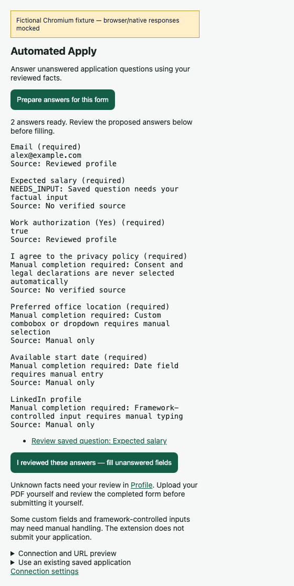

# Phase 3 backend and extension delivery

Local engineering verification passed. Live acceptance remains PARTIAL; PR publication is waiting for the owner-approved Phase 2 merge. This report does not claim live acceptance PASS.

Starting SHA: `89e2a50ef72610af06859b85ac7c33a2bcf1c2cb` (verified PR #37 integration head). Final implementation/source SHA: `faa5582f956246af94b4c0d888ea0d58f562c234`. Later delivery commits contain browser-fixture assertions and documentation only; the tested backend and extension implementation stays unchanged.

Worktree: `/Users/karanagg/Desktop/Projects/automated-apply-codex-p3`. Branch: `feat/phase3-codex-integrations`. The primary checkout and private configuration were preserved. GitHub main was `1ad14a4d37cbef59548df2b6ec75c9495719b61f` at the baseline check; PR #37 remained open on recheck after implementation. No frontend source, AGY document, historical Supabase migration or GitHub workflow was changed.

## Implementation and reuse

The [baseline audit](codex-audit.md) classifies working, partial and missing services. The [versioned API contract](codex-api-contract.md) describes additive request/response fields and AGY integration requirements.

Existing startup observations, company/contact identities, official-company people imports, public search, Apollo/SignalHire adapters, provider reservations, candidate profiles/evidence, packet revisions, PKCE/encrypted-token lifecycle and Chrome/native DOM workflows were reused.

New implementation adds:

- Durable `NEEDS_INPUT` requests, original questions and evidence requirements, drafts, exact-context factual approval, optimistic versions, history, and stale-source checks. Drafts never become approved profile facts or semantic answer reuse automatically. Existing profile/evidence editing remains available. Source changes invalidate dependent packet/fill-plan context.
- Independently authorized read-only Gmail accounts and OAuth intents, sharing the existing lifecycle service while keeping legacy send/compose storage unchanged. Default scopes are metadata-only. Body access requires a separate actual read grant, reviewed restricted-scope requirements, account purpose and explicit selection.
- Per-account selections, bounded pagination/backfill, encrypted credential isolation, refresh/revoke, a durable sync lease, account-generation/policy checks around HTTP, restart checkpoints and atomic selected-message evidence persistence. The client exposes only Gmail GET operations. Retained evidence omits raw MIME/body, raw subject, sender email and tracking-query strings. Expiration/disconnect purges evidence into minimal deduplication tombstones without adding DELETE grants.
- Account-scoped candidate job links and explicit reviewed local imports. The owner supplies the actual vacancy title; existing ingestion deduplicates and preserves application decisions. Message/thread evidence never confirms employment eligibility, current hiring or submission.
- Typed Apify official API metadata/schema/run-status/dataset access, bounded response sizes, validated identifiers, authorized run/dataset allowlists and up to five same-account Actor routes per existing job source. Routes share the existing account-wide `apify` reservation ledger. Configuration rejection can select another route; an attempted dispatch is never replayed via failover. Actor review expires within 24 hours; LinkedIn and personal-session inputs remain blocked.
- Apollo free-account/work-email/endpoint review, official health/rate/credit introspection, unknown-schema rejection and pre-dispatch credit/rate hard stops. Application reservations remain conservative and survive uncertain outcomes. No upgrade or overage is authorized.
- Country, industry and technical-staff startup filters; reported 2–10 bands; exact counts kept distinct from bands and conflicts. Name-only/generic-source evidence cannot merge unrelated employers. Hiring still requires attributable current evidence.
- Source-supported published business-email evidence, separated from provider-reported and independently verified mailbox status. Employer-domain/source checks reject unrelated personal emails. Suppression, retention, corrections and manual professional links reuse the existing contact system.
- Extension references and safe dashboard links for saved unanswered questions, plus freshness checks after approved answers change. Existing owner gestures, value preservation, dynamic/controlled inputs, file checks, cancellation, native restart handling and default-disabled submission remain in place.

## Schema and operational boundary

The review-only proposal is `backend/scripts/migrations/phase3_gmail_readonly.review.sql`. It adds `gmail_read_accounts` and `gmail_read_oauth_states`; it does not change legacy tables or public objects belonging to other applications. The explicit renderer supports the approved `public` schema and disposable `job_agent` fixtures. Both new tables have RLS and restricted runtime DML, with no browser/service-role token access and no write-scope credentials.

The optional catalog overlay accepts only the exact pinned schema verified in disposable PostgreSQL 17. The SQL checksum is a public artifact explicitly annotated as a secret-scanner false positive; the scanner policy and existing baseline are unchanged. No live DDL was applied. Account listing reports `schema_ready:false` until the proposal is reviewed/applied through a separately authorized maintenance process. Sync/body access remain disabled by default.

## Genuine bounded live checks

Private evidence is outside Git in the application-support `phase3-codex-evidence` directory, with private filesystem permissions. It contains provider observations, not fabricated contacts or suitable jobs.

- Existing approved Supabase connectivity succeeded over TLS against schema `public`, PostgreSQL 17, with restricted role flags. Only read-only queries were used; no migration, service replacement, deployment or data import occurred.
- The local Codex MCP configuration had only the existing Supabase server and no Apify server. ChatGPT's Apify connector was not treated as local CLI access. The independent official Apify API credential authenticated successfully.
- The official Apify limits/usage endpoints reported a monthly account limit of **$5** and usage of approximately **$0.0065** at observation time. These are provider-reported observations, not permission to spend or proof of exact free-credit/overage controls.
- All three requested Actors returned public metadata, pricing revisions and an input schema: `harvestapi/linkedin-company-search`, `harvestapi/linkedin-company`, `harvestapi/linkedin-company-employees`. Pricing revisions were retained with observation time rather than hardcoded into configuration. Publisher descriptions do not establish collection rights. **Zero Actor runs**; LinkedIn collection remains disabled pending precise method/rights/cost approval.
- No local Apollo credential was configured in the inspected private configurations. Account eligibility, work-email requirements, endpoint access and actual credits remain **unverified live**. No Apollo enrichment call occurred. Guard behavior is established with fictional official-response fixtures, not claimed as a real account result.
- One legacy Gmail connection existed; its recorded grant was not the exact new Phase 3 read-only grant. The Phase 3 tables were absent live. **Zero new accounts authorized or synced, zero message reads, zero sends and zero mailbox modifications.** Existing legacy credentials were preserved.
- No real contacts, suitable jobs, packets or autofill acceptance were fabricated. No employer application was submitted. No Telegram/email/LinkedIn message was sent.

Gmail documentation was checked before any proposed body access: both metadata and read-only scopes are restricted; public production use requires the applicable verification/security-assessment process. External apps in Testing generally receive seven-day refresh tokens when requesting Gmail scopes. The corresponding account must explicitly grant the required scope before any sync. See [Gmail scopes](https://developers.google.com/workspace/gmail/api/auth/scopes), [restricted-scope verification](https://developers.google.com/identity/protocols/oauth2/production-readiness/restricted-scope-verification), and [OAuth token expiry](https://developers.google.com/identity/protocols/oauth2).

Provider implementation references include [Apify API](https://docs.apify.com/api/v2), [Actor build schema](https://docs.apify.com/api/v2/actor-openapi-json-get), [Apollo credit statistics](https://docs.apollo.io/reference/view-credit-usage-stats), [endpoint statistics](https://docs.apollo.io/reference/view-api-usage-stats), and [free-account eligibility](https://docs.apollo.io/docs/developer-faqs).

## Validation

- Focused feature checks: **119 passed** before the compatibility fixes; final affected-feature rerun: **84 passed**. The five originally failing integration groups and the Phase 3 PostgreSQL verifier subsequently passed together: **32 passed**.
- Extension unit checks: **46 passed**, including real Python native-protocol checks.
- Staged DDL verifier: passed in **two disposable PostgreSQL 17 schemas**. Repeated DDL preserved the baseline catalog; RLS/ACL and write-scope denials passed; committed and rolled-back data remained correct across database sessions/pool reopen; concurrent missing-answer writers and approval history passed.
- Ruff `E9,F,I`, changed extension Prettier checks, Python compilation, backend OpenAPI export, isolated OpenAPI-derived TypeScript generation/compilation and new-operation auth declarations passed. Frontend generated types are AGY-owned and were not edited.
- Full-app Bandit passed with zero findings and one existing unused-annotation notice. The pinned Python dependency audit found no known vulnerabilities. The native secret hook passed without weakening policy/baseline.
- Final complete backend regression at `faa5582`: **2,536 passed**, zero failed/skipped, **2 warnings**, **1,579.88 seconds (26m 19s)**. Both warnings are existing fictional PDF JavaScript-fixture deprecations. This run includes the historical migration, runtime readiness, restart, transaction, provider, auth and browser suites.
- Final real Chromium DOM-race fixture: **16 passed**, zero external requests/submissions. Actual Chromium unanswered-field and popup journeys passed, including saved-question URL/label checks before owner authorization.
- Final Chrome 156.0.8078.4 MV3/native/FastAPI/disposable PostgreSQL 17 acceptance: **23 passed**, no failed cases. Real OS stdio native messaging, service-worker suspension/reload and browser/backend restart paths were exercised. Fictional intercepted pages and programmatic extension entry points were used; no physical native OS gesture or real employer autofill is claimed. All 22 persisted history rows reported `submitted:false`; form submit events and form POST requests were zero.

An initial broad run was deliberately interrupted after **354 passing tests** when review found a rare legacy/new OAuth state-prefix collision. That run is not counted as a full regression pass. The corrected `read.` namespace has a regression test. A public SQL checksum was also moved to an explicitly reviewed checksum constant to resolve the secret-hook false positive. The first completed full run returned **2,525 passed and 5 failed**. Those failures exposed historical partial-schema compatibility: missing owner-preference storage in older migration verifiers and optional Gmail tables in generic health probes. The corrections preserve baseline behavior and report unavailable missing-answer storage explicitly; their focused integration rerun passed. The subsequent final full run passed all 2,536 tests; the earlier failed run remains part of the validation history. Earlier failures remain in local logs.

The focused negative cases cover denied LinkedIn/session inputs and unauthorized Actor/run paths, no ambiguous-route replay, unreviewed/premium Apollo hard stops, rejected Gmail write scopes/arbitrary paths, account token/evidence isolation, duplicate sync/imports, policy-change cancellation, sensitive-answer exclusions, unapproved drafts, stale approvals and old fill-plan rejection. Existing auth/CSRF/SSRF, instruction-like-label, value-preservation and submission-denial suites remain part of the full regression.

All ordinary HTTP tests use isolated fixtures and deny real network calls. Browser pages, provider responses, candidate facts, PDFs and submissions exercised in tests are fictional. Heavy checks use `/tmp/automated-apply-heavy-tests.lock`; PostgreSQL 17 fixtures are disposable loopback containers. No hosted GitHub Action was dispatched or rerun.

## External blockers and publication

Live acceptance remains **PARTIAL**. Apollo credentials/eligibility, precise Actor collection rights and exact cost controls, new Gmail consent/schema review, AGY's dashboard question view/generated contracts, a suitable real vacancy and a specifically approved real applicant autofill gesture remain outside the evidence established here. The historical 27-job online timeout remains undiagnosed; small fixtures and successful metadata reads are not offered as a resolution.

PR #37 was still open at the final check (head `89e2a50`); GitHub main remained `1ad14a4`. It was not merged. No older PR was merged separately. Per the task's publication condition, the backend/extension PR is prepared locally and must wait for the owner-approved #37 merge, incorporation of the actual main merge commit and combined revalidation. No push, auto-merge, deployment, purchase, cloud-model enablement or scheduled external action occurred.

## Changed files

The implementation and browser-fixture commits change the following owned files; this report and the PR preparation are documentation-only additions.

- `backend/.env.example`
- `backend/app/ai/schemas.py`
- `backend/app/api/v1/application_answers.py`
- `backend/app/api/v1/contact_enrichment.py`
- `backend/app/api/v1/integrations.py`
- `backend/app/api/v1/provider_research.py`
- `backend/app/browser/contracts.py`
- `backend/app/browser/service.py`
- `backend/app/core/config.py`
- `backend/app/integrations/connection_service.py`
- `backend/app/integrations/gmail/read_client.py`
- `backend/app/integrations/gmail/read_service.py`
- `backend/app/integrations/gmail/schema.py`
- `backend/app/integrations/gmail/schema_checksum.py`
- `backend/app/integrations/gmail/schema_manifest.json`
- `backend/app/integrations/google_oauth.py`
- `backend/app/integrations/logging.py`
- `backend/app/knowledge/missing_input.py`
- `backend/app/local_agent/public_database.py`
- `backend/app/main.py`
- `backend/app/models/connected_account.py`
- `backend/app/operations/health.py`
- `backend/app/operations/migrations.py`
- `backend/app/schemas/applications.py`
- `backend/app/services/application_answer_service.py`
- `backend/app/services/applications/answer_builder.py`
- `backend/app/services/applications/packet_builder.py`
- `backend/app/services/contact_enrichment/apollo_capabilities.py`
- `backend/app/services/contact_enrichment/base.py`
- `backend/app/services/contact_enrichment/contact_identity.py`
- `backend/app/services/contact_enrichment/ranking.py`
- `backend/app/services/contact_enrichment/schemas.py`
- `backend/app/services/contact_enrichment/service.py`
- `backend/app/services/contact_read.py`
- `backend/app/services/job_sources/apify_adapter.py`
- `backend/app/services/job_sources/factory.py`
- `backend/app/services/job_sources/registry.py`
- `backend/app/services/people_discovery/base.py`
- `backend/app/services/people_discovery/public_search.py`
- `backend/app/services/people_discovery/service.py`
- `backend/app/services/providers/apify.py`
- `backend/app/services/startup_discovery/company_identity.py`
- `backend/app/services/startup_discovery/intelligence.py`
- `backend/app/services/startup_discovery/normalizer.py`
- `backend/app/services/startup_discovery/ranking.py`
- `backend/app/services/startup_discovery/schemas.py`
- `backend/app/services/startup_discovery/service.py`
- `backend/app/services/startup_discovery/source_registry.py`
- `backend/scripts/migrations/phase3_gmail_readonly.review.sql`
- `backend/scripts/phase3_live_readiness.py`
- `backend/scripts/verify_phase3_integrations_postgres.py`
- `backend/tests/discovery_fakes.py`
- `backend/tests/test_browser_forms.py`
- `backend/tests/test_gmail_connection.py`
- `backend/tests/test_gmail_oauth.py`
- `backend/tests/test_phase3_gmail_readonly.py`
- `backend/tests/test_phase3_integrations_postgres.py`
- `backend/tests/test_phase3_missing_input.py`
- `backend/tests/test_phase3_provider_guards.py`
- `backend/tests/test_phase3_startup_research.py`
- `backend/tests/test_public_ats_postgres.py`
- `backend/tests/test_startup_people_bridge.py`
- `docs/phase3/codex-api-contract.md`
- `docs/phase3/codex-audit.md`
- `extension/form-messages.js`
- `extension/popup.html`
- `extension/popup.js`
- `extension/tests/missing-input.test.mjs`
- `extension/tests/popup-answer.browser.mjs`
- `extension/tests/screenshots/phase3-missing-input-fictional.png`

## Extension review image

Actual Chromium rendering with fictional candidate data and mocked browser/native responses; the image is not live employer acceptance. The saved-question link was asserted before any fill authorization.

## Reproduction and local evidence

Final test logs are local artifacts outside Git: `/tmp/phase3-full-backend-verified.log`, `/tmp/phase3-backend-verified.xml`, `/tmp/phase3-verified-dom-races.log`, `/tmp/phase3-verified-unanswered-fields.log`, `/tmp/phase3-verified-popup-answers.log` and `/tmp/phase3-verified-chrome-e2e.log`. The full backend command was `python -m pytest backend/tests -q --durations=15 -o faulthandler_timeout=60 --junitxml=/tmp/phase3-backend-verified.xml` using an isolated localhost PostgreSQL 17 test URL and `P22_TEST_POSTGRES_CONTAINER=codex-p3-pg17`. Credentials remain private.

Chromium commands: `node extension/tests/fill-races.browser.mjs`, `pnpm -C extension test:answers:chrome`, and `pnpm -C extension test:chrome`. Commands were executed from the appropriate script working directories under the shared advisory lock; the MV3 script acquires that lock internally. The temporary frontend dependency symlink was removed after checks; no frontend source/type file was changed. The owned PostgreSQL test container was stopped after verification.
