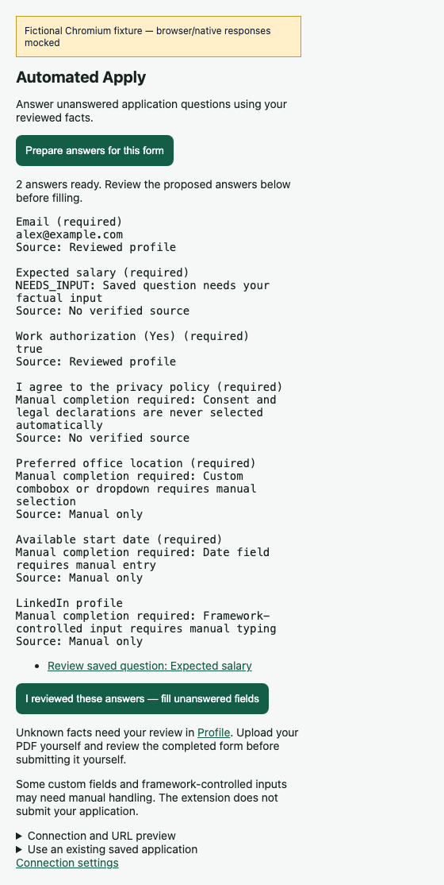

# Prepared backend/extension PR

Publication is intentionally pending the owner-approved merge of [PR #37](https://github.com/karanagg166/automated-apply/pull/37). This is a local review description, not a published or merged PR. Branch: `feat/phase3-codex-integrations`.

## Proposed title

feat(phase3): persist missing answers and add guarded research and Gmail reads

## Proposed description

Unknown application questions previously returned an ephemeral `needs_input` result, and Gmail connection storage supported one legacy account. This change persists missing questions and evidence requirements, adds editable/versioned drafts and separate exact-context approval, and invalidates prepared answers and fill plans after source edits. The extension identifies and links saved questions while preserving owner review and existing form values.

New independently authorized Gmail accounts use read-only scopes and separate encrypted credential/intent tables while reusing the existing OAuth lifecycle. Ingestion requires account-specific selection, bounded history/pages and explicit body-access review; durable leases and atomic checkpoints protect restart/disconnect races. Message evidence and reviewed local job imports remain unverified until the owner reviews the actual source. The read workflow has no Gmail sending or mailbox mutation operation.

Provider work reuses the current discovery/contact services: typed Apify metadata/schema access and same-account routes, fresh Actor review and byte/cost guards, Apollo account/endpoint/credit preflight, stronger company identity, country/industry/technical-staff filters and published-business-email evidence. LinkedIn collection/actions, premium upgrades, cloud models and scheduled external actions remain disabled.

The two-table Gmail SQL proposal is staged for separate review, with pinned PostgreSQL catalog overlays. No live DDL is applied by startup or this PR. Existing legacy Gmail tables, public schema state and historical migrations are preserved. Frontend integration is described in [the API contract](codex-api-contract.md); frontend source remains AGY-owned.

Validation: **2,536 backend tests**, **46 extension unit tests**, **16 DOM races** and **23 MV3/native/PostgreSQL scenarios** passed, plus actual Chromium unanswered-field/popup checks. Security, dependency, secret and isolated generated-contract checks passed. Exact evidence: [delivery report](codex-final.md). All local candidate/provider/employer fixtures are fictional. Genuine live checks established approved Supabase TLS connectivity and local Apify authentication plus public Actor schemas; they did not execute Actors, sync Gmail, enrich Apollo contacts or submit an employer application. Live acceptance is **PARTIAL**.

Before publication: incorporate the actual approved #37 main merge commit and verify the combined source/contracts again. No automatic merge, deployment or hosted GitHub Action is authorized.

## Review screenshot

Actual Chromium popup with fictional candidate data and mocked native/browser responses.
