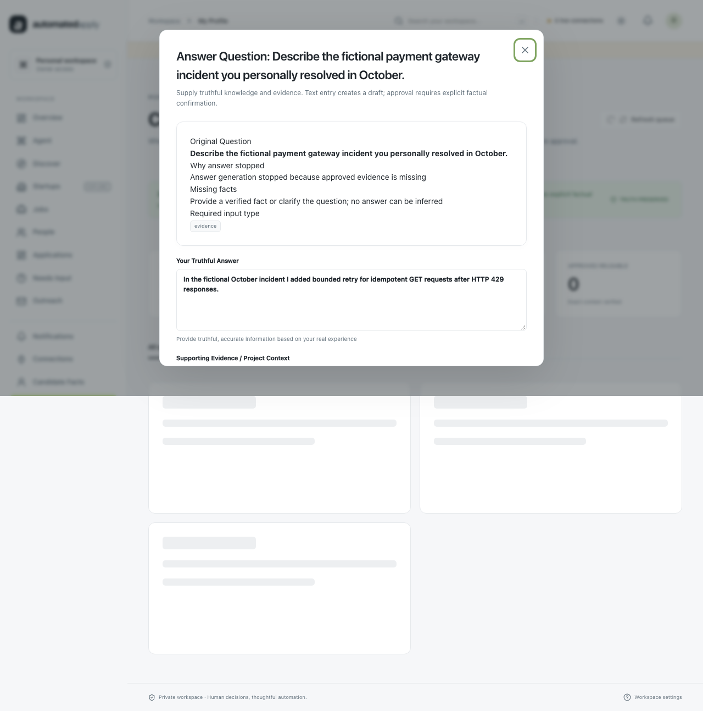

# Phase 3 final integration and publication

Integrated engineering validation passed: frontend, backend, extension and combined browser checks pass together. Genuine provider acceptance remains partial; fictional fixtures and remaining runtime approvals are identified below. Publication is a manually reviewed PR, not a runtime deployment.

## Baseline, approval and preserved histories

GitHub PR #37 was inspected while open at `89e2a50ef72610af06859b85ac7c33a2bcf1c2cb`. The owner explicitly approved merging that exact head in this task. The GitHub merge used an expected-head guard and the merge method, producing `ec5dc9b26363b762b4fa508e6d17583741101a5b`. No automatic merge was enabled. PR #35 was already closed without merging; PR #36 was already merged. Neither was changed by this task.

The new linked worktree is `/tmp/automated-apply-phase3-final-20261028`, branch `integration/phase3-final-20261028`. Merge commits preserve both original delivery histories, Codex `77ab9eac0c9b33471b35cde78bb04acd32abd746` and AGY `2a87789cec9c83b7ec5f51377d64fe28521e0d74`, and the actual Phase 2 merge commit. Frontend corrections were delegated to a follow-up agent in another linked worktree and merged with ancestry preserved. That follow-up was authored by Codex; it does not claim to be the original Gemini agent.

The primary checkout remains on its original branch at `e08b7f0c6c961b0228eddfd70dabb8dbb4c63a88`. The original AGY and Codex worktrees and branches retain their original delivery SHAs and clean tracked state. No duplicate repository clone was created. Private configuration and the installed application were preserved.

## API mismatches and resolutions

The actual frontend implementation was compared with the backend, rather than relying on either delivery report. The frontend defects were sent through [issue #38](https://github.com/karanagg166/automated-apply/issues/38). The original frontend report's 412-only description and original delivery SHA were historical claims, not final integration evidence.

| Area | Observed defect | Integrated resolution |
| --- | --- | --- |
| Apify identities and rights | Invented Actor catalog, prices, verified permissions and `$5` fallback; `source:apify` dispatch instead of portal IDs; paid authorization from metadata screen | Actual provider/source metadata endpoints; real portal and Actor IDs; inspection-only controls; no chargeable dispatch from this workflow |
| Apify budget and backend readiness | Config presence was reported as authorization; no local reserved balance in provider status | Validate current reviewed source configuration; typed local reservation/remaining-budget fields explicitly distinguished from provider credits; metadata response never authorizes execution |
| Startup research | Industry sent as generic query; inferred technical staff; incorrect size-evidence enums and 2–10 range handling | Actual `industries`, `country`, `has_technical_staff`, evidence enums and counts; bounded legacy and reported size-band matching without inventing headcounts |
| Contact research | Publication support, provider reports and mailbox verification were conflated | Actual `email_evidence_status` and publication URL; suppression/staleness override verification badges; public professional links remain manual |
| Gmail OAuth | New connect route lost its browser-binding cookie | Forward the exact new route's upstream cookie, preserving PKCE and browser-bound state; proxy regression covers both legacy and new routes |
| Gmail accounts | Wrong email/status fields and absent-schema handling | Actual `account_email`, account/sync states and permissions; honor `schema_ready:false` even on HTTP 200 |
| Gmail evidence and import | Assumed raw sender/subject, object links and fabricated job-alert records | Actual string links and protected account evidence; reviewed lead import requires the owner's actual title; evidence remains `requires_review`, never a confirmed submission |
| Missing-answer API | Untyped output prevented reliable generated clients; explicit creation with unavailable storage could fail internally | Typed create/list/read/edit/approve/history responses; unavailable-storage creation returns the documented 409 |
| Missing-answer approval | Unsaved editor text could differ from the approved saved revision; stale statuses/deep links were incomplete | Save the exact draft first, clear confirmation after edits, bind approval to saved version/profile/context; handle effective stale status and exact protected request deep links |
| Candidate facts | Incorrect 412 label, wrong drafts envelope, implicit truth confirmation on project/link saves | Actual 409/428 behavior with 412 compatibility; drafts array and explicit reuse-approval map; factual confirmation required before writes, including removal of the last project |
| Assistant readiness/provenance | URL presence implied valid destination; confirmation implied PDF verification; owner answers labelled as profile facts | Actual destination/browser state; confirmation does not claim file verification; extension identifies exact-context owner-approved answers |
| Browser worker integration | Per-field calls replayed a DOM authorization designed for one fill; approved project fallbacks retained unrelated missing-answer approval requirements | One reviewed batch, with durable consumption, pre-dispatch cancellation/freshness fences and DOM checks between mutations; owner-answer revisions are checked only for actual owner-answer evidence |

Imported Gmail records retain the mailbox/account/message/thread correlation in protected evidence, which records `imported_job_ids`. General job observations retain the `gmail_alert` source and original URL. Raw mailbox identifiers and headers are not copied into general job metadata. The combined browser test follows the protected evidence-to-job correlation and rejects cross-account import. Evidence retention and purge continue to apply.

## Validation

All heavyweight suites use the same inode at `/tmp/automated-apply-heavy-tests.lock` through `fcntl.flock`. Backend, frontend/build/browser and extension/native acceptance run sequentially. PostgreSQL 17 uses disposable loopback databases and test-only credentials. Ordinary provider transports are intercepted; no genuine candidate data is used by tests.

The final full backend rerun passed at `5fd3d161465790d9d46a9a05906b45cdeaae8750`, with the explicit Docker restart target enabled. The tested backend tree is `16606551bd6f4e781cc3e14a6978e4e412ef2c5f`; application tree `a2e75c1eaa348c6f95dbf76e5f266e60a31a6f0c`; frontend tree `91a20cf1bf2bc6719c24548f330fd0fd93f2217b`; extension tree `994f0f5735876fca43b7ca15c77c27f74af3cf51`. Later publication documentation does not change these components. Frontend Vitest/build ran at `3d0bdf6429871f866e6dccfed6d213f7edd84a17`, with the identical final frontend tree; corrected combined browser, dashboard, backend and extension runs used `5fd3d161465790d9d46a9a05906b45cdeaae8750`.

| Check | Result |
| --- | --- |
| Full backend with PostgreSQL integration and actual restart | 2,542 passed, zero failed/errors/skipped; 1,274.72 seconds; two existing PDF-fixture deprecation warnings |
| Frontend Vitest | 172 passed, 25 files |
| Frontend production build | Passed |
| Actual FastAPI/PostgreSQL/production frontend Chromium journeys | 15 passed, 107.68 seconds |
| Dashboard Chromium journeys | 12 passed, 41.7 seconds |
| Additional actual-browser/submission acceptance | 48 passed, 426.32 seconds |
| Extension Node tests | 47 passed, zero failed/skipped; corrected-backend rerun passed |
| Actual Chromium DOM-race cases | 16 passed; zero external requests/submissions |
| Chromium unanswered-field and popup journeys | Both passed, including fresh-review, value-preservation and saved-question links |
| Actual MV3/native/FastAPI/PostgreSQL acceptance | 23 passed, zero failed; Chrome 156.0.8078.4 |
| Ruff E9/F/I | All 66 changed Python files passed |
| Full-app Bandit | Zero findings/errors; existing unused-annotation notice |
| Pinned Python and production frontend dependency audits | No known vulnerabilities |
| OpenAPI/generated TypeScript consistency | Regenerated and byte-identical |

Focused runs are separate diagnostics and are not added to the full-suite total. TypeScript, formatting, native secret checks and private-artifact checks passed. Workflow triggers and secret policy/baseline are unchanged from main: all three hosted workflows remain manual-only. No hosted run was dispatched or rerun. Browser/submission acceptance intentionally exercises authorized POSTs only against fictional local fixture employers. The native extension run separately records zero form submit events/POSTs and all 22 retained history rows as `submitted:false`. No real employer submission occurred.

An initial full-backend invocation omitted the disposable PostgreSQL URL and was stopped early; it is not a passing regression run. The first complete run had 2,540 passes, one skip and two existing PDF-fixture deprecation warnings. The skipped restart test then passed separately. The final full run after the browser fixes included that explicit restart target and passed all 2,542 tests without skips.

The first frontend unit run had 163 passes and two obsolete expectations, corrected to conservative real API output. The first combined browser run had 14 passes and one failure: its complete Connections screen needed the local-agent fixture tables. A subsequent startup failed because a previously interrupted fixture left global role names; isolated per-fixture roles now prevent that collision. The additional browser acceptance diagnostic was interrupted after 22 passes and 15 failures, exposing the one-use DOM batching and stale project-provenance defects. Both production defects were fixed with regression coverage; an incomplete-form assertion was also corrected to retain `needs_input`. The complete additional-browser rerun passed all 48 cases, and the complete combined frontend/browser rerun passed all 15. Earlier failed or interrupted evidence is retained outside Git.

The screenshot shows the fictional saved-question editor. Actual approval, history, dirty-editor refusal and answer reuse are verified by the combined test assertions rather than inferred from the image.

## Genuine live results

Fresh bounded checks used existing approved configuration and the restricted online PostgreSQL role over TLS. They performed no DDL, deployment or installed-service replacement.

- Approved online PostgreSQL connectivity and restricted-role flags passed.
- Apify account authentication/limits inspection and input schemas for all three investigated public Actors succeeded. Every Actor remains `disabled_pending_review`; metadata inspection did not establish collection rights, execution authorization, exact future pricing or free allowance. Actor executions: zero. No personal LinkedIn credentials or browser sessions were accessed.
- Existing Gmail identity verification passed using the current legacy compose grant, with an OAuth access-token refresh and GET-only identity/profile checks. The probe did not request scopes, read messages, create drafts, send, modify, archive or delete mail. Its request allowlist excluded every mailbox mutation.
- The separate Phase 3 Gmail tables are absent in the approved live database. No new read-only account consent or selected-message live sync was attempted; sync/body gates remain disabled. The existing compose grant cannot be repurposed into the new read-only workflow.
- Apollo has no configured local credential. No Apollo search/enrichment, credit-consuming call or upgrade was attempted.

Private evidence is stored with restricted permissions outside Git in the application-support `phase3-integration-evidence-20261028` directory. No raw token, live mailbox address, live candidate fact or private report is committed.

## Remaining owner actions and acceptance boundaries

Owner action 1: review the single Phase 3 integration PR and merge it manually only if approved. This task does not merge the Phase 3 PR. No deployment, hosted workflow dispatch/rerun, automatic PR merge, paid upgrade, account rotation, employer submission or message send is authorized or performed by this publication task.

Owner action 2, only when activating runtime: approve the additive Gmail SQL against the actual `public` schema with the documented maintenance/recovery process; authorize deployment/runtime replacement; connect each intended mailbox with its own read-only grant and curated selections. Body reads require separate restricted-scope review, actual body-read consent and a documented purpose. No consent or live migration is inferred from passing fixtures.

Owner action 3, only if future provider collection is wanted: billable collection remains blocked in the new metadata workflow. Any future provider execution requires current collection rights, exact pricing, verified account limits/credits and explicit bounded owner authorization; unknown allowance blocks execution. Apollo additionally needs eligible local credentials and capability/credit verification. Account selection must never rotate identities to evade free quotas.

Owner action 4, for genuine employer acceptance: fictional Chrome/native and frontend browser journeys do not establish a physical owner's toolbar/activeTab gesture or genuine employer autofill acceptance. A suitable vacancy and specific owner-approved real applicant gesture remain required for that live acceptance. Resume attachment remains manual in the extension. The historical 27-listing online timeout remains undiagnosed and is not represented as resolved by small successful checks.
