# Selected Chrome profile execution

Phase 5.3 keeps one selected normal, persistent Chrome profile for interactive
applications. Connect personal Chrome and a separate job-application Chrome
profile independently; the owner explicitly selects which receives work.

## Why the old flow opened another profile

The dashboard rendered `BrowserAssistant`'s dedicated-browser workflow as its
application browser. `/browser-applications/{packet}/open` called `LocalBrowser.open`,
which launched a persistent Playwright context under the dedicated profile root.
The command-agent path separately queued `browser_job:*` records for `BrowserWorker`.
`ChromeDriver` spawned `driver.mjs`, whose `launch()` used
`chromium.launchPersistentContext(.../automated-apply-automation)`, deliberately
rejecting ordinary Google Chrome profile directories. Neither launch attached to
the owner's already-running Chrome. This was intentional test isolation, exposed
as the default interactive execution path.

The existing extension's `tabs.create()` stayed within its own Chrome profile,
but no durable profile identity or dashboard/Telegram mailbox selected it.

## New path

```mermaid
flowchart LR
  Owner[Authenticated dashboard or owner Telegram] --> Queue[Selected profile command mailbox]
  Queue --> Native[Existing authenticated local native host]
  Native --> Extension[Connected MV3 extension in selected Chrome]
  Extension --> Tab[Reuse bound tab or create tab in existing profile window]
  Tab --> Review[Isolated-world inspection and exact field review]
  Review --> Fill[Separate extension field approval]
  Fill --> Receipt[Retained-value receipt in PostgreSQL and dashboard]
  Receipt --> Status[Owner Telegram status query]
```



- Settings' **Connect this Chrome profile** creates a random binding UUID and a
  separate 256-bit credential in trusted `chrome.storage.local`. No Google email,
  cookie, password, Chrome profile directory, extension ID or tab ID identifies
  the profile. The credential is never displayed; PostgreSQL stores its hash.
  The authenticated owner/native-host configuration establishes account ownership.
- Connection grants no selection or command consent. Dashboard Connections and
  each application show names, UUIDs, connection status and heartbeat timestamps.
  Selection uses an expected selection version and pauses/revokes the previous
  profile's plans and pending commands. Disconnect never selects another profile.
- **Use connected Chrome extension** is the default. The legacy browser panel is
  mounted only after explicitly choosing **Use isolated automation browser**.
  Its opening API requires `executor=isolated_browser`; the worker CLI requires
  `--executor isolated_browser`. The default natural-language command queue uses
  connected Chrome; broad fill requests require review in the selected extension.
- The authenticated native allowlist supports connect/heartbeat/poll/start/ack.
  No external messaging, public endpoint, remote debugging or arbitrary native
  proxy is added. Native messages keep the existing bearer, fixed host, extension
  origin, size limits, response correlation and timeout controls.
- `CHROME_PROFILE_COMMANDS_ENABLED=false` by default. Even with that separately
  approved deployment flag, this profile's Settings checkbox must be enabled.
  Connecting/selecting/installing does not enable commands. A 30-second alarm
  records metadata heartbeat; only opted-in profiles poll. Each alarm claims at
  most one command. Chrome must be running; alarms may be delayed by sleep.
- Heartbeats expire after 100 seconds; queued commands expire after 120 seconds;
  leases last 90 seconds. Selection, profile/session, packet and task versions
  are checked. Request IDs deduplicate commands; a leased/started command is
  never replayed after uncertainty. Persisted in-flight commands recover as
  `outcome_unknown`. Old commands require manual review and a fresh owner request.
- Open checks selected profile and exact public HTTPS destination, then checks
  that origin's granted permission. It reuses only its saved tab when destination
  and browser session match; otherwise it creates a tab in the saved normal
  Chrome window, or another existing normal window of that same profile if the
  saved window closed. It waits for the destination load before binding. It
  never launches Chrome/Chromium. Incognito windows are refused.
- PostgreSQL task identity includes profile binding, browser session, window,
  tab, packet/revision and destination. Browser restart rotates the session and
  clears stale tab/plan authority. Worker restart invalidates inspection/fill
  authority. Explicit Open is required to transfer a paused packet to a newly
  selected profile; Pause/Stop survives that transfer.
- Plans and receipts also include original profile/session/tab identity. Switching
  profiles revokes unconsumed plans, including plans prepared without a task.
  Late partial receipts are saved under the original plan even after transfer,
  without changing the new profile’s task. Historical receipts retain their
  original identity and are not counted as a
  retained fill in a different selected profile.
- Dashboard and Telegram commands can open/prepare/pause/resume/cancel. Filling
  remains the selected extension's separate, exact-field approval. No remote fill
  or submission command is accepted. Retained receipts persist through the existing
  native/API pipeline. `/chrome status` reports command and task state with receipt
  method/count, without answer values. No unsolicited Telegram notification is added.
- Prepare reads only the stored application tab, even while another tab or
  window in the selected profile is active. It does not change focus. Before
  and after inspection it validates the profile/session, versioned task and
  current packet context, exact window/tab and URL, loading/navigation state,
  origin permission and command expiry. Focus loss revokes old plans and fill
  authority; only a fresh inspection may proceed from that focus-only pause.
  Owner Pause/Stop and navigation/restart pauses remain blocked. See the
  [focused regression and failure classification](pr45-review-followup.md).

Owner-only Telegram syntax:

```text
/chrome status
/chrome open <packet UUID> <packet revision>
/chrome prepare <packet UUID> <packet revision>
/chrome pause|resume|cancel <packet UUID> <packet revision>
```

These use the existing private-chat/owner-user authorization before dispatch.
Wrong bot mentions, stale revisions and non-owner messages cannot route work.
`/apply <URL>` remains a URL preview, never submission authorization.

## Limitations and approval boundaries

Normal Chrome profile UI labels are owner-supplied; they are not verified Google
identities. Clearing extension storage or removing/reinstalling the extension
can create a new binding; disconnect the abandoned binding explicitly. Cloning
browser profile storage would clone its binding credential; copying profiles is
unsupported. Use normal profiles with separate extension storage.

MV3 alarms/native processes have startup latency; commands are bounded queued
work, not an always-on browser connection. A stale heartbeat reports
`PROFILE_OFFLINE`, pauses work and never falls back to Playwright. Offline can be
observed on the next dashboard read, native request or reconnect; no new server
watcher is activated. Waking/reconnecting never authorizes a fill. Chrome may restore its own tabs; the
assistant does not enumerate or silently adopt restored personal tabs. Numeric tab
IDs from the prior session remain invalid and a fresh Open/inspection is required.

Website access must be granted for each exact origin before a remote Open. A
background command cannot display a Chrome permission prompt on the owner's
behalf. Use the selected extension's Open Application gesture to request it.
External redirects need fresh destination review and that origin's permission.

Owner Pause/Stop, manual CAPTCHA handoff, stale packet rejection, exact selected
fields, existing/manual value preservation and retained receipts remain enforced.
The tab-scoped guard only blocks new tab-associated requests. It does not control
pre-existing streams or independent background activity. Return browser control
releases that guard explicitly and may release scheduled website activity.

The engineering tests use two disposable Chromium profiles with fictional forms.
The owner-approved real Naukri read-only observations predate installation of this
change. Genuine execution through the new binding/command channel remains pending
separate installation/channel approval. No genuine fill or Telegram test was sent.

Chrome API references: [Tabs permissions](https://developer.chrome.com/docs/extensions/reference/api/tabs),
[alarms and sleep/persistence](https://developer.chrome.com/docs/extensions/reference/api/alarms),
[native messaging](https://developer.chrome.com/docs/extensions/develop/concepts/native-messaging).
The added permission is `alarms`; no broad `tabs`, cookies or debugger permission
is required. The bundle requires Chrome 120+ and keeps the stable extension ID.
