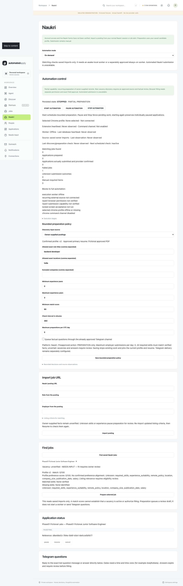

# Phase 5.3 recurring automation validation

The work is based on PR #45 head `2c0b84401251efb3bed948b4a8efdf81b52a451f`.
Final implementation SHA is the commit containing this report. No merge/install,
live activation, genuine mailbox/site action or Telegram send ran.

Exact PR prerequisite: only `test_chrome_profiles.py` and `test_extension_tasks.py`
ran at the unchanged reported SHA: 42 passed. Its seven previously affected
frontend files passed 69 checks. The individual review finding classifications
remain in [the PR follow-up](pr45-review-followup.md).

New/current focused checks:

```sh
backend/venv/bin/python -m pytest backend/tests/test_naukri_recurring.py \
  backend/tests/test_naukri_alert_email.py backend/tests/test_naukri_lock_monitor.py \
  backend/tests/test_phase3_gmail_readonly.py backend/tests/test_chrome_profiles.py \
  backend/tests/test_extension_tasks.py backend/tests/test_packet_telegram_questions.py -q
backend/venv/bin/python -m pytest backend/tests/test_execution_naukri.py \
  backend/tests/test_phase1_installation.py -q
pnpm -C frontend exec vitest run tests/naukri.test.tsx tests/naukri-automation.test.tsx
pnpm -C extension build
node --test extension/tests/task-coordinator.test.mjs \
  extension/tests/form-bridge.test.mjs extension/tests/network-guard.test.mjs
PYTHON=/ABSOLUTE/TEST/PYTHON node extension/tests/chrome-profiles.browser.mjs --prepare-only
PYTHON=/ABSOLUTE/TEST/PYTHON node extension/tests/chrome-profiles.browser.mjs
```

PostgreSQL verification (disposable localhost PostgreSQL 17 only):

```sh
PROFILE_TEST_DATABASE_URL=postgresql://.../candidate_profile_test \
  backend/venv/bin/python -m backend.scripts.verify_naukri_recurring_postgres
```

That script creates/drops its own child database. Eight simultaneous scheduler
transactions reserve only two daily preparations, four workers produce two
packets with the pinned resume, recreated pools recover persisted cadence and
caps, and Stop prevents another claim. No network provider is called.

Two Chromium journeys passed through real MV3 extension/native host/FastAPI and
disposable PostgreSQL: selected-only delivery, command coalescing/tab reuse,
profile switching, service-worker/browser restart, offline behavior, retained
fictional fill receipt; and exact background Prepare with unrelated foreground
tab then window. Neither uses installed Chrome profiles. Employer write/submission
counts remain zero; the background Prepare run also verifies zero fill authority.

API export, regenerated TypeScript, typecheck, changed-file Ruff/Prettier and
production build are required. A temporary dependency symlink initially prevented
Turbopack resolution. Installing locked dependencies locally from the pnpm offline
cache fixed the build without changing application configuration or lockfiles.

The focused browser dashboard journey uses FastAPI/PostgreSQL, owner authentication
and production Next. It checks persisted Start across a reload and Stop; worker
execution is separately verified by the PostgreSQL script. Its screenshot is
fictional. No locked-screen or genuine end-to-end result is inferred.

Known live gaps: real official alert samples, selected account approval/schema
readiness, actual normal Chrome connection, genuine locked DOM behavior,
Telegram delivery/status agreement, permitted filling/retention, and genuine
submission capability/confirmation. No claim of 24/7 reliability is made.

Focused results from this engineering turn:

| Check | Result | Evidence boundary |
| --- | --- | --- |
| Current backend files named above | 166 passed | Fictional records, no real HTTP |
| Naukri dashboard/component unit files | 11 passed | Mock transport |
| Extension coordinator/bridge/guard files | 61 passed | Simulated browser events |
| Concurrent recurring PostgreSQL check | Passed | Disposable PostgreSQL 17; fictional packets |
| Both native Chromium profile journeys | Passed | Disposable profiles; no genuine employers |
| Dashboard production-browser journey | 1 passed | Real Next/FastAPI/PostgreSQL; fictional owner/job |
| OpenAPI/types, typecheck, production build, changed-file Ruff/Prettier | Passed | Engineering checks |

The dashboard browser test initially waited on a disabled policy-save button:
the shared fictional profile had no experience confirmation. The journey now
explicitly sets/reviews that fictional profile through the owner gateway. No
production confirmation gate was relaxed. New regressions also exposed and
fixed pending execution state being refreshed before flush during OFF, and a
malformed legacy requisition poisoning a batch. Cases preserve fencing and
reject uncertain facts instead of weakening assertions.



The primary checkout remains clean at `39a49507d3b5bf93a0a65ecbbffdcc4c3469dfa2`.
No private configuration, keys, installed release, native-host definition or
LaunchAgent was edited. The new launchd support was only inspected/tested as code.
No full suite or hosted Action ran. No new genuine job observation, email read,
Telegram message, field fill, submission, or locked-screen interval was recorded.
