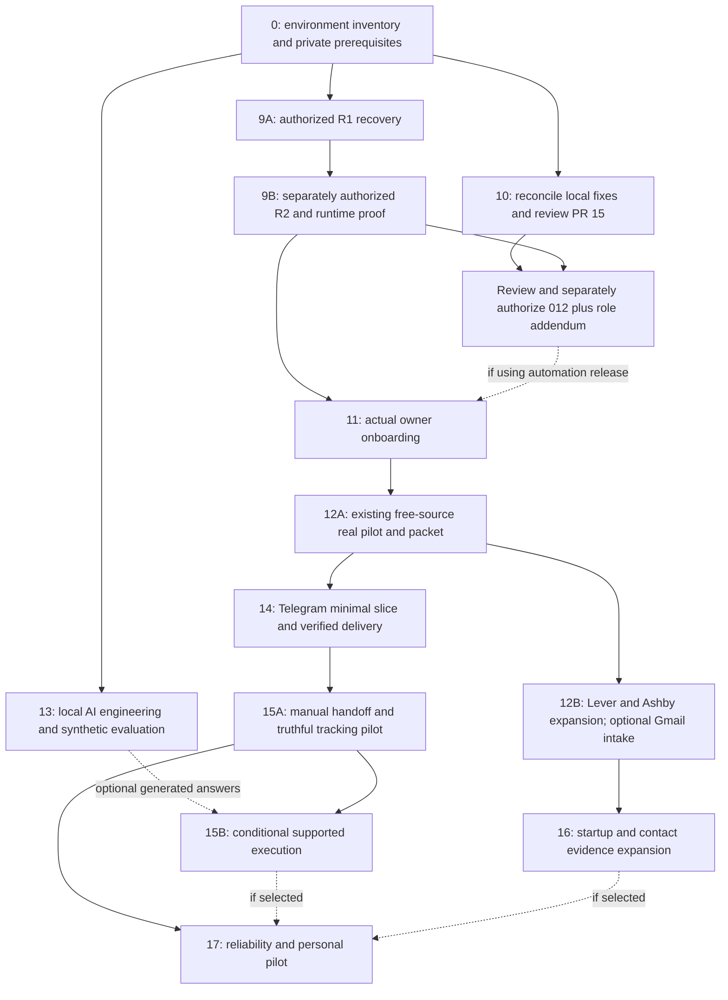

# Automated Apply: remaining implementation roadmap

Audit date: **2026-10-21 (Asia/Kolkata)**. Baseline: `origin/main` / `e7ec1dd`.
This is a planning deliverable, not activation permission. Historical completed work stays in
[the existing roadmap](../roadmap.md); this document governs the remaining zero-cost path.

## Read these artifacts together

| Artifact | Purpose |
| --- | --- |
| [Phase 0](phase0-environment-setup.md) | Actual Mac inventory, safe setup commands and readiness gates |
| [Provider matrix](free-platform-capability-matrix.md) | Official API, permission, pricing, scope and retention research |
| [Account plan](real-account-connection-plan.md) | Owner actions, consent and genuine connection evidence |
| [Architecture](zero-cost-architecture.md) | Reused boundaries, state mapping and local/hosted decision |
| [Execution specifications and backlog](phase-by-phase-implementation.md) | A–M specifications, estimates, ordered stable task IDs |
| [Blockers and decisions](operational-blockers-and-decisions.md) | Release reconciliation, authorization ledger and next prompt |

## Audit method and evidence limits

Inspected tracked module/test inventory, full README and historical roadmap, backend configuration,
routes/services/models/repositories, migrations and security overlays, frontend BFF/features/tests,
CI and Docker definitions, Drive worker, ignored owner instructions and operational reports.
Fetched origin and checked GitHub PR metadata, reviews, workflow/job results and backend job log.
Inspected other local worktree/branch diffs and their evidence documents without moving them.
Readiness checks inspected local configuration without printing values or querying private data.
No fresh remote SQL, personal-data import, provider smoke, account login or notification occurred.
A documented historical check is labeled historical; a fixture is never live evidence.
The README still has an older sentence saying the dashboard remains future work, despite the
merged frontend above it. Its target diagrams and Phase1-scoped roadmap statements are historical;
use the source-backed inventory below for current capability, not that obsolete sentence.

Status vocabulary: **IMPLEMENTED** = code exists; **TESTED** = identified executed checks;
**MERGED** = main ancestry/GitHub merge; **DEPLOYED** = running selected release/host evidence;
**REAL ACCOUNT CONNECTED** = actual consent plus identity/scopes; **LIVE VERIFIED** = actual
operation receipt for that feature/environment/revision; **BLOCKED** = named unmet prerequisite.
An account-free public API can be live-read historically without any account connection.

## Release inventory

* Main is `e7ec1ddd3b37ac5d591283865247afb761bd5150`. PRs
  [#14](https://github.com/karanagg166/automated-apply/pull/14) and
  [#13](https://github.com/karanagg166/automated-apply/pull/13) both report merged on October 20.
  Older descriptions saying #13 is draft are historical, not current status.
* [PR #15](https://github.com/karanagg166/automated-apply/pull/15) is **OPEN, unmerged**,
  head `ac265d3`, base main `e7ec1dd`, 43 changed files. No submitted reviews were returned.
  Head still matches the previously recorded head; successful CI did not merge it.
  [Backend CI](https://github.com/karanagg166/automated-apply/actions/runs/39473096192)
  succeeded; fetched actual job log reports **1,248 passed in 167.57 seconds**.
  [Frontend CI](https://github.com/karanagg166/automated-apply/actions/runs/39473096185)
  succeeded. Local documented evidence is 39 frontend tests/seven journeys; that count is
  not presented as a freshly downloaded frontend test log. The exact-main workflow lookup
  returned no runs, so this audit makes no fresh exact-main CI-success claim.
* Local `codex/phase9-completion-20261021` at `edb59c5` contains a private-resume packet
  reference fix and restricted-PG regression: **unpublished/unmerged**. Its ignored report
  records 358 focused backend, 33 frontend and six PG-backed browser tests passing.
* Local `codex/phase10-completion-20261021` at `2cd672e` includes fixes beyond #15:
  `ccc66c5` matching/evidence/owner safeguards and `3eb59f5` private-resume fix.
  Its report records 1,281 backend, 41 frontend and seven browser tests. No hosted CI evidence
  for this unpublished source; do not confuse it with #15's CI.
* Local `codex/phase11-release-candidate-20261021` at `51082fb` extends that completion branch
  with release Compose/manifests/runbooks, locally tested, unpublished and undeployed.
* Separate local `feat/phase11-real-account-workflows` at `a339188` contains Gmail intake,
  manual imports, capabilities and proposed **013**. It is another unmerged line, not part
  of the release candidate. Review/reuse `backend/app/integrations/job_intake.py`,
  `provider_capabilities.json`, `backend/tests/test_account_intake*.py` and its existing
  `docs/phase11-real-accounts.md`, `docs/phase11-provider-capabilities.md`,
  `docs/phase11-validation.md` via `git show <branch>:<path>`. It also proposes dependency
  security updates. Do not duplicate this work or silently combine its migration manifest.
* Initial tracked tree was clean; pre-existing **untracked `supabase/.temp/`** remains
  untouched and excluded from this change. `.env`, `backend/.env`, `test.db`, `reports/`,
  `secrets/` and other worktrees are preserved. Private reports are not GitHub artifacts.

## Feature inventory

All rows below lack verified production deployment and current real-owner operation unless
explicitly stated. “Main” means implemented and merged, not operationally complete.

| Feature / implementation | Tests and evidence | Milestones / remaining blocker |
| --- | --- | --- |
| FastAPI/async SQLAlchemy: `backend/app/main.py`, `db/session.py`, `repositories/` | `test_api.py`, `test_repositories.py`, CI | IMPLEMENTED/TESTED/MERGED; remote runtime blocked |
| Profile/preferences/versioning: `models/candidate_profile.py`, `services/candidate_profile_service.py`, `api/v1/profile.py` | `test_candidate_profile.py`, `test_candidate_profile_postgres.py` | Main; actual approved profile unverified |
| Resource/evidence retrieval: `repositories/candidate_knowledge.py`, `services/candidate_evidence_retrieval.py`, `profile_link_resolver.py` | `test_candidate_evidence.py`, `test_profile_resources.py`, `test_profile_link_resolver.py` | Main; real GitHub URL is not a GitHub API connection |
| Answer engine: `services/application_answer_service.py`, `ai/`, `application_question_classifier.py` | `test_application_answer_service.py`, `test_application_question_classifier.py`, `test_llm_provider.py` | Main deterministic + Gemini code; Gemini not connected; Ollama absent |
| Discovery registry/factory/direct feeds: `services/job_sources/{registry,factory,direct_api}.py` | `test_source_registry.py`, `test_job_sources_direct.py`, `test_discovery_adapters.py`; historical `docs/phase6a-live-verification.json` | Main HN/Arbeitnow/Remotive/Greenhouse; historical public reads only; no current owner DB ingestion |
| Ingestion/dedup/observations: `job_ingestion.py`, `job_deduplication.py`, `models/discovery.py` | `test_job_ingestion.py`, `test_job_deduplication.py`, `test_phase2b_postgres.py` | Main; cross-source duplicate ambiguity needs continued conservative handling |
| Matching: `job_discovery_matcher.py`, `application_assistant.py` | `test_profile_aware_job_filtering.py`, `test_application_assistant.py` | Main deterministic relevance; newer weights/freshness fixes local only; no live approved-candidate match |
| Gmail alert parser: `job_sources/gmail_adapter.py` | `test_gmail_adapter.py` | Main legacy raw-refresh-token/snippet path is disabled in registry; not safe connected intake; reuse side branch after review |
| Account registry/OAuth: `integrations/{registry,connection_service,google_oauth,token_store}.py` | `test_gmail_oauth.py`, `test_gmail_connection.py`, `test_gmail_token_store.py` | Main; real secondary Gmail identity/scopes unverified; metadata scope cannot read bodies |
| Gmail send: `services/gmail_sending.py`, `integrations/gmail/`, `models/outreach_send.py` | `test_gmail_send*.py`, `test_outreach_send*.py`, `test_phase4b_postgres.py` | Main exact-confirmation workflow; disabled; no real send receipt |
| Applications: `services/applications/`, `models/application_packet.py`, `repositories/application_packet.py` | `test_application_packet*.py`, `test_application_status_tracking.py`, `test_phase5a_postgres.py` | Main revision-specific packets/manual handoff/self-report; private-resume approval fix pending merge; provider-confirmed submission forbidden |
| Startup intelligence: `services/startup_discovery/`, `models/startup.py`, `api/v1/startups.py` | `test_startup_intelligence.py`, `test_live_startup_discovery.py`, `test_phase6a_postgres.py` | Main evidence/headcount/hiring filters; no verified real 2–10 employee pilot |
| Contacts/outreach: `services/contact_enrichment/`, `people_discovery/`, `outreach_drafting.py` | `test_contact_enrichment*.py`, `test_contact_identity.py`, `test_outreach_drafting.py` | Main; Apollo/SignalHire mocks are not account entitlement; paid/search paths excluded |
| Owner dashboard: `frontend/src/features/`, `components/`, `app/(workspace)/` | `frontend/tests/components.test.tsx`, `tests/e2e/journeys.spec.ts` | Main authenticated fictional journeys; real dashboard readiness blocked by DB/owner setup |
| BFF/security: `frontend/src/lib/{gateway,security,http-boundary}.ts`, `app/api/`; `core/security.py`, `mcp/` | frontend `security.test.ts`; backend `test_security.py`, `test_mcp_auth.py`, `test_mcp_tool_permissions.py` | Main owner-only, CSRF/allowlists; process-local throttle/signed-cookie limits remain documented |
| Resume/PDF: `dashboard/resumes.py`, `dashboard/resume_worker.py`, `resume_sync/` | `test_resume_sync*.py`, `test_resume_drive_download.py`, `test_phase7_dashboard.py` | Main encrypted upload/public-link Drive sync; actual online import/review unverified; historical local private artifacts preserved without querying them |
| Notifications: `dashboard/{notifications,models,schemas}.py`, frontend `notifications.tsx` | `test_phase7_dashboard.py` | Main in-app/preferences/outbox only; external Telegram adapter absent |
| Automation: #15 `backend/app/automation/`, `scripts/run_discovery_worker.py`, frontend `automation.tsx` | #15 `test_automation.py`, `test_automation_postgres.py`; CI above | IMPLEMENTED/TESTED on feature branch, NOT MERGED/DEPLOYED; 012/addendum/enablement separately gated |
| Persistence/security: `operations/`, `db/safety.py`, `supabase/migrations/001–011`, `docs/sql/phase9-*.sql` | `test_database_safety.py`, `test_phase9_database_readiness.py`, `scripts/verify_phase9_runtime.py` | Main; Phase 9 activation not complete; no remote runtime/TLS/recovery proof |
| Packaging/workers: root `Dockerfile`, `frontend/Dockerfile`, `scripts/sync_drive_resume.py` | CI image probes; local Phase 11 release artifacts | Main images tested; no selected running application host; no production worker enabled |

## Dependency graph and delivery order

Numbering follows the requested 9–17 sequence; **execution can take small slices out of numerical
order**. Telegram 14's minimal slice precedes optional discovery/enrichment expansion. 9A/9B
are authorization boundaries inside Phase 9, not new parallel phases. 15A is fully achievable
using existing manual handoff; 15B is conditional and may close with documented unsupported
capabilities instead of an auto-submit claim. Each spec defines separate implementation and
activation completion. No roadmap entry grants operational permission.

## First genuine success

Approved encrypted resume/facts in the real DB → one current job from an existing permitted
feed/selected employer board → relevance plus explicit unknown eligibility → reviewed packet
and correct private resume → explicitly authorized Telegram alert → owner completes official
application or documented manual handoff → exact self-reported/provider-evidenced tracking.
No Apollo, SignalHire, search subscription, autonomous browser or LLM is needed for this first
milestone: deterministic facts and owner-written narratives are sufficient. A handoff alone
must remain “manual action required”; only a subsequent actual report means submitted.

Estimated engineering effort after inputs: Phase 0 0.5–1 day; 9 1–3 days plus owner/authorization
wait; 10 reconciliation 1–3; 11 1–2; 12A 0.5–1, 12B 3–5; 13 3–5; 14 2–3;
15A 0.5–1, 15B 4–8 conditional; 16 3–5; 17 3–5 plus 7–14 calendar days observation.
These are planning ranges for one engineer, not commitments or permission/access estimates.

Only next recommended execution: **Phase 9A prerequisites and authorized encrypted recovery**,
with the exact narrow prompt in [blockers](operational-blockers-and-decisions.md#next-codex-prompt).
