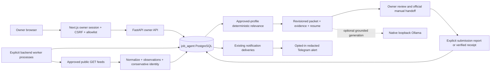

# Zero-cost architecture and operation decision

Design/research date **2026-10-21**. Extend the current modular FastAPI/Next.js/PostgreSQL
application. No Redis, Kafka, hosted queue, new orchestration framework, vector database or
additional deployable AI service is necessary. Ollama is an optional native local runtime;
workers reuse the backend image/process code and the same reviewed database boundary.

## Selected mode

**Development:** Python 3.11 existing venv + Node24 + synthetic disposable PG17. **First personal
operation:** API, Next.js and explicitly selected workers on the Mac; genuine data in the
selected shared Supabase `job_agent` after Phase 9. Native Ollama runs on loopback when selected.
This respects today's README policy requiring online PostgreSQL for actual data. Entirely local
real-data persistence is a technically free replacement, but requires a later explicit policy
change, backups/security acceptance and different readiness validation; do not enable it by
relaxing current guards as a setup shortcut.

| Mode | Fit | Unresolved constraints |
| --- | --- | --- |
| A: local Mac app + approved Supabase | No new application hosting fee; local inference; controlled owner workflow | Mac sleep/power/network stops work; 8 GiB RAM and disk pressure; DB may pause; no continuous-availability promise |
| B: Supabase + separately approved host | Could make UI reachable without Mac; same app/runtime boundaries | No selected free always-on worker/AI host established; split-host OAuth cookie/ingress and local model connectivity need design review |

[Vercel Hobby](https://vercel.com/docs/plans/hobby) permits personal noncommercial use;
[cron](https://vercel.com/docs/cron-jobs/usage-and-pricing) on Hobby is daily with imprecise timing,
so it cannot replace the durable polling worker. [Render Free](https://render.com/docs/free)
web services sleep after 15 minutes idle and share 750 workspace instance hours/month; free
background worker entitlement is not established. Neither is the default worker/AI host.
Do not use artificial keepalive traffic, assume another project's entitlement or expose local
Ollama to support a nominally free cloud frontend. Host/card/quota eligibility must be reviewed
at a later concrete deployment decision. No host account was created here.

## Component and trust flow

The browser never sees backend bearer/database/provider credentials. Source text, resumes,
repo READMEs and email content are untrusted data, never instructions to fetch URLs, call tools,
change facts or send anything. AI can propose text only. Authentication is single-owner; keep one
frontend instance while throttles are process-local. A stolen signed session remains valid until
expiry/secret rotation; horizontal scale/session revocation are outside this personal pilot.

## Shared design contracts and reuse

| Concern | Existing boundary to extend | Planned behavior |
| --- | --- | --- |
| Capabilities and permissions | `services/job_sources/registry.py`, `integrations/registry.py`, `services/applications/platforms/registry.py` | One coherent operation-specific view: configured/authorized/manual/live evidence; reuse/reconcile local account branch capability data; paid/unknown access off |
| Credentials | `core/config.py`, `integrations/token_store.py`, `connection_service.py` | Explicit server-only secrets, context-bound encrypted OAuth, stable resume key, revocation, credential rotation with recovery |
| Quotas | `credit_manager.py`, `discovery_budget.py`, startup `ProviderAccessWindow` | PostgreSQL atomic reservations and shared cooldowns; free source caps, no upgrade/topup; unknown paid outcomes remain reserved while paid path disabled |
| Schedules | #15 `automation/store.py`, `worker.py` | Singleton admission, unique source/request claims, SKIP LOCKED, short transactions, leases/fences, no locks over HTTP; no API-startup loop |
| Evidence/jobs | `models/discovery.py`, `job_ingestion.py`, `job_deduplication.py` | Stable source/ATS identities, immutable observations, canonical application destination, no blind merge on title/company; human possible-duplicate review |
| Matching | `job_discovery_matcher.py`, approved profile/version cache in #15 | Relevance distinct from eligibility; deterministic requirements and explicit missing evidence; reconcile local freshness/weights fixes |
| Resume/resource selection | `resume_sync/`, `candidate_knowledge.py`, application `resume_selector.py` | One confirmed primary or explicit version; private reference stays private; changed data invalidates review/approval; merge private-reference fix |
| Answer knowledge | `candidate_evidence_retrieval.py`, `application_question_classifier.py`, `application_answer_service.py`, `ai/validation.py` | Approved facts first, scoped approved Q&A reuse, selected evidence retrieval, optional local generation, validation, mandatory narrative review |
| Application adapter | `services/applications/platforms/`, `packet_builder.py`, `review.py` | Declare inspect/fill/upload/submit/confirm capabilities independently; manual fallback for unsupported stage; no generic portal executor |
| Submission | `ApplicationPacket`, `ApplicationSubmissionEvidence`, `ApplicationEvent`, `tracker.py` | Canonical job+candidate guard; exact approval/version; durable attempt before network; receipt or uncertainty after network; no blind replay |
| Contacts/startups | `startup_discovery/`, `contact_enrichment/`, `people_discovery/` | Published fact/source/time, conflict/unknown fields and freshness; headcount 2–10 requires numeric evidence, not “small” inference |
| Notifications | `dashboard/models.py`, `notifications.py`, `NotificationDelivery` | Extend existing outbox, unique event/channel, explicit recipient/opt-in, pause/quiet/digest, bounded dispatch, unknown outcome review |
| Audit/operations | `operations/health.py`, `runtime_security.py`, `reports.py`, migration manifest | Redacted diagnostic codes; readiness distinct from liveness; authorized stored probe; exact revision and last verification, no startup DDL |

Use existing PostgreSQL transactions and optimistic revisions. Source HTTP and local inference
happen outside row-lock transactions; commit only against current context/version/fence. Use
unique constraints for durable local idempotency. Retrying a DB transaction before external dispatch
can be safe; retrying an uncertain external submission/send cannot be assumed safe. No distributed
exactly-once promise. New migrations are additive and separately reviewed with restricted-role
ACL/catalog changes; do not edit historical 001–012 to fit future schemas or reserve 013 twice.

## One application state projection, no parallel status system

The current design intentionally separates discovery (`Job.status`), packet lifecycle/readiness,
tracking outcome and append-only submission evidence. Keep those established dimensions. UI labels
are a projection of them, not another mutable status table.

| Requested meaning | Authoritative existing representation / planned extension |
| --- | --- |
| Discovered | Saved Job + source observations; keep existing discovery state |
| Matched | Version/evidence-bound relevance result, not eligibility certification |
| Shortlisted | `Job.status=shortlisted` |
| Preparation pending | Packet `created/preparing/needs_input` with computed missing items |
| Ready to apply | Current approved packet `approved_for_manual_handoff`, readiness `ready_for_manual_handoff`; may still require manual upload |
| Manual action required | Existing `manual_action_required` readiness/handoff warning; opening URL is not submission |
| Submission in progress | **Missing**; Phase 15B add guarded attempt/lifecycle transition to current domain |
| Submission unknown | **Missing**; Phase 15B add uncertainty to attempt/current lifecycle with append-only event, immutable attempt identity |
| Submitted confirmed | Reserved `provider_confirmed_submitted` only with genuine provider receipt; current 008 rejects it. `user_reported_submitted` remains explicitly owner-reported, never rebranded provider confirmation |
| Rejected/interview/offer | Existing `application_rejected`, `interview_scheduled`, `offer_received` tracking states, evidence-guarded |
| Withdrawn | Existing lifecycle `withdrawn`, preserve prior receipt/history |

Phase 15B must review the actual SQL guards, schema enums/contracts and UI projection before
making provider confirmation reachable. No “submitted” label from HTTP 200, button click, packet
approval or arbitrary page text. Destination-specific receipt rules are required. Conservatively
cross-source canonicalize before packet creation and block a possible duplicate submission until
reviewed; unique candidate/job alone cannot deduplicate incorrectly split jobs.

## Strict ₹0 ledger

Claims below checked 2026-10-21; local software licenses and optional provider terms apply.
Monthly subscription/API incremental target is ₹0, using existing computer/internet. Electricity,
disk capacity and owner time exist; this is not a claim of zero resource consumption.

| Dependency | Free/API/card/expiry | Overage or limitation / local alternative |
| --- | --- | --- |
| Python/FastAPI/Next.js/PostgreSQL17/npm/Git/Playwright/age | Open-source local use; no account/card/expiry/API fee | Resource and license obligations; use existing toolchain, no paid IDE/test service |
| Docker Personal | [Free for personal use](https://www.docker.com/products/personal/); no paid subscription needed here | Registry pull limits may apply; reuse local images, no paid registry; native PG/free compatible container runtime alternative |
| Supabase CLI | Local open-source tool, no mandatory subscription | Does not grant DB credentials, free project eligibility or activation authority |
| Selected Supabase project | [Free](https://supabase.com/pricing) offers 500 MB DB, 1 GB Storage, 5 GB egress plus 5 GB cached egress, two active-project limit; no trial expiry assumed | Actual selected-org plan/headroom/backup entitlement **unverified**. No upgrade/card/add-ons/PITR/IPv4 purchase. Shared app consumes same capacity; hard stop if insufficient; later reviewed local PG alternative |
| Supabase operations | [Free projects can pause after seven days low activity](https://supabase.com/docs/guides/platform/free-project-pausing); [billing](https://supabase.com/docs/guides/platform/billing-on-supabase) | Free automatic backup/PITR not included in pricing; use authorized encrypted logical backup with verified restore. No SLA, no keepalive workaround, no silently upgrading an already-paid org |
| Ollama + selected Qwen3 | Native local runtime/Apache model; no card/trial/API charge | Hardware bounds; disable cloud; owner-authored deterministic answers if inadequate |
| Public feeds/ATS reads | Credential-free documented GET, no paid applicant API tier required | Source limits/permission/availability; no nationwide India coverage promise; manual/selected employer feed fallback |
| Telegram ordinary messages | Free bot delivery, no Premium/card/trial | Paid broadcasts/Stars disabled; local in-app fallback when unreachable |
| Gmail/Drive/GitHub | Free personal use within actual limits; no billing/paid subscription in default | OAuth policy/expiry, API quota changes and eligibility; no increases that enable billing. Manual mail/PDF/repo evidence fallback |
| Backup storage | Existing owner-controlled encrypted medium/password-manager capacity only | No new mandatory paid cloud backup plan; if no independent existing capacity, recovery remains a blocker rather than pretending same-disk copy is disaster recovery |
| CI | Existing GitHub Actions workflows | Respect current account/repo entitlement and spending controls; public/private minutes and runner limits differ. No billing activation; local checks remain possible if hosted minutes exhausted |
| Vercel/Render | Optional external hosting, not required | No asserted free always-running worker/LLM; no account created, trial or payment method required |
| Apollo/SignalHire/Brave/Serper/Apify/Gemini/WhatsApp | **Excluded default**, irrespective of promotional credits | No mandatory keys, no card, no paid calls; official published contacts/manual research/local model/Telegram replace them |

For existing code set paid provider gates false, Apify run/month caps zero, people search off and
paid credentials absent from the dedicated runtime. `LLM_MONTHLY_MAX_REQUESTS=0` is appropriate
while Gemini generation is unused; deterministic packet operations must still work. Local
monthly “credit limits” are spending controls, never proof of actual free provider balances.
Use small API+worker pool budgets jointly (initial 2/0 each, confirm selected project's real
connection limits). Source schedules coalesce missed intervals to avoid quota bursts.

## Retention, capacity, monitoring and recovery

Proposed owner-approved defaults: keep canonical jobs/application evidence for active search;
archive stale listings without erasing history; raw alert bodies transient by default; diagnostic
receipts 7–30 days; contact evidence follow existing 90-day retention and suppression behavior;
private resume versions retain audit references until explicit retention review. These are design
choices, not provider-granted retention rights. Measure database sizes/indexes/encrypted PDFs
before setting practical quotas; near free DB capacity stop ingestion/notify rather than upgrade.
Budget logical backup egress as well as discovery/application traffic.

Use `/health` for process liveness, `/ready` for DB/catalog/runtime readiness and owner-only
`/api/v1/operations/status` for sanitized persisted evidence. Worker heartbeat, last run, failures,
lease/unknown counts, notification backlog, disk/RAM, remaining free quotas and backup age need
visible health. Local sleep means missed work, not failed submissions; resume one due batch,
never replay uncertain sends. Database unavailable => no dispatch/new work, keep durable state,
show clear blocked UI and recover using existing encrypted backup runbook. Telegram outage =>
in-app diagnostics; do not rely exclusively on the failed channel to report its own outage.
